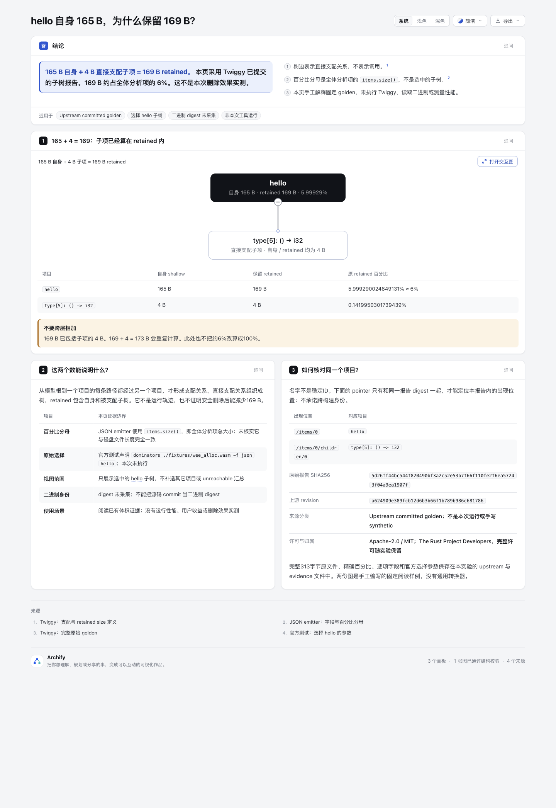
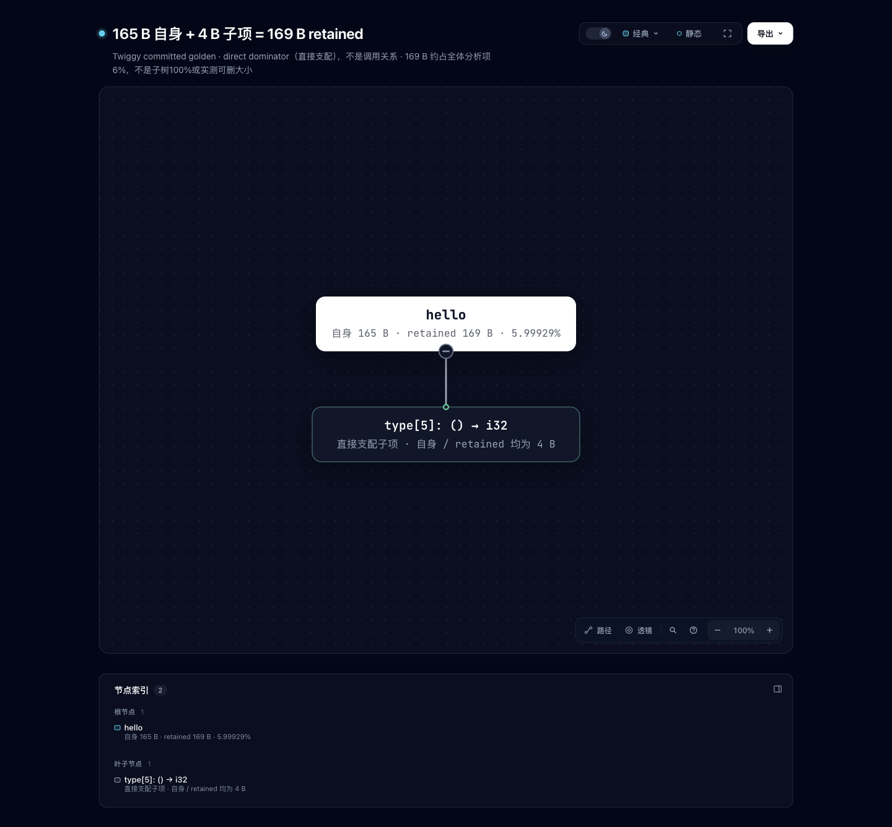

# Retained size：165 B 自身为何保留 169 B？

这个手工编写的固定阅读样例，解释 Twiggy 官方子树报告中的 **165 B 自身 + 4 B 直接支配子项 = 169 B retained**。它使用 Archify 原生 Tree 和 Explainer，没有通用 adapter、二进制解析器、Wasm runtime 或共享产品改动。





两张图由协调 Codex agent 实际打开对应 HTML 后截图并查看，1440×1100 视口；绑定信息见 [capture.json](screenshots/capture.json)。这不是人类验收或阅读效率实验。Tree 使用既有居中长画布，此处不声称改进布局。

## 固定来源与许可

来源是 [AlexEne/twiggy @ a624909e389fcb12d6b3b66f1b789b986c681786](https://github.com/AlexEne/twiggy/tree/a624909e389fcb12d6b3b66f1b789b986c681786)。该仓库在本次调研时为 archived；不承诺跟随后续格式。

- [完整原始 golden](upstream/dominators_wee_alloc_subtree_json)：313 bytes，SHA256 `5d26ff44bc544f820490bf3a2c52e53b7f66f110fe2f6ea57243f04a9ea1907f`。原文件无末尾换行，保留原字节。
- [官方测试声明](upstream/dominators_tests.rs) 中 `dominators_wee_alloc_subtree_json` 的参数是 `dominators ./fixtures/wee_alloc.wasm -f json hello`。这是上游测试命令声明，本实验没有运行它。
- [JSON emitter](upstream/emit.rs) 和 [概念说明](upstream/dominators-and-retained-size.md) 保留用于核对字段、比例与关系语义。
- 以上原文件来自相同固定 commit；路径、官方链接、字节数和 SHA256 见 [upstream/manifest.json](upstream/manifest.json)。这是 **upstream committed golden**，不是本次工具运行，也不是手写 synthetic 数据。
- 包声明 Apache-2.0 / MIT，见 [Cargo.toml](upstream/Cargo.toml)。本实验复制的上游资料采用 MIT 许可选项，保留原始 [LICENSE-MIT](upstream/LICENSE-MIT) 与 [LICENSE-APACHE](upstream/LICENSE-APACHE)。原版权声明为 The Rust Project Developers；未将其作品冒称本实验原创。

本实验未下载或读取原 Wasm 文件，二进制 digest 未采集。上游源码 commit 不冒充二进制 digest。

## 字段与解释边界

[Tree JSON](retained-size.tree.json) 由手工编写的 [Explainer 草稿](retained-size.archify.md) 直接引用，只解释这两个项目。[evidence.json](evidence.json) 保留完整原字段、选择参数及定位映射；不做推断补全。

- 边表示 **immediate dominator / 直接支配关系**，不是调用或运行先后。retained 已含自身和支配子树，因此不能再算 `169 + 4 = 173`。
- 原百分比保留：hello retained 为 `5.999290024849131%`，子项为 `0.1419950301739439%`。emitter 分母是全体分析项的 `items.size()`，不是本次选择子树；没有改成100%。本实验未进一步证明该总量等于磁盘文件长度。
- JSON 没有稳定 item ID。`report SHA256 + /items/0` 或 `/items/0/children/0` 只能定位这份报告内的出现位置；名字不能用作跨构建稳定身份。Tree 节点 ID 是此固定样例的手工标识。
- 预览将原名称中的 `->` 排版为 `→`；原名称与逐字数值完整保存在表格、原文件和 evidence 中。
- 只显示 hello 选择子树；不发明其他根或 unreachable 汇总。没有重新实现支配算法，也不宣称删除 hello 后实际减少169 B、更快运行或带来用户性能收益。

## 渲染与复核

实验分支 `codex/lab-retained-size`，基线 `82c7e0f089a02a4d514714adf37dc2061682da5f`。运行环境 Node `v22.23.3`；复用仓库 public CLI。没有安装/更新任何 live Skill。

在仓库根、Node22及 archify 依赖可用时，公开命令为：

```sh
node archify/bin/archify.mjs render tree experiments/retained-size/retained-size.tree.json experiments/retained-size/output/retained-size.html
node archify/bin/archify.mjs render explainer experiments/retained-size/retained-size.archify.md experiments/retained-size/output/explainer.html
node archify/bin/archify.mjs finalize tree experiments/retained-size/retained-size.tree.json experiments/retained-size/output/retained-size.html --out-dir /tmp/retained-size-tree-receipts --json
node archify/bin/archify.mjs finalize explainer experiments/retained-size/retained-size.archify.md experiments/retained-size/output/explainer.html --out-dir /tmp/retained-size-explainer-receipts --json
```

这些命令会重生目标文件；如需保留原产物，请在副本中运行。CLI 的相邻 delivery receipt 可能包含本机路径，公开前应将它与 finalize 原始 receipts 一起留在 checkout 外。本实验公开的 [portable-summary.json](portable-summary.json) 是明确标记的派生摘要，含原 receipt hash、命令、阶段结果和文件 digest，不冒充原始 receipt。

实际结果：两份 public render exit0；两份 finalize 的 validate/deliver/check 均 pass。Tree 的默认 showcase finalize 还实际运行 browser-check 并 pass；Explainer browser-check 为 not-run。协调 agent 的两张实际截图与自动 browser gate 分开记录。第一版 Explainer 有一条 writing-de-chain 警告；拆分首段句子后重新 render/finalize，最终无诊断。首次 receipt 未删除，留在 checkout 外。

这是固定样例，没有新增可执行转换逻辑，因此不增加泛化 reader 边界测试或运行全仓测试。执行了七份原始文件 hash/bytes 核对、165+4=169 与原百分比静态核对、产物/摘要/截图绑定核对及公开本机路径扫描。生成 HTML 保留 renderer 输出字节，没有后处理。`git diff --cached --check` 对三份 HTML（含归档）报告渲染器输出中的既有尾随空白，故全目录该检查未通过；排除原始生成 HTML 的作者输入与来源文件检查通过。未为消除空白而改写产物。

独立复核指出初版 Explainer 的 shorthand Tree 与独立 Tree 数值相同，但用了两套节点 ID；已改为直接引用同一份 `retained-size.tree.json`，让两种视图和 evidence 映射共用一个模型。旧 HTML、截图和 capture 原字节保存在 [before-model-binding](screenshots/before-model-binding/)；主截图对应修复后页面。

AI 协助：Codex 编写固定样例、核对官方来源与运行 public CLI；协调 agent 截图并实际查看，另有独立 agent 进行来源和产物复核。上述不代表用户项目、上游工具实际执行、远端 CI 或人类验收。
