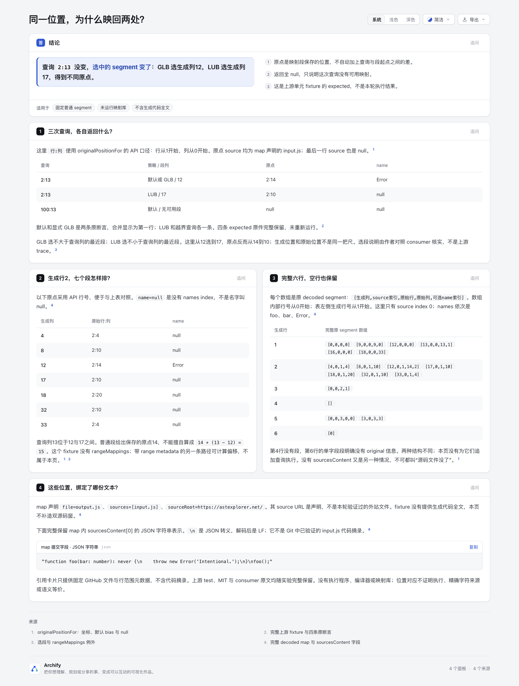

# Segment origins：同一查询为什么有两个原点？

[打开解释页](explainer.html)。同一 generated `2:13`，默认/GLB 选段12而 LUB 选段17，expected original 分别是 `2:14/Error`、`2:10/null`。这些是不同查询策略给出的原点，不能擅自逐字符加偏移。

页面先显示三行查询表，再列生成行2的全部七个段。随后保留完整六行 map，包括空数组与单字段段，以及 sourcesContent 的完整 JSON 字符串。没有生成代码全文，所以没有双源码窗或补造的 output.js。图不增加信息，本实验没有 native 图。

## 输入与许可

固定 [jridgewell/sourcemaps@b7600158f4de012d246b7834a73c7c2190e75136](https://github.com/jridgewell/sourcemaps/tree/b7600158f4de012d246b7834a73c7c2190e75136)。[完整原件账目](upstream/source-manifest.json) 绑定五份未改 bytes：MIT LICENSE、完整 `trace-mapping.test.ts`、consumer `trace-mapping.ts`、binary-search 和 segment tuple 定义。不是只保留两条有利断言。没有运行 TS、source-map 库、上游 test、编译器、宏或外站；没有安装依赖。

[fixture-projection.json](fixture-projection.json) 是作者手工整理的**固定投影**，不是上游 JSON 文件或本轮 mapper 输出。它保留完整 decoded map、完整 sourcesContent 与四条 expected：默认、显式 GLB、LUB、越界。页面将前两条合并显示；原断言仍在上游全文 L251–286 和投影内保留。

| 解释 | owning source |
| --- | --- |
| API 行从1、列从0开始；默认 GLB；全 null | `src/trace-mapping.ts` L313–353 |
| 原数组行从0开始；source/name 索引 | `src/sourcemap-segment.ts`、test L29–71 |
| GLB 选生成列12、LUB 选17 | `traceSegmentInternal` L548–583；test L251–279 |
| 普通段返回原点，range metadata 可另算偏移 | `originalPositionFor` L339–353及 range 分支 |

投影里的选段 pointer 是作者对照 consumer 的解释，**不是上游执行 trace**。该完整 map 没有 rangeMappings；不能将本页推广到所有 source-map 段或其他库。空行、单字段明确 unmapped、缺 sourcesContent 是不同情况；没有为它们补造新查询 expected。

map 的 `input.js`、`output.js` 与 sourceRoot URL 是声明。sourcesContent 中的源码是已提交 test 字段，不是 Git 中独立验证的 input.js。JSON 的 `\n` 解码后是 LF；完整文本的三个 LF 与第二行四个空格均保留。固定 tree 没有随例提供生成 output.js 全文。四个页面 citation 使用固定 GitHub URL/行范围，hover 只提供元数据，不含 verified code excerpt。没有打开这些远程链接或请求 URL 内容。

上游文件按完整 MIT 许可保留。原创 Markdown、投影与审计按本基线 Archify Apache-2.0 范围提供；不改变仓库 LICENSE/notices。

## 证据与命令

仓库基线 `10b4dd5c5f2264baa315ee65a9b4cc23c13ea5f0`。仅新增本目录，不修改 Viewer、schema、CLI、模板、ZIP、产品依赖或 live Skill。范围按 CONTRIBUTING 的内容/呈现影响选择，不跑全仓 suite，不增加 source-map parser、求值器或统计/性能测试。

使用官方 Node 22.23.2；正常公共 CLI 完成 validate、deliver、check，0 diagnostics。Explainer 默认不启动浏览器，回执 `requested=false, ran=false`。原始 finalize/delivery/stdout/stderr 在 checkout 外；[portable-summary](portable-summary.json) 只公开原文件名、hash、阶段结果与文件账目，明确为派生摘要，不伪装成原始回执。

```sh
node archify/bin/archify.mjs finalize explainer experiments/segment-origins/explainer.archify.md experiments/segment-origins/explainer.html --json --out-dir '<receipt-directory>'
python3 experiments/segment-origins/audit.py
```

[audit.py](audit.py) 仅用标准库做七项字节/呈现核对，[audit-result](audit-result.json) 为其实际 stdout。它核原件 byte/hash、已冻结投影身份、三行显示包含四条 expected、七段字段/行号换算、全部六行、JSON 字符串 round-trip 和范围说明。它**不解析 TS、不解码 map、不选择 segment，也不能单独证明手工投影与上游语义一致**；该对应由独立源码审查负责。事实审计不称作上游 test 通过或产品 suite。

首轮 finalize 失败：两行相同 `2:13` 被自动分配成重复 row ID。保留第一版原 Markdown 和失败 stdout/stderr，随后只加两个显式 row ID、拆分一条过长句并纠正 prose 的转义表示，expected/map 没改。重跑成功，没有放宽校验或后处理 HTML。所有生成 HTML 与上游源保留原 bytes，包括生成器或原件的既有空白。

## 实际浏览器范围

首版 root 的390px手机观察中，首表为438px/332px（scroll/client），name 列初始不可见。按有界修整只将四个 heading 缩为“查询”“策略 / 段列”“原点”“name”，行值、显式 row ID、map、四条 expected、JSON 字面和引用均未改；正常 CLI 重新生成。旧 HTML、Markdown、回执、首轮桌面/手机原图和观察均保留在 checkout 外，不混作最终成功图。没有为消除所有 overflow 继续压缩；JSON 长行原文不改写。

Root agent 已实际采集并逐张查看四张最终原 PNG：[capture](screenshots/capture.json) 绑定 HTML、Markdown、投影、图片及四份外置原 DOM 观察的 bytes/SHA；[observations-summary](screenshots/observations-summary.json) 是白名单派生摘要。原观察本身没有 artifact hash，页面身份绑定依据 root 明确指定的终版 HTML，未伪造原始 capture metadata。

| 图片 | PNG 实际尺寸 | 实际观察与边界 |
| --- | --- | --- |
| [桌面浅色全文](screenshots/desktop-light.png) | 1440×1903 | viewport 1440×1100，三表完整；页面宽1440 |
| [手机浅色全文](screenshots/mobile-light.png) | 390×3400 | viewport 390×844，首表仍需局部横滚；另两表332px fit |
| [手机查询表右滚](screenshots/mobile-query-right.png) | 390×844 | 真实 wheel160，同一次调用等待 scrollLeft 0→100 |
| [深色来源卡](screenshots/source-dark.png) | 1440×1100 | 实际点击 dark、首 panel anchor，再 hover source-oracle |



首表标题缩短后宽度438→432px，手机容器仍为332px；**没有解决整表同时可见**。右滚后 name 列可读，但左侧查询位置被裁掉。记录这次有界内容修整的结果，不继续压缩或宣称阅读收益。另两表 scroll/client 都为332，完整六行与七段仍在 DOM；JSON pre 为330/668px，长行原文不改写，未验证其横向滚动操作。

来源卡只显示标题、github.com 与“打开原文”URL；preCount 仍为1，即页面原有 JSON fence，没有新增源码 excerpt。没有点击外链、取得外部源文本或测试 Escape。DOM 中 JSON 字符串解码与完整 sourcesContent 相同，保留三个 LF；这不等于验证一个独立 Git input.js。

这里只报告实际 click/anchor/hover/wheel 和图片观察。没有键盘、AT、OS、触屏、外部源码、mapper、上游执行或跨浏览器验收。静态 finalize 的 browser-check 仍是未请求；root 实际观察不冒充该自动阶段通过。首轮旧两图保留为私有历史，不当作终版证据。

该页用于一个上游合成单元 fixture 的教学阅读，不是自然用户事故、生产 source-map 报告或本轮编译输出。没有执行因果、语义等价、逐字符精确来源、效率提升、跨浏览器或真人学习收益声明。

AI 协助：Codex / GPT-6.1 Sol 完成研究、作者内容、审计和文档；独立 agent 只读复核源码/字节/产物。root agent 负责实际浏览器与图片。此说明不代表人类审核或批准。
