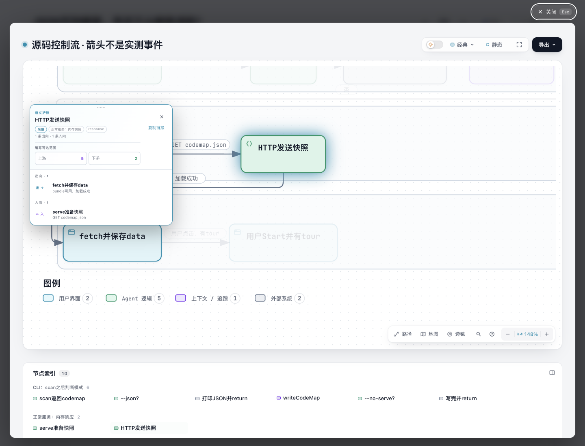
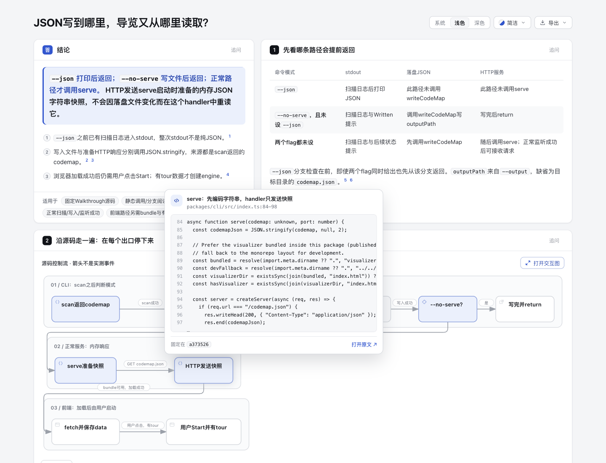

# 源码节点的键盘激活等价性

固定真实 CLI tour 中的 source-only 节点已有鼠标“开原生图”动作，但键盘 Enter/Space 没有等价激活。此修复让它们复用现有 block-linked 节点的 button role、节点名字和两种按键处理；段落 aria-describedby 仍只用于 blockId。没有修改 CSS、schema、SourceCard 数据、Passport、Atlas 或 keyboard gate。

**基线真实 Tab 已可达，来源卡和 focus shadow 已存在。** 最初从无显式 tabindex 推断不可达，以及只看 outline 推断不可见，均被真实 Chromium 操作推翻并撤回。不要把新增显式 tabindex 写成这两个收益。实际差异是 AX action 语义和按键激活。

## 固定来源与配对产物

当前 base：`10b4dd5c5f2264baa315ee65a9b4cc23c13ea5f0`。完整输入取自已发布 [CLI reading tour @ 1dff88d331679319442277a4ffc7cd3637bccee2](https://github.com/tt-a1i/archify/tree/1dff88d331679319442277a4ffc7cd3637bccee2/experiments/cli-reading-tour)：[原 authored Markdown](input/cli-reading-tour.archify.md)、[完整源文件与 MIT 许可](input/source/)、[原输入 manifest](input/source/manifest.json)、[原页面冻结资源](input/frozen-page.json)。Walkthrough 固定 revision `a373526c92bd1d4c3953370b9a57f19e4fb15d08`；没有运行其 CLI、扫描器、服务或浏览器程序。原 manifest 中 archifyBase=3f95 属于旧输入历史，不能当成本轮 runtime。

本轮没有以旧 7814… HTML 冒充新基线。[generate.mjs](generate.mjs) 用固定完整 document/source excerpts，在未改 reader 的 10b runtime 下重新 prepare native 图并 render [base/tour.html](base/tour.html)。随后候选只复用这个**新基线** [prepared-page.json](base/prepared-page.json) 的全部资源，重新 render [candidate/tour.html](candidate/tour.html)。两页 prepared bundle 逐值相同，完整 reader 替换后两页逐字相同。10 个 nodeSources、无 nodeBlocks、11 份 pinned source、native 图及内容字节没有为证明失败而改写。

| 新产物 | Bytes | SHA-256 |
| --- | --- | --- |
| base/tour.html | 697086 | `947c4a479f7a9cc4c36aec045411d5d9e8e6eca8be496ecfb274984ca13a5c5e` |
| candidate/tour.html | 697058 | `0d8449e3cf9198aadb776442decc498fc6007c7e883cff974b48534e075eac60` |

这些配对页由相同真实输入通过 renderer API 生成；没有声称它们经过本轮 finalize 或全页 browser gate。实际动作由 scoped Chrome tests 与 root Ego 记录单独验证。

## 用户动作与实际差异

具体节点是 `response` / HTTP发送快照，对应固定 `packages/cli/src/index.ts` L84–98。读者从图节点看来源，再选择开原生图核对其上下游。

| 动作 | base 实际结果 | candidate 实际结果 |
| --- | --- | --- |
| 连续真实 Tab 到 response | 可达，来源卡显示，已有 focus-visible shadow | 保留同一行为和外观 |
| AX role/name | group / 聚焦HTTP发送快照，正常服务：内存响应 | button / HTTP发送快照 |
| Enter | 无 dialog | 原生 Viewer focus=response |
| Space | 无 dialog；root 观察 scrollY 0→283.5 | 原生 Viewer focus=response；scrollY 保持 0 |
| 原图 close / Escape | 无对应键盘打开结果 | 回到触发 node=response |
| 来源卡 Tab / Shift+Tab / Escape | 原有机制保留 | root 实际核链：进入外链、回 node、Escape 隐藏并回 node，后续 Tab 到 browser-data |
| pointer hover / click | 同一 source card 与 native node | 同一 source card 与 native node；关闭现在返回实际 node |

最后一项焦点返回是明确的兼容变化：原 click handler 用节点是否可聚焦决定 opener。source-only 显式成为 button 后，鼠标关闭也从 Explore 按钮改回实际节点；为保持旧 Explore 返回新增模式状态不值得。不是修改鼠标的 native target 或新增导航历史。Open source 仍是明确外链；没有用 Enter 自动打开 GitHub，没有在本轮打开外链。

## 实际图片

Root 在同一 Ego Chromium、1440×1100、scale 1、浅色实际操作并逐图查看五张原 PNG；Clean 页面 / 原生 Classic、Still。原图片与 [capture 派生记录](screenshots/capture.json) 保持原字节，绑定两份 HTML、五图和四份 checkout 外原始观察 JSON。file URLs 已明确省略；它不是原始 CLI receipt。

主图是 candidate 的实际 Enter 打开结果：



下面两张本来就有相同焦点反馈，只用于确认保留；不声称改变 focus 样式：

| base 的 response 焦点 | candidate 的 response 焦点 |
| --- | --- |
|  |  |

[基线 hover](screenshots/base-hover.png) / [基线键盘路径](screenshots/base-keyboard.png)。实际键盘/鼠标、AX tree 与新截图分别记录；没有物理屏幕阅读器、跨浏览器、用户效率或人类验收结论。

## 验证范围与诚实保留的失败

官方 Node **22.23.2**，bundled zlib **1.3.1-e00f703**，macOS arm64；当前 CONTRIBUTING 的 canonical ZIP 条件在本次新 base 上重新核过。

- archive10b 原 runtime 负对照：真实 Tab/source-card 前置步骤通过；AX action、Enter native、Space native 三个 leaf 均失败。父 test 还因鼠标关闭仍回旧 Explore 与候选新合同不同而失败，不能把它另称一个原有缺陷。基线 test 比最终版本少后置的 error-collection 断言；三个失败条件与动作未变，精确 test/log hashes 分列在摘要。
- 精确最终 source/test 上，source-only 新例及既有 paragraph reuse、native exact focus 两个邻近 browser tests：**6 pass / 0 fail / 0 skip**。含真实 sequential Tab、card/footer 正反向与 Escape、AX role/name、Enter/Space exact focus、Space 不滚页、modal 返回、pointer 行为、mixed source+block 原描述/双链接，以及没有重复激活造成页面 error。
- renderer focused **15 pass**；core smoke **19 pass**；现有 generated checks 全通过。没有全仓测试或 hosted CI 结论。临时复用 lock dependency entries 相同的安装，renderer 根包历史 version/license 元数据差异已核；没有改 lock 或安装 live Skill，完成后移除临时链接。
- 两次 canonical ZIP 正常构建逐字相同；实际 **235 entries**，与此 base inventory 相同，仅 `archify/explainer/reader.js` 内容变更。ZIP SHA-256 `531124ef47c6e37bc5a91a9bb014e208476cc717eabdbd42f88ec10515675c4e`；解包源与当前 reader 逐字相同，CRC 通过，checkout 外 extracted package smoke 通过。

初次“outline 必须存在”的断言错误排除了已有 drop-shadow，保留失败日志但不作为产品回归；一次测试 close-event Promise 被 await 卡住导致 CDP timeout，已修正 harness 的 listener 安装返回方式，未改产品绕过。最早静态 Tab 不可达判断、root theme selector 零匹配 driver 记录也保留历史并已纠正。原始日志/receipts 都留 checkout 外；[evidence-summary.json](evidence-summary.json) 只是明确派生投影，不冒充原件。

## 正常生成物的既有 freshness 差异

四个 `docs/cases/explainer/*.html` 正常 `deliver --quality standard` 重建，原 sourceText、parsed document、native spec/SVG 与 quality 均保持。其旧 tracked HTML 已落后于 10b 当前 runtime，含 preview click/opener、block reuse 等既有生成差异；79行级别 diff 不能全部归因本修复。

本轮额外用 **archive10b 原 CLI**、同一 MD、同 standard 参数、同输出路径正常重建四份 base-generated 页面，再正常重建 candidate。每份 base-generated→candidate-generated 均仅精确完整 reader 替换差异；对应四组旧 tracked/base-generated/candidate hashes 分列在摘要。没有手工剪贴生成 HTML。初次准备额外给 `--repo-root` 增加了旧页本来没有的 optional code excerpts，被比较发现后拒用；最终恢复原参数和原 source 形状，保留准备失败记录。

生成 HTML 与原上游源码的尾空白保留；scoped authored source/tests/README 检查与完整生成物检查分开。没有改原生 Viewer template、Gallery 或它们的生成链。本次四个 Explainer reader 直接内嵌产物需要刷新。

## 复查

按 CONTRIBUTING 配置依赖，使用上述官方 Node；真实 Chrome tests 需要 `ARCHIFY_CHROME` 或项目支持的 `ARCHIFY_EXPLAINER_BROWSER_TESTS=1`。

```sh
# 先将本实验复现材料放入 base10b 比较 checkout（不覆盖其 archify/ 源码），使用新的输出目录：
node experiments/source-keyboard/generate.mjs <fresh-base-dir>
# candidate checkout 复用新基线的完整资源：
node experiments/source-keyboard/generate.mjs <fresh-candidate-dir> <fresh-base-dir>/prepared-page.json
node --test --test-name-pattern='source-only nodes in the frozen CLI tour|retry layout and referenced node explanations|native step opens' test/explainer-browser.test.mjs
npm run test:focus -- test/explainer-renderer.test.mjs
npm test
npm run test:generated
scripts/build-zip.sh <outside-archive.zip>
node scripts/package-smoke.mjs <outside-extracted-archive>/archify
```

`generate.mjs` 只渲染冻结输入，不读取/运行 Walkthrough 项目；全新目录由 mkdir 拒绝覆盖，文件用 wx。它是本实验局部复现脚本，不是新增公共 CLI。重建 docs 的精确命令是：`node <base-or-candidate-runtime>/archify/bin/archify.mjs deliver explainer docs/cases/explainer/NAME.archify.md docs/cases/explainer/NAME.html --quality standard --json`，NAME 为 finalize-delivery/first-rental/p99-tail-latency/tls-first-visit，正常源读取无需额外 repo-root。原始 receipts 含本机路径，不公开。

AI assistance：Codex / GPT-6.1-Sol medium 实现、真实固定对照、验证及证据写作；独立 agent 审源码/测试/资源绑定，root 统一 Ego 操作并逐图查看。自动与 agent 结果不代表个人 human-review confirmation。没有提交、推送、安装或发布声明。
