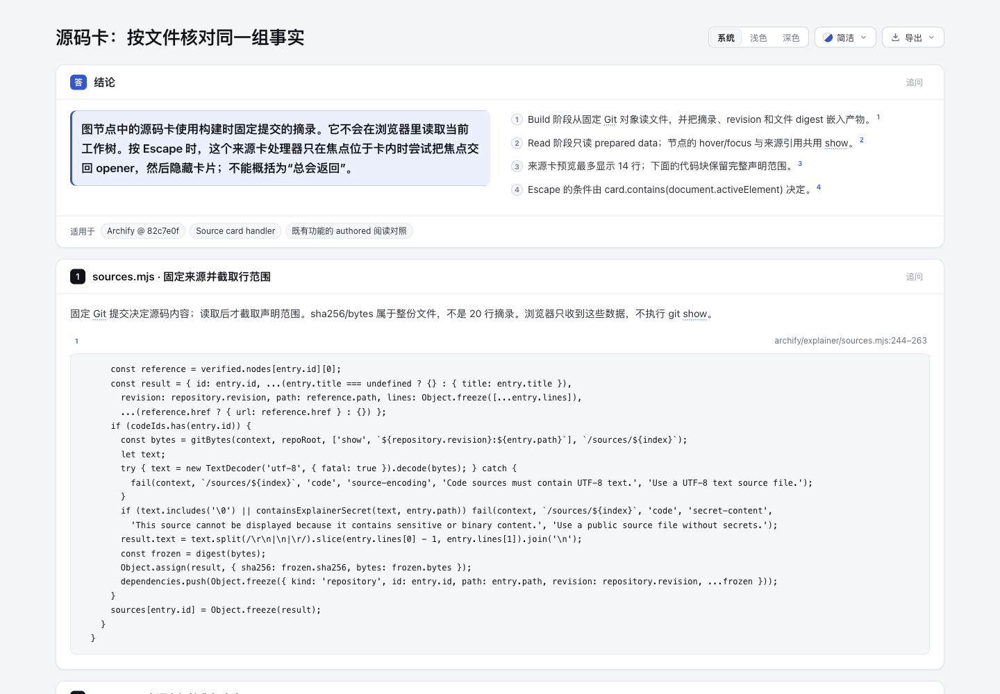
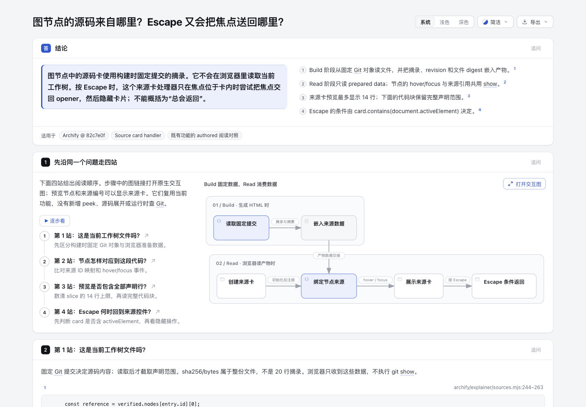

# Source question tour · 同源 authored 阅读对照

具体问题：图节点来源卡里的代码是当前工作树文件吗？按 Escape 时焦点一定返回节点吗？本实验只编写两份 Explainer 内容，复用已有来源引用、固定 Git 摘录、节点卡片和 steps；没有改 Viewer、schema、Skill 或 ZIP，没有新增 parser、peek、展开或播放器。

- [四站问题导读](question-first.html) · [authored Markdown](question-first.archify.md)
- [按文件组织的对照页](file-first.html) · [authored Markdown](file-first.archify.md)
- [来源逐段核对](source-audit.json) · [可移植证据摘要](receipt.json)

两页来源完全相同：固定 82c7e0f089a02a4d514714adf37dc2061682da5f 的 **5 个片段、72 行、2 个文件**，相同结论、4 段解释和同一张原生 Workflow。差别是问题页用 4 站引导理解顺序，对照页按文件/行序排列。四站不等于四个片段：第 2 站同时读初始化和节点映射。

| 站点 | 回答 | 固定代码 |
| --- | --- | --- |
| 1. 是工作树内容吗？ | Build 从固定 revision:path 读 Git 文件、截取声明行并记录整文件摘要；浏览器不执行 Git。 | sources.mjs 244–263 |
| 2. 节点怎样找到片段？ | Read 初始化来源卡，从 preparedSources 取来源，经 nodeSources 映射；hover/focus 共用 show。 | reader.js 599–611、638–649 |
| 3. 预览显示全部范围吗？ | 最多 14 行，超出显示省略号；下方 @code 保留完整声明范围。 | reader.js 615–626 |
| 4. Escape 何时返回？ | 此 handler 只有 card 含 activeElement 时才尝试 opener.focus，随后 hide；不能写成总返回。 | reader.js 654–668 |

完整路径均为 archify/explainer/。最后一段含 Tab 和后续 checklist 起始行，本实验不扩写 checklist。Escape 结论只针对 source-card handler，不代表页面其他 Escape 处理器。

所有来源使用固定 @meta repo_revision、@source path/lines 和 @code，未手贴另一份代码。source.sha256/bytes 对应整份 Git 文件；source-audit.json 另记摘录 hash，二者不能混淆。本例全部 5 个来源已验证，不推断每个可选 citation 都有源码摘录。

## Build 与 Read 是数据边界

图中 Build 固定并嵌入来源，Read 初始化来源卡、映射、展示与条件返回。唯一跨区连接明确写“产物数据交接”，Read 没有返回 Build 的运行调用。

Read 初始化节点有 599–611 的创建 card/准备数据代码支撑，帮助解释“内容先存在，随后注册节点事件”；最终 6 节点、4 列。泳道形式不是硬验收目标；初版 shorthand 自动合成 phases 也不代表事实错误，没有因此改 compiler。

预览节点及来源编号可显示卡片。steps 是阅读导航，图链接打开现有原生交互图；不承诺每一步自动展开源码。

## 生成与核对

从仓库根、Node 22 与现有依赖可用时，用公开 finalize 命令生成。例如：

    node archify/bin/archify.mjs finalize explainer experiments/source-question-tour/question-first.archify.md experiments/source-question-tour/question-first.html --repo-root . --out-dir <private-question-receipts> --json

对 file-first.archify.md / file-first.html 执行相同命令。实际两页 validate、deliver、check 均通过，browser gate 未运行。含本机路径的原始回执放在 checkout 外，公开 receipt.json 仅是明确标注的可移植投影，不是伪造的原始回执，也不声明复制后的物理文件具有 current provenance。

从实际 HTML prepared bundle 抽出 5 段 text，逐字节对照固定 Git 对象，5 个整文件 SHA-256/bytes 也全部吻合。两页 preparedSources、5 个 @code 来源集合、原生 Workflow spec 完全一致，只有 Build→Read 数据交接。这是 authored 内容审计；没有为低影响叙述造镜像测试或运行完整产品测试。

初次生成的作者内容失败如实保留在外部原始日志：steps/panel ID 重名、图过宽使文字缩小。修复只改本实验 ID、节点与标签组织，没有放宽校验。2 类 writing warning 仍记在摘要中。

## 尚未证明的部分

协调 agent 已在真实浏览器查看两页概览，hover 图节点显示对应固定来源；244–263 的来源卡实际显示 244–257 共 14 行和省略号。一次连续、固定视口的键盘操作中，Tab 进入卡内原文链接，Escape 返回来源编号；焦点在卡外时 Escape 保留原控件焦点。首站链接实际打开原生图并聚焦“读取固定提交”，关闭后回到导读。详见 [操作观察](screenshots/interactions.json)。

较早一次跨浏览器工具会话的截图操作在 Escape 后观察到 BODY 焦点；期间视口覆盖释放/重建与指针状态没有连续控制，该观察一并保留，不将其归因为产品缺陷，也不声称所有来源节点都保证返回。正式 browser gate 仍未运行；这些实际操作不是人类验收。

没有读者计时、顺序随机化或独立用户对照，因此不宣称更快理解、节时、降低错误率或用户接受。已证明的只是相同来源可组织成问题导读，是否更有用仍待实际使用。

## 灵感与许可

参考 [Microsoft CodeTour](https://github.com/microsoft/codetour/tree/29955a004445d3fd2ad5df35dd00f9cc0400ba7d)（固定 29955a004445d3fd2ad5df35dd00f9cc0400ba7d，[MIT](https://github.com/microsoft/codetour/blob/29955a004445d3fd2ad5df35dd00f9cc0400ba7d/LICENSE.txt)）的站点叙述，以及 [Code Hike](https://github.com/code-hike/codehike/tree/cd81d8af1c503b699cbf0458d504e4578bcb9c74)（固定 cd81d8af1c503b699cbf0458d504e4578bcb9c74，[MIT](https://github.com/code-hike/codehike/blob/cd81d8af1c503b699cbf0458d504e4578bcb9c74/license)）让解释与代码对应的原则。没有复制上游代码、UI、格式解析器或依赖。叙述和布局原创；所引 Archify 代码遵循固定提交的 [MIT](https://github.com/tt-a1i/archify/blob/82c7e0f089a02a4d514714adf37dc2061682da5f/LICENSE)。

## 实际产物图片

| 按文件组织 | 按问题组织 |
| --- | --- |
|  |  |

[固定源码卡](screenshots/pinned-source-card.png) · [Escape 节点来源](screenshots/escape-node-source.png) · [首站原生交互图](screenshots/native-first-stop.png) · [完整导读](screenshots/question-first-full.png)

[capture.json](screenshots/capture.json)记录实际 HTML/图片 hashes 与视口。两页同源而交互安排不同，这不是控件完全等同的盲测；没有从截图推断理解速度。

AI 协助：Codex / gpt-6.1-sol 编写内容、独立核验和截图；人类代码、视觉与使用效果验收待进行。
