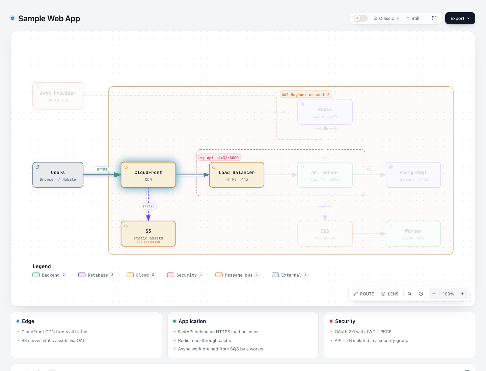
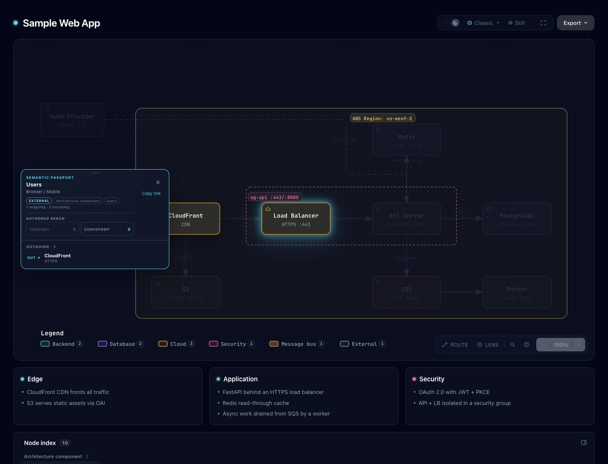

# Spatial focus：在当前画面按方向移动键盘焦点

这是一个经授权的窄 Viewer 原型，比较基线 `10b4dd5c5f2264baa315ee65a9b4cc23c13ea5f0` 与本目录绑定的候选字节。读者先用 Tab 到达原生节点，再用方向键把 **DOM 焦点**移到画面中同方向的邻近节点；Enter/Space 保持既有激活行为。它解决空间布局与 DOM Tab 顺序不同的阅读动作，不追踪图上的关系，也不证明阅读速度或可访问性改善。

- [Architecture 基线](architecture-base.html) / [候选](architecture-candidate.html)：完整现有 `archify/examples/web-app.architecture.json`。
- [Workflow 基线](workflow-base.html) / [候选](workflow-candidate.html)：完整现有 `archify/examples/agent-tool-call.workflow.json`。
- [输入、产物及静态 SVG 绑定](artifact-manifest.json)；[派生机器证据与文件账目](portable-summary.json)。这些 JSON 是公开派生摘要，不是原始未经删减的 CLI 回执。

两组同输入页面的完整静态 SVG 逐字相同，所有标签、节点、关系与几何保持原样。运行时 DOM 焦点会触发既有 Intent Trace，因而临时高亮与 `data-intent-trace-active` 等属性可以改变；这不等同于提交节点选择。候选不调用选择/清除、Passport、hash、camera 或 reveal。已有 pinned selection、关系选择、Passport 内容、hash、camera 与页面滚动由相应行为测试保护。

## 范围与成本

仅当 exact event target 是已获得 DOM 焦点的主 SVG 语义节点时接管 plain Arrow。排除整幅 Tree、Route active（包含端点捕获和结果态）、修饰键、IME/229、已处理事件、输入/anchor/子控件；现有关系 hit overlay、Passport 与 Route Journey 的键盘规则仍由原 owner 处理。

候选节点必须可聚焦、computed-visible、面积非零，且矩形完整进入 Viewer client box 与浏览器 viewport 的交集。该几何条件不检测 Passport、toolbar 或其他 overlay 的遮挡。算法先限制中心在按键方向，再按矩形间距的平方欧氏距离、中心距离、原产物 DOM 顺序打破平局；没有回程记忆，不承诺反向键必回原节点。合格 origin 的边界按键也 consume，避免默认滚页；无目标则焦点不动、不环绕。只调用 `focus({preventScroll:true})`，不跨屏抓取节点或移动相机。

已有选择会把其他节点降到 `.13` opacity；局部 `:focus-visible` 例外使当前键盘目标暂时可读，焦点移走后回到已有样式，不清除选择。实现是一个私有矩形检查、一个 SVG listener 和一条 CSS 规则，无新持久状态、schema、公共 API、依赖或拓扑索引。每次按键读取当前节点矩形和 computed style；没有大图性能提升声明。维护成本主要是与其他按键 owner、聚焦样式及派生模板/ZIP 的兼容。

## 来源与许可

灵感来自 [Foblex/f-flow 固定提交](https://github.com/Foblex/f-flow/tree/8ccfe9e32f0f990c955524eb8ab48abab0cf8735) 的空间 a11y navigation。完整 MIT LICENSE、navigation/controller、已提交 test 与 accessibility example 原字节保留于 [upstream](upstream/source-manifest.json)。没有运行或安装上游，没有移植其 Angular 框架、selection、加权评分或 return-memory；本原型的矩形排序规则是独立实现，并不宣称等同 Foblex 算法。Archify 自身声明按本基线 Apache-2.0/已有 notices 保留。

真实公开 Architecture/Workflow 示例用于可拍比较；`test/fixtures/spatial-focus.architecture.json` 是明确的 synthetic 回归输入，特意让 DOM 顺序 `a,c,b,d` 与左右空间顺序不同，不冒充自然用户工作负载。它覆盖错误地按 DOM 顺序选邻居的问题；受控矩形 probe 保护边缘距离/平局/隐藏与裁切合同，不冻结自动布局坐标。

## 已有机器证据

使用官方 Node 22.23.2、bundled zlib `1.3.1-e00f703` 与本机 Chrome。依赖复用既有 checkout 的相同非 root lock entries，未安装或改 lockfile。完整原回执、stderr、失败日志和 superseded source/HTML/ZIP 保存在 checkout 外；摘要给出原文件名、SHA 和阶段结果，未把删路径摘要伪装为原回执。

| 证据 | 实际范围与结果 |
| --- | --- |
| 当前新测试 | 最新边界滚动 regression，7 pass / 0 skip；真实 Tab→arrows→Enter、Tab 顺序、保留选择、light/dark focus opacity、无候选、隐藏/裁切、子控件/IME/修饰键、Workflow 和 Tree 规则 |
| 当前 Route + spatial | 16 pass / 0 skip；Route 为既有未修改测试，修复了发现的按键抢占 |
| exact archive | 最新 spatial 7 pass / 0 skip；通用 package smoke pass；解包 CLI 的 Architecture finalize 四 gate pass，HTML 与候选逐字相同 |
| 复用直接相邻测试 | 早期 source 的 Focus / Passport explanation / drilldown / Tree 共 17 pass；原 aggregate 因 Route 子测试及 parent 有 2 fail，保留原日志，不能称 aggregate pass；后续只加 Route guard 与等价有限初始化，Route 已在当前版本重测 |
| 复用 core/CI-scope | 早期 source 的 core 19 + scope 16，共 35 pass / 0 skip；不是当前 source 新跑，后续两个窄改的适用性在摘要说明 |
| 基线反证 | 同一较早版本 regression 对 exact base archive：7 total、2 pass、5 fail（4 子例及 parent），证明不是只在候选上自证；最新边界追加 probe 未回跑基线 |
| 正常生成 | final `test:generated` pass；31 个正常输出的完整静态 SVG 与基线逐字相同；另有包中 5 个既有 drilldown HTML 及其他手工 gallery/docs/Delta 页面保留 tracked base，不称 fresh，也不声称所有已存页面都包含新行为 |
| canonical ZIP | 两次构建逐字一致，235 members，CRC pass，template 与源码及包内容对应；未安装 live Skill |

可复现命令（仓库根目录，先选定官方 Node/Chrome；输出用新路径）：

```sh
ARCHIFY_CHROME='<Chrome executable>' node scripts/run-tests.mjs --require-files test/spatial-focus-browser.test.mjs test/route-probe-browser.test.mjs
node archify/bin/archify.mjs finalize architecture archify/examples/web-app.architecture.json '<fresh-output.html>' --browser-check
node archify/bin/archify.mjs finalize workflow archify/examples/agent-tool-call.workflow.json '<fresh-output.html>' --browser-check
npm run test:generated
scripts/build-zip.sh '<first.zip>'
scripts/build-zip.sh '<second.zip>'
# compare ZIP bytes, extract one archive, then:
node scripts/package-smoke.mjs '<extracted>/archify'
```

`test-value` 的决定是新增一个真实键盘文件，复用既有 Route/Focus/Tree 等合同；没有源码字符串快照或性能基准。Focused Survey 检查新 helper/listener 的直接 consumers：不增加重复 selection/camera 状态，不抽成通用 navigation 框架。为守已有按键 owner 保留显式 Route guard，当前没有值得再抽象或删除的层。

## 保留的失败与修正

1. 初命令没有设置 Chrome，产生 1 skip，不能算浏览器通过。随后 synthetic 输入关系标签撞节点，原 fixture 保留，修复显式 `labelAt`；再一次测试错把既有 active string 当 array，改测试预期，未改产品 active 合同。
2. 四个 finalize 并发写同目录导致 delivery lock，保留三次失败回执；按正常顺序重跑通过，没有移锁或放宽检查。
3. 首候选抢占 Route 捕获中的 ArrowRight，原未修改 Route 测试报失败；新 listener 在 Route active 时退出，当前 16 测试保护回归。旧 source/HTML/ZIP 和日志保留于外置 raw。
4. Route 修复版包内通用 smoke 又发现 `Infinity` 初始化被既有 Delta 的整 HTML 非有限数字词扫描拒绝。保留原失败；只把新排序初始化改为有限值并用首 candidate 分支初始化，未改 scanner、旧测试或排序。最终 smoke、exact archive 与生成检查通过。

## 实际浏览器图片与观察

Root agent 实际采集并逐张查看下列六张原 PNG，均为 1440×1100。图片原字节保留；[capture](screenshots/capture.json) 绑定四份 HTML、两个完整输入、六张 PNG 和七份外置原始 DOM 观察的 bytes/SHA；[观察摘要](screenshots/observations-summary.json) 是白名单派生记录，不是原 DOM dump。

| 状态 | 基线 | 最终候选 |
| --- | --- | --- |
| Architecture，light，九次真实 Tab 后 Right | [仍在 Users](screenshots/architecture-base-settled-right-light.png) | [移到 CDN](screenshots/architecture-candidate-settled-right-light.png) |
| Workflow，light，同样键盘路径 | [仍在 User](screenshots/workflow-base-settled-right-light.png) | [移到 Chat](screenshots/workflow-candidate-settled-right-light.png) |
| 已选 Users，100%，dark | 不另造基线选择对照 | [Right 两次到 LB](screenshots/architecture-selected-lb-dark.png) |
| Route 捕获，dark，显式聚焦 Users 后 Right | 由既有未改 Route regression 保护 | [保持 Users](screenshots/route-capture-dark.png) |





前四图在 fresh goto/reload、fonts ready 与 double RAF 后走同一真实 Tab/Right 路径；同一图类型的基线/候选容器 bounds 相同（Architecture 1376×816.8203125、Workflow 1376×914.921875），均已记录 `nav-reserve:54px`。观察中无激活，hash、camera style、scroll、Passport/regions 保持；候选 DOM 焦点移动附带既有 Intent Trace 变化，不能声称所有属性或高亮都不变。

选择态另测：真实 Enter 选择 Users 后，使用现有 `0` 回到 100%、`t` 切换 dark，并回到 Users 的 DOM 焦点；Right 两次依次到 CDN/LB。LB 从 `.13` 到 `1` 且 focus-visible，Users 的 selected/pressed、`#focus=users`、整幅 SVG attributes、Passport text、scroll 在这一序列内保持。此处的整 SVG attributes 不变只适用于该已选序列，不推广到前四图的 Intent Trace。

Route 图使用真实 Route button 与显式 `page.focus(node-users)`，然后真实 Right：记录 `isTrusted=true`、`defaultPrevented=false`，焦点、hash、Route 内容、camera style、scroll 保持。它不证明 Route 的 Tab 可达性或端点选择成功。另一次同 invocation 的稳定 190% 观察中，Users→CDN 后再 Right 停在 CDN；LB right 1444.097778 超过 client right 1407，被排除且没有 pan。该排除 probe 没有附成功截图。

早先 base 未记录 `nav-reserve`，与 candidate 出现 54px 差异，已重采并消除比较差异，未据此确认产品 bug 或确定原因。早先跨 viewport/layout 调用的 190% 测量与后续截图矩形不同，不能当作“目标完全进入 viewport”通过。那些 scratch、未 settle 图片和 superseded candidate 仍在私有原始采集区，不列为上述最终成功图。

机器 browser-check、受控 Chrome regression、root 实际键盘与截图是不同证据。本轮没有 OS clipboard、真人、AT、跨浏览器、完整键盘验收或学习效率结论；viewport containment 也不保证没有 overlay 遮挡。生成 HTML 保留 CLI 原字节（包括生成器既有尾随空白），没有为清理格式后处理输出。

AI 协助：Codex / GPT-6.1 Sol 完成研究、实现、测试、证据整理和文档，独立代理只读审查；root agent 负责实际浏览器操作与目视记录。该说明不代表人类审核或批准。
