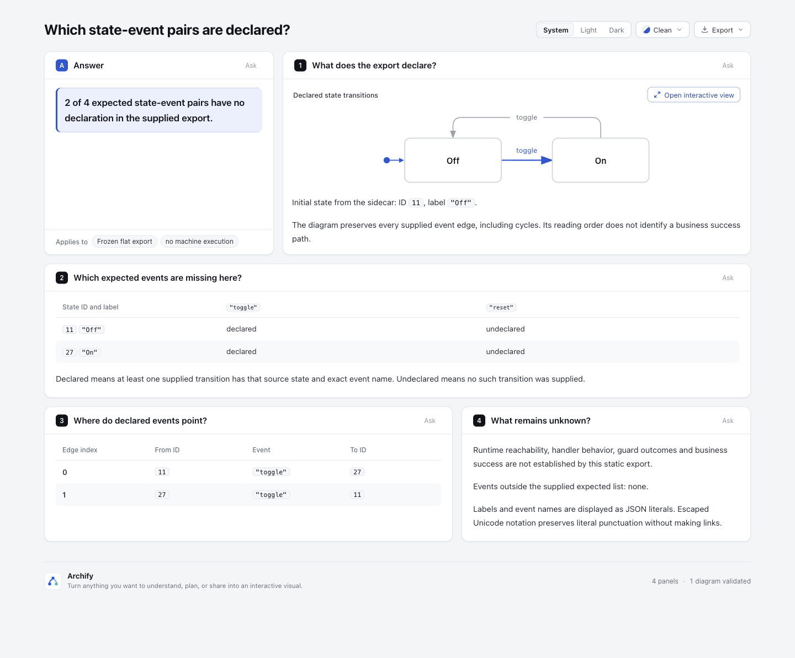
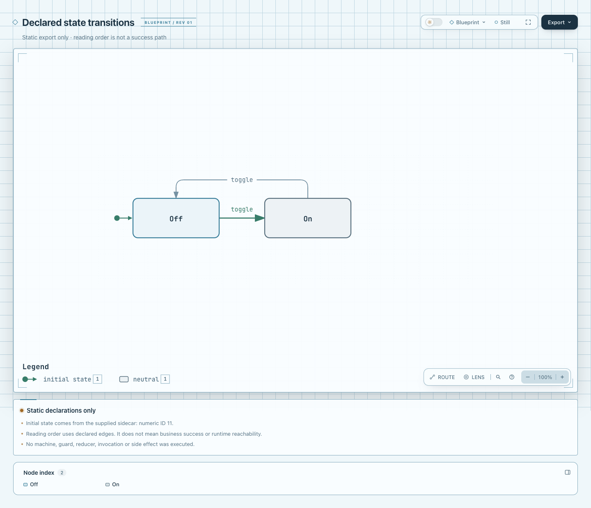

# 静态状态×事件合同实验

消费已经冻结的 flat state/event JSON 和独立 sidecar，生成原生 Lifecycle 与带事件矩阵的 Explainer。目标是让读者核对事件声明遗漏，不是运行状态机、验证 guards 或判定业务成功。

本实验只新增此目录，不改主 CLI、schema、renderer、Viewer、CI、ZIP 或 live Skill。Archify 基线 `82c7e0f089a02a4d514714adf37dc2061682da5f`；分支 `codex/lab-state-contract`。代码独立实现，无新增 runtime 依赖。

## 输入来自什么合同

固定来源：[robot3-viz @ 5e931694734445b3cd91d20dfc916901035f31c8](https://github.com/jbreckmckye/robot3-viz/tree/5e931694734445b3cd91d20dfc916901035f31c8)，[BSD-2-Clause LICENSE](https://github.com/jbreckmckye/robot3-viz/blob/5e931694734445b3cd91d20dfc916901035f31c8/LICENSE)。通过官方源码直接核对：

- [`src/types/dag.ts`](https://github.com/jbreckmckye/robot3-viz/blob/5e931694734445b3cd91d20dfc916901035f31c8/src/types/dag.ts)：`R3Dag` 根是 `nodes` / `edges`；node 为 numeric `id`、`kind`、`label`，可有 delegate；edge 为 from/to/kind 和可选 label。
- [`src/lib/dag.ts`](https://github.com/jbreckmckye/robot3-viz/blob/5e931694734445b3cd91d20dfc916901035f31c8/src/lib/dag.ts)：`getDAG` 将 guard/reducer 节点及 immediate 边纳入输出；这些节点标签不足以恢复函数逻辑。导出根没有初始状态字段。
- [`src/lib/nodes.ts`](https://github.com/jbreckmckye/robot3-viz/blob/5e931694734445b3cd91d20dfc916901035f31c8/src/lib/nodes.ts)：state label 来自机器状态名，ID 是数值身份，不能依靠节点排序猜初态。

没有 import/require 上游机器或运行其 JS。上游测试用 TS 调用机器后检验 partial objects，未发现可安全直接复制为完整冻结导出的纯 JSON fixture，因此没有假称已获取真实上游运行导出。本目录的 [toggle.export.json](fixtures/toggle.export.json) 是**原创 synthetic** 数据，只采用上游 flat R3Dag 形状；[toggle.sidecar.json](fixtures/toggle.sidecar.json) 是本实验新增的显式输入合同，不属于上游格式。没有复制上游 parser、源码或示例资产；BSD 许可链接用于准确说明来源。

```json
{
  "initialState": 11,
  "expectedEvents": ["toggle", "reset"]
}
```

sidecar 的 `initialState` 必填，直接使用数字 node ID；`expectedEvents` 必填，事件名按原字节精确比较。可选 `readingPath` 是数字 ID 数组，必须从指定初态开始且每步有真实声明边。不提供时沿输入边顺序选择未访问的出边，得到一个用于排版的简单阅读路径。两种方式都不会创建缺失边。

## 当前真实产物

- [native Lifecycle JSON](output/state-contract.lifecycle.json)：2 states，2 条相反方向的 toggle 边，循环没有被拓扑排序删掉。
- [native Lifecycle HTML](output/state-contract.lifecycle.html)：原生 Viewer，可聚焦核对两条真实边。
- [state×event matrix JSON](output/state-contract.matrix.json)：4 个预期状态事件对中，2 declared、2 undeclared；保留匹配边的原始 edgeIndex/target，不把多条同事件边缩成一个猜测目标。
- [Explainer draft](output/state-contract.archify.md) 与 [Explainer HTML](output/state-contract.html)：原生图、矩阵、逐边清单、初态来源与未知边界同页展示。
- [portable evidence summary](output/evidence-summary.json)：包含输入、源码、产物 SHA-256、执行环境、测试及公开命令结果。它是**明确标注的结构化摘要，不是原始 Archify receipt**；含本机路径的原始 receipts 在 checkout 外完整保留，没有修改后冒充原件。

实际浏览器截图见文末，两个 reset 未声明格和两条 toggle 边均保留。图片不是机器运行测试，用户验收仍待进行。

## declared 与 undeclared 的准确含义

`declared`：提供的 export 中至少有一条 edge，其 from 是该状态 ID，label 与该 expected event 完全相同。`undeclared`：没有提供这样的 edge。它们没有描述运行库忽略事件、抛错、接受事件或执行成功的方式。事件矩阵只遍历 sidecar 列表；不在列表中的实际事件另行列出，仍在图和逐边清单中保留。

初态只来自 sidecar。`mainPath` 是 Lifecycle 的原生排版入口；本实验将它明确称为**阅读路径**，不是业务成功路径，不从状态名推断 success/failure。初态用 start，其余状态统一 neutral。终态、运行可达性、guard 结果、业务成败均不由本实验评估；原生 renderer 可能给无出边节点画 final 装饰，这只表示导出中没有后续边。

原生 Lifecycle v3 的相邻主路径必须有 transition。本实验因此拒绝只有一个状态、初态没有非自环出边、阅读路径有空档、或有断开的状态岛等无法在此受限布局下忠实呈现的输入，绝不添加 decorative 连线填空。测试从实际渲染 HTML 的 semantic path 核对只有两条声明边。

## 支持与明确拒绝

支持 2–6 个 flat state 节点、最多 24 条 event 边、1–6 个 expected event。节点 ID 为非负安全整数且不可重复；引用必须存在。保留状态/边的输入顺序、自环、环、同一状态事件的多个目标和重复声明；不会据此猜哪个目标会在运行时被选中。

标签是非空单行文本，最多 80 UTF-16 units；控制字符拒绝。这是转换边界，不保证任意长文本都能过原生布局门禁。原生 renderer 不可布局的内容继续返回其诊断，不替换标签凑通过。

以下任一项均整体失败，没有成功后省略的阶段：

| 形状 | 结果 |
| --- | --- |
| guard / reduce / action / invoke-machine / invoke-promise 节点 | unsupported-node |
| immediate / side-effect 边 | unsupported-edge |
| delegate / guards / reducers / children / invoke 等额外字段 | unsupported-field，即使该值为空也拒绝 |
| 嵌套、并行、context、handler、任意机器 JS | 不在此 JSON 合同；不解释、不执行 |
| 缺失 initialState / expectedEvents、重复 ID/event、未知引用、缺失 event label | 明确输入诊断 |
| 未声明事件 | 正常矩阵格 undeclared，不作为输入错误 |

矩阵内的源字符串经 `literalMarkdown` 处理：先序列化为 JSON 字面值，再把会触发 Markdown/表格结构的字符写成 JSON Unicode escape，最后放入 inline code。JSON 值可无损还原；`[jump](https://...)` 不会变成可点击链接，反引号、竖线、HTML 形状也不会改变表格/指令。原生图仍使用原始标签，交给其自身 SVG escaping；不把编码后的字符串作为状态身份。

## 运行

仓库根目录、Node 22。本机运行器路径为 `/opt/homebrew/opt/node@22/bin/node`；下面用 `node` 便于其他机器复现。

```sh
node --test experiments/state-contract/state-contract.test.mjs

STATE_LAB_RUN_ROOT=$(mktemp -d)
node experiments/state-contract/state-contract.mjs experiments/state-contract/fixtures/toggle.export.json experiments/state-contract/fixtures/toggle.sidecar.json "$STATE_LAB_RUN_ROOT/output"
node archify/bin/archify.mjs render lifecycle "$STATE_LAB_RUN_ROOT/output/state-contract.lifecycle.json" "$STATE_LAB_RUN_ROOT/output/state-contract.lifecycle.html" --quality showcase
node archify/bin/archify.mjs render explainer "$STATE_LAB_RUN_ROOT/output/state-contract.archify.md" "$STATE_LAB_RUN_ROOT/output/state-contract.html" --quality showcase
node archify/bin/archify.mjs finalize lifecycle "$STATE_LAB_RUN_ROOT/output/state-contract.lifecycle.json" "$STATE_LAB_RUN_ROOT/output/state-contract.lifecycle.html" --receipt "$STATE_LAB_RUN_ROOT/lifecycle.finalize.json" --out-dir "$STATE_LAB_RUN_ROOT/lifecycle-evidence" --quality showcase --json
node archify/bin/archify.mjs finalize explainer "$STATE_LAB_RUN_ROOT/output/state-contract.archify.md" "$STATE_LAB_RUN_ROOT/output/state-contract.html" --receipt "$STATE_LAB_RUN_ROOT/explainer.finalize.json" --out-dir "$STATE_LAB_RUN_ROOT/explainer-evidence" --browser-check --quality showcase --json
```

CLI 只接受已冻结的两个 JSON 文件，不 import 模块。输出目录必须全新且由本次调用私有使用：原子 `mkdir` 拒绝已有文件、目录及 symlink，三个文件采用 `wx`。中途失败只清理本次创建的文件，其他文件保留；不承诺与恶意/并发进程争用同一路径或替换 inode 时的安全性，请勿共享运行目录。不能用已有源目录作为输出，也不自动删除用户的旧实验结果。

## 验证与已知限制

按 `test-value` 选择了语义和真实失败边界，而非实现镜像或自动坐标快照：

- 40 tests passed、0 failed、0 skipped：初态由 sidecar决定、toggle 环、reset 缺失、多个同事件 target、额外事件、显式阅读路径每步真实、所有 rich 语义拒绝。
- public render 测试实际调用 native Lifecycle 与 Explainer；用包含链接形状、反引号、竖线和 HTML 字符的输入验证字面边界；检查 semantic edge 方向与数量。
- 实际文件检查保留 regular target、既有目录、symlink victim 和输入别名；rich 输入无输出目录；机器 JS 未执行；受控写出失败保留非本次拥有的文件。
- `render --quality showcase` 对两种输出均成功；最终阶段及浏览器是否实际运行以 portable summary 的独立记录为准。通过 renderer 不等于用户视觉接受，未做真实机器运行或业务成功验证。

首次 Explainer draft 因结论被拆成两段而被公开 parser 拒绝，改为一段后重跑；没有绕过原生解析器。原生 Lifecycle 已实际 finalize 并运行浏览器检查。Explainer 普通 finalize 的浏览器门禁默认不运行，额外显式请求的结果单独记录，不能把默认未运行写成通过。

本轮没有真实上游机器导出验收、真实业务事件全集或运行 trace；仅能证明对冻结 flat 输入的确定性投影。未知 guards 也不提供“unknown”假格：含 guard 的整个输入直接拒绝。若需要 rich 机器，先另定可表达合同，不把它们擦掉继续画图。没有改动共享产品代码，因此没有运行全仓库测试或宣称支持所有机器。

## Actual browser images

Both toggle directions are visible, and the matrix retains two reset cells as undeclared. The initial-state note identifies the sidecar source. No machine was run.





Capture settings and current HTML/image hashes are in [capture.json](screenshots/capture.json). These are agent-captured and agent-inspected images; human acceptance is pending. Original finalize visualReview fields remain unchanged.

AI assistance: Codex and GPT-6.1 Sol subagents performed investigation, implementation, focused validation, review and documentation. The repository owner has not yet accepted this experimental branch.
