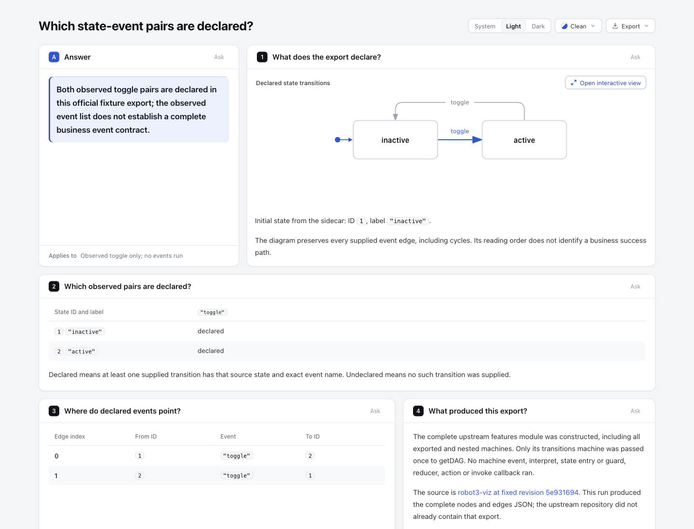
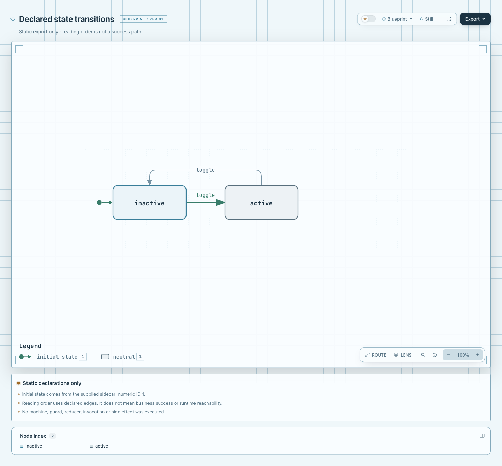

# 官方 toggle fixture 的实际 flat 导出

完整官方机器 fixture 经本轮受控构造与 `getDAG` 实际导出，再由未改动的 state-contract 适配器接受。原始 stdout 是 373 B 的完整 `nodes` / `edges`：inactive ID 1、active ID 2，以及两条反向 toggle 边；不是手工编 ID，也不是上游已经提交的 JSON fixture。

[Explainer](output/state-contract.html) 与 [原生 Lifecycle](output/state-contract.lifecycle.html) 使用同一份 [Lifecycle JSON](output/state-contract.lifecycle.json)。当前 runtime 是固定 dev `67f12389212c54b3122da60e2813c7f8dab7ab2f`，本实验 merge HEAD `4d240bb034f55594e2d036fd1de749ecfef0f9e9`。旧 synthetic 输入、产物、截图、摘要全部保留原字节；没有修改适配器、shared code、ZIP 或安装 live Archify。

## 原始输入与执行边界

上游固定 [robot3-viz `5e931694734445b3cd91d20dfc916901035f31c8`](https://github.com/jbreckmckye/robot3-viz/tree/5e931694734445b3cd91d20dfc916901035f31c8)，[BSD-2-Clause 原许可](upstream/LICENSE)。[完整 features.ts](upstream/test/machines/features.ts) 原始 4366 B / SHA-256 `fb43d2906bf9afd85e7c4d17940b2ceb6f1f9e3aa1b5aa125ab89a9e2d14293e`；复制必要完整源码、原 package.json/yarn.lock/README 与许可，未摘取重写机器定义。

完整 features 模块顶层实际构造了**全部导出机器（含嵌套机器）**。只将其 `transitions` 导出传给原 `getDAG` 一次。Robot3 0.2.21 的构造函数保存 callback；`getDAG` 读取状态声明和 guard/reducer 函数名。没有 interpret/send、状态 entry、guard/reducer/action/invoke callback，没有访问用户项目、服务或真实业务数据。它不是运行 trace、状态空间或可达性验证。

[原始 getDAG stdout](inputs/getDAG.stdout.json) SHA-256 `a094d601558058cdd2e39d4c4115d9e342592e8061d8dc198c4ead36040e5234`；[构造时观察](inputs/constructor-observation.json) 和 [独立 derived sidecar](inputs/derived-sidecar.json) 分开保存。初态由构造时 `transitions.current = inactive` 唯一匹配实际导出节点的 ID 1，未从节点排序猜测。sidecar 的 expectedEvents 仅取实际导出边的 `toggle` 标签。因此矩阵 **2 declared / 0 undeclared 只覆盖这一个观察事件**，不证明完整业务事件全集、不回答 reset，也不说明运行时事件接受或成功。

[原适配器 draft](adapter-output.archify.md) 逐字保留。最终 [authored draft](output/state-contract.archify.md) 只收窄结论、scope 和矩阵标题，并补充来源/执行范围面板；没有改图、矩阵、事件、ID 或补造缺失声明。页面中的“没有执行机器”指没有事件/状态 entry/callback 执行；声明构造确实发生。

## 锁定依赖与复现

只用原 yarn.lock 内的 robot3 **0.2.21** 与 TypeScript **4.5.4**，不安装原项目的 D3/React/Dagre/Jest/Parcel。两 registry tarball 的 SHA-512 integrity 与原锁逐项一致，SHA-256/URL 见 [来源清单](upstream-manifest.json)；[Robot3](licenses/robot3-LICENSE) 与 [TypeScript](licenses/typescript-LICENSE.txt) 原许可随附。这里不发布 tarball、node_modules 或无关 archive。局部 `.gitattributes` 只对本目录复制的 upstream/licenses 禁用行尾归一化，确保提交后原 CRLF 与许可字节仍匹配来源 hash。

[reproduce.mjs](reproduce.mjs) 接收两个本地 tarball、全新私有临时目录和可信 npm CLI 路径，先核源文件与 tarball hashes，再生成只含两依赖的局部 lock，运行 `npm ci --ignore-scripts --offline --no-audit --no-fund`，缓存也位于该目录。没有全局安装、联网执行器或禁用 npm 安全策略。失败目录保留证据，不自动删除/覆盖已有目录；本实验仅在 macOS arm64 / Node 22.23.2 验证，不承诺恶意并发路径替换安全。

只对四个完整上游 TS 文件运行 TypeScript `transpileModule` 为 CommonJS/ES2020，再运行原 `getDAG`。**不是上游 full build、typecheck 或测试**。局部 runner 最后要求 stdout 与 sidecar 和本目录冻结输入逐字相同。

```sh
# 使用 upstream-manifest.json 中原锁 URL 获取本地 tarball，并交给 runner 验证；不在仓库安装依赖。
node experiments/state-contract/measured/reproduce.mjs <robot3-0.2.21.tgz> <typescript-4.5.4.tgz> <fresh-private-dir> <trusted-npm-cli.js>

# adapter 输出目录也必须全新；它只读 JSON，不加载机器。
node experiments/state-contract/state-contract.mjs experiments/state-contract/measured/inputs/getDAG.stdout.json experiments/state-contract/measured/inputs/derived-sidecar.json <fresh-adapter-output>
node --test experiments/state-contract/state-contract.test.mjs

# 复验本页固定 authored source，两个原始 receipt 和 out-dir 放 checkout 外。
node archify/bin/archify.mjs finalize lifecycle experiments/state-contract/measured/output/state-contract.lifecycle.json <fresh-artifact-dir>/state-contract.lifecycle.html --quality showcase --receipt <outside-evidence>/lifecycle.finalize.json --out-dir <outside-evidence>/lifecycle --json
node archify/bin/archify.mjs finalize explainer experiments/state-contract/measured/output/state-contract.archify.md <fresh-artifact-dir>/state-contract.html --quality showcase --browser-check --receipt <outside-evidence>/explainer.finalize.json --out-dir <outside-evidence>/explainer --json
```

Archify render/finalize 需要 CONTRIBUTING 规定的依赖。本次临时复用同锁依赖条目（旧安装仅根包 version/license 元数据不同），没有安装/修改仓库依赖或 lock；结束后移除临时链接。回放固定 Markdown 时原生 source JSON 在它的同一目录；输出 artifact 可以另放新目录。

## 证据与限制

原始命令 stdout/stderr、完整下载 archive、tarball、安装日志和 CLI receipts 留在 checkout 外。[portable 摘要](evidence-summary.json) 是明确派生记录，不是原始 receipt。摘要绑定源码/输入/产物，并区分本轮实际结果、旧证据与未知。

早期 canonical Node 分发的 npm symlink 不可用；改用同一 Node 调用可信现有 npm CLI。第一次 remote URL lock 安装被 npm `EALLOWREMOTE` 拒绝，随后转译因依赖未装而失败。这些原始记录保留；改用已按上游锁验证的本地 tarball 并使用 ignore-scripts 后成功，没有关闭该远程策略。最终新增 runner 在另一全新目录实跑成功，完整 stdout 和 sidecar 逐字复现。

原有 focused **40 pass / 0 fail / 0 skip** 在当前 merge runtime 重跑；没有改测试、适配器或跑全仓测试。两个初版公开 render 成功；两个最终 finalize 的 validate/deliver/check/browser-check 均通过，diagnostics 为 0，Explainer 显式请求 browser-check。初版页面 scope 过宽，经 root 指出后只改 authored scope 与矩阵标题，再单独 finalize Explainer；初版 Markdown/HTML/原 receipts 保留在 checkout 外。native 未变，不重复运行。阶段与绑定见摘要。新 authored README/runner 的 scoped diff-check 通过；完整新增文件检查会报告上游 README、TypeScript 原许可和生成 HTML 的原有尾空白。保留其原字节，不手修官方源/许可或生成文件来消除提示。自动门禁不是视觉或人类验收；没有用户阅读速度结论。

## 实际图片

Root 已在 Ego 实际打开并逐图查看三张原 PNG，没有改图片字节或打开外链。浅色、viewport 1440×1100、scale 1；Explainer 为 Clean，native 为 Blueprint / Still / 100%。概览 PNG 为 1440×1100；全文 PNG 实际为 1440×1553，native full-page PNG 为 1440×1337，图片尺寸与 capture 前 viewport 分别记录，不把全文内容高误称相同 viewport。

实际看到 observed toggle 范围、两格 declared、两个相反方向的 toggle，以及完整模块构造范围的来源面板。[全文图片](screenshots/explainer-full.png) / [capture 与 HTML、图片 hash 绑定](screenshots/capture.json)。这是独立于自动 finalize gates 的浏览器查看；没有发送机器事件、打开上游链接、测试辅助技术或声明人类验收。





AI assistance：Codex / GPT-6.1-Sol medium 做只读来源调查、受控导出、转换、生成和证据整理；独立 agent 已核固定来源/依赖完整性及构造边界。Root 的实际截图/查看另行绑定；不声明个人 human-review confirmation。
