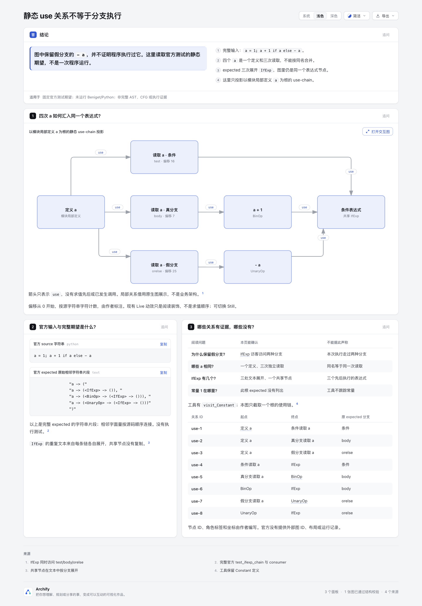
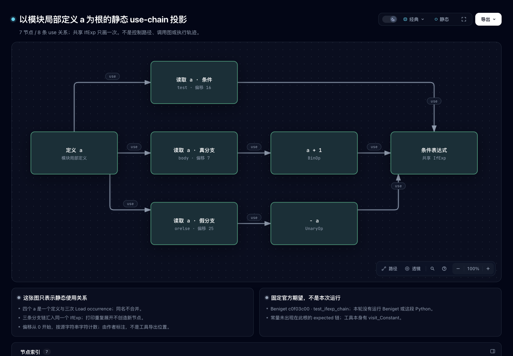
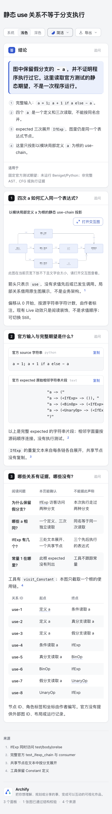
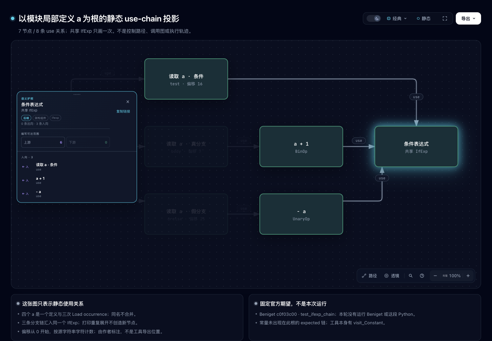

# 静态 use 关系不等于执行分支

这是一个新内容原型：直接编写中文 Explainer 和一个原生局部关系图，解释固定官方测试中的 use-chain。没有新 parser、扫描器、运行器、播放状态或共享产品修改。

固定 Archify 基线为 [`10b4dd5c5f2264baa315ee65a9b4cc23c13ea5f0`](https://github.com/tt-a1i/archify/commit/10b4dd5c5f2264baa315ee65a9b4cc23c13ea5f0)。本轮所有新增文件限于本目录。最终提交身份由协调者另行报告，不用基线 HEAD 冒充尚未提交的作者内容。

- [中文页面](explainer.html) · [作者 Markdown](explainer.archify.md)
- [独立原生图](use-chain.html) · [原生 JSON](use-chain.architecture.json)
- [完整节点/边/源范围账目](projection-ledger.json) · [portable 验证摘要](portable-summary.json)
- [完整上游来源清单](upstream/source-manifest.json) · [BSD-3-Clause 原文](upstream/beniget/LICENSE) · [归属说明](ATTRIBUTION.md)

## 读者要区分什么

官方测试完整 source 是 `a = 1; a + 1 if a else - a`。期望链同时保留条件、body、orelse中的使用，不能把它当作一次运行的三个步骤。

图只表示**以模块局部定义 a 为根的静态 use-chain 投影**，不是完整 AST 或工具所有 roots。四个 `a` 是一个定义与三个不同 Load occurrence；按名字合并会丢失关系。expected 中三次打印 `IfExp`，对应同一 AST 表达式的 Def；图里只保留一个共享节点。7节点、8条 use 边全部列账，不包含新推导的控制转移、调用或执行边。

`source-input.txt` 与 `expected-chain.txt` 都是完整的字符串内容，未加末尾 LF；前者26个 ASCII 字符。后者由作者连接原测试的五个相邻字面量，不通过运行或解析Python得到。`selected-test.txt` 是完整 L56–67 原片段，完整测试另在 upstream 中。图上偏移是作者按 source 字符串标注的0基字符位置，不是编辑器1基列号，也不是Beniget导出位置；账目使用半开区间。

常量没有出现在此根的 expected chain 中，不意味着工具没有常量 Def。`visit_Constant`实际存在。visitor访问 test/body/orelse 的代码顺序也不表示Python实际求值顺序。本轮未运行Beniget、gast、AST分析或这段Python，未提供输出值、可行路径或动态trace。

## 固定一手来源与consumer

上游固定 [`serge-sans-paille/beniget@c0f03c00a4b737916a3dcfe9849fc177d1e1fe88`](https://github.com/serge-sans-paille/beniget/tree/c0f03c00a4b737916a3dcfe9849fc177d1e1fe88)，四个完整文件逐字保留。根许可为BSD-3-Clause，非重新许可。局部 `.gitattributes` 为完整上游文件设置 `-text`，防止仓库默认换行归一化改变源/许可SHA；不清理上游尾空白。

| 固定文件/范围 | 实际用途 |
| --- | --- |
| [tests/test_chains.py L36–46](https://github.com/serge-sans-paille/beniget/blob/c0f03c00a4b737916a3dcfe9849fc177d1e1fe88/tests/test_chains.py#L36-L46) | consumer构建DefUseChains并visit，完整assertEqual规范化dump |
| [L56–67](https://github.com/serge-sans-paille/beniget/blob/c0f03c00a4b737916a3dcfe9849fc177d1e1fe88/tests/test_chains.py#L56-L67) | 完整 source 与完整 expected；本轮不是重跑结果 |
| [L2285–2288](https://github.com/serge-sans-paille/beniget/blob/c0f03c00a4b737916a3dcfe9849fc177d1e1fe88/tests/test_chains.py#L2285-L2288) | 名称规范化，不是控制流筛选 |
| [beniget.py L207–219](https://github.com/serge-sans-paille/beniget/blob/c0f03c00a4b737916a3dcfe9849fc177d1e1fe88/beniget/beniget.py#L207-L219) | 文本按分支复制visited集合，共享IfExp会重复展开 |
| [L508–512](https://github.com/serge-sans-paille/beniget/blob/c0f03c00a4b737916a3dcfe9849fc177d1e1fe88/beniget/beniget.py#L508-L512) | 从模块locals取得dump根 |
| [L1302–1311](https://github.com/serge-sans-paille/beniget/blob/c0f03c00a4b737916a3dcfe9849fc177d1e1fe88/beniget/beniget.py#L1302-L1311) | BinOp / UnaryOp use |
| [L1335–1340](https://github.com/serge-sans-paille/beniget/blob/c0f03c00a4b737916a3dcfe9849fc177d1e1fe88/beniget/beniget.py#L1335-L1340) | 同一IfExp Def，访问test/body/orelse |
| [L1422–1424](https://github.com/serge-sans-paille/beniget/blob/c0f03c00a4b737916a3dcfe9849fc177d1e1fe88/beniget/beniget.py#L1422-L1424) | Constant访客确实存在 |
| [L1481–1507](https://github.com/serge-sans-paille/beniget/blob/c0f03c00a4b737916a3dcfe9849fc177d1e1fe88/beniget/beniget.py#L1481-L1507) | 按AST occurrence建Name Def并连局部定义 |

页面只提供固定URL的普通来源元数据，不把source card说成验证过的代码摘录；本轮没有为上游建立Git源码验证repo-root。

## 实际验证与保留失败

用Node 22.23.2运行现有公共 `render` 与 `finalize`，不运行上游。最终原生图 validate/deliver/check/browser-check 四阶段通过，0诊断；中文Explainer前三阶段通过、0诊断，自动browser未请求。原始CLI receipts/stdout/stderr在checkout外保留，公开 `portable-summary.json` 是明确标注的选段与hash账目，不是脱敏后冒充的原始receipt，也不建立分享副本当前物理delivery provenance。

标准库 `audit.py` 的14项检查通过：完整上游字节、完整选段/expected、四个a、共享IfExp、7/8账目、source偏移、实际HTML代码/8关系表、内嵌spec与gzip原生HTML、JSON资源及无私路径。它不求解程序语义或运行上游。`audit-results.json` 是安全原stdout逐字副本，完整私有stdout另留存。没有为纯内容新增共享测试或重复全仓suite/CI/ZIP。

Root暂存24个文件后，实际 `git diff --cached --check` 退出2，报告128处空白：`explainer.html` 19处、`use-chain.html` 22处、上游 `LICENSE` 1处、`beniget.py` 21处、`test_chains.py` 65处。它不是全包空白检查通过。先前仅作者7个文件的检查通过，不能替代这次staged结果。两HTML保留公共CLI生成原字节，上游源/许可保留固定来源原字节，未为消除报告而清理空白。原始检查输出留在checkout外，14038B，SHA-256 `4600e93fbcd5b4854a9b0e02b7f1fba3e69e80f69579decd55cdb26b35c1afff`；该非零结果不改写任何gate或源文件hash。

首版通过全部适用gates，但root实际看图后要求补首屏完整source、压紧布局、明确0基偏移；完整旧作者输入、HTML和receipts原字节在checkout外 `first-revision` 保留。新版首次复用旧browser evidence目录时，原生finalize在browser阶段因 `viewer/evidence-path-conflict` 失败（旧证据绑定旧HTML），前三阶段通过。失败原件保留；改用新独立out-dir后重跑四阶段通过，没有移除诊断或改产品验收规则。

初稿作者曾写 `meta.animation:none`；实际10b4 renderer仍统一输出 `data-animation="trace"`，因此新版删除无效字段，不宣称禁止动效。现有Viewer的Live/Still是阅读装饰，不是use边求值/执行顺序；页面明确这一点。根截图若切Still，将作为真实操作另记，不能由输入字段推断静止。`render explainer`和`finalize`的prepared quality/bundle不同，未要求两页字节相同；最终内嵌native HTML与独立finalized native逐字相同。

## Root 实际图片与局部浏览器观察

Root在Ego Chromium实际捕获并逐张查看以下四图；PNG原字节复制，[capture-summary.json](screenshots/capture-summary.json)也是root派生摘要的原字节副本。原始三个观察JSON留在checkout外，以bytes/SHA单独绑定。它不是CLI browser receipt，未把前述Explainer自动browser未请求改为通过。

| 中文页完整图 | 独立原生图与共享IfExp |
| --- | --- |
|  |  |
|  |  |

桌面视口1440×1100，完整PNG为1440×2068；首屏可见完整source，压紧作者布局后小字提示消失，文档宽1440。手机视口390×844，完整PNG为390×2825，文档宽390；原生缩略图仍有打开交互图提示，长expected代码与较宽关系表需要横向滚动，不声称所有内容在手机一屏同时可见。

独立原生视口1440×1000、深色。捕获前动效控件已经显示“静态”、`aria-pressed=false`、标题“恢复动效”；root没有切换按钮，不能据此说产物禁用了默认Live。实际pointer点击`#node-ifexp`后，Passport显示0条出向、3条入向（条件读取、BinOp、UnaryOp）和6个编写上游节点；这些是作者图的邻接/可达关系，不是程序执行。该高度截图未覆盖全部页脚与sidebar文字。

首版1440×1988截图只在私有证据保留，其hash在capture中；没有拿首版当终版。Root本轮没有完整键盘遍历、AT、触屏、跨浏览器、原程序执行或读者收益验证；没有外站导航、SourceCard代码摘录、OS剪贴板或手机原生图交互声明。机器gates与root局部观察分开，不能等同真人验收。若图没有额外帮助，可保留表而不扩展产品。

## 复现

在该实验分支运行以下命令。Node22与Python3标准库即可；不安装Beniget、gast或live Skill。使用新的checkout外证据目录；既有raw receipt不可覆盖其他HTML的证据。

```sh
STATIC_USES_RAW_DIR=$(mktemp -d)
node archify/bin/archify.mjs render architecture experiments/static-uses/use-chain.architecture.json experiments/static-uses/use-chain.repro-render.html --quality showcase
node archify/bin/archify.mjs finalize architecture experiments/static-uses/use-chain.architecture.json experiments/static-uses/use-chain.repro.html --quality showcase --json --out-dir "$STATIC_USES_RAW_DIR/native"
node archify/bin/archify.mjs render explainer experiments/static-uses/explainer.archify.md experiments/static-uses/explainer.repro-render.html
node archify/bin/archify.mjs finalize explainer experiments/static-uses/explainer.archify.md experiments/static-uses/explainer.repro.html --json --out-dir "$STATIC_USES_RAW_DIR/explainer"
python3 experiments/static-uses/audit.py
```

不同输出名会改变资源的portable路径与receipt绑定，不以repro HTML hash等同原artifact。audit核仓库中冻结的最终两HTML；若另存repro产物，需要单独核新绑定，不用旧摘要冒充新运行。
