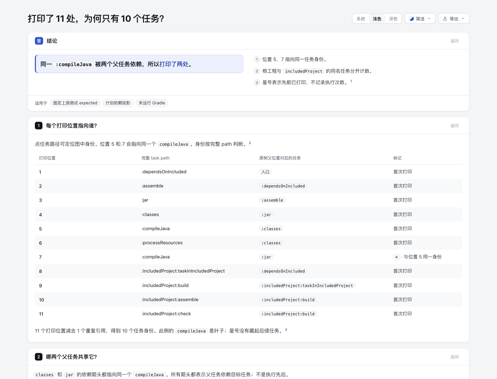
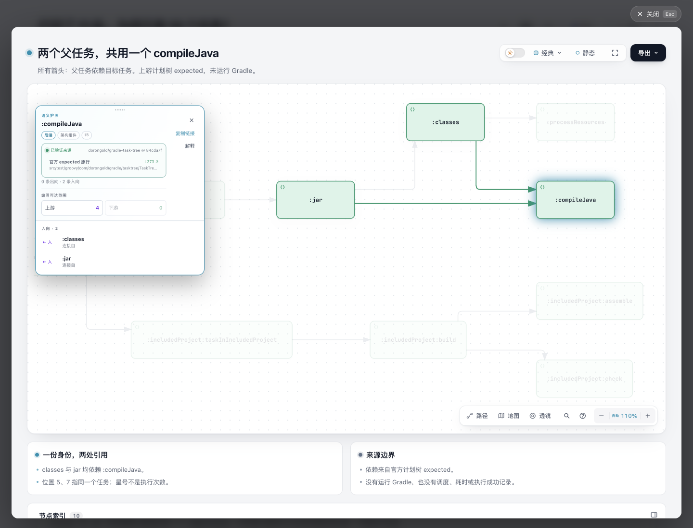
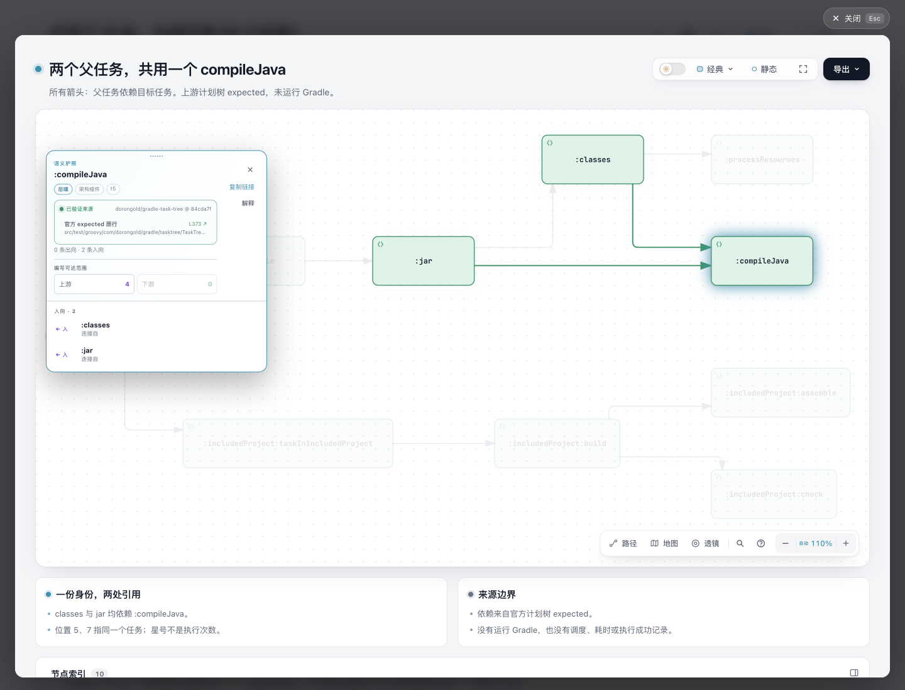

# 打印位置与任务身份：11处为什么是10个task

[问题解释页](output/explanation.html) · [独立身份图](output/dependencies.html) · [11位置映射](mapping.json) · [官方expected显示文本](expected-tree.txt) · [来源审计](source-audit.json)

同一 `:compileJava` 被 `:classes` 和 `:jar` 依赖，因而在官方树中打印两处。表中位置5、7都对应同一个task identity；完整图保留10个身份、10条父任务到依赖任务的有向边。`*` 表示先前已打印。**这个expected里的compileJava是叶子，没有虚构被省略的后续任务；打印次数也不表示执行次数。**

这是固定上游测试expected的作者编排。上游原树已有清楚图例，未发现其语义错误；本轮也没有运行Gradle、获得自然生产日志或测量读者收益。可检验假设只是：11行位置账目与共享目标小图并排，是否比原树更容易回答“哪两个父任务共用一个身份”。如果原树加一句说明就足够，应保留研究而不扩成parser平台。

## 固定来源与范围

- 上游：[dorongold/gradle-task-tree](https://github.com/dorongold/gradle-task-tree/tree/84cda7f0ce2363c96b1b26713ad34558519bdf05)，固定SHA `84cda7f0ce2363c96b1b26713ad34558519bdf05`，Apache-2.0；[完整许可与归属](NOTICE.md)。
- 完整原fixture：[upstream/source/src/test/resources/samples/multiproject](upstream/source/src/test/resources/samples/multiproject)，包含4个Gradle配置、4个Java文件。没有执行任何文件。支持源码/测试是所选完整原文件，不能称整套构建环境或上游仓库已复现。
- 官方完整expected在 `TaskTreeTaskTest.groovy` 的 `expectedOutputWithIncludedBuildTask()`，L365–386；对应测试调用 `:dependsOnIncluded :taskTree` 并对output contains expected作断言。本轮读取这些断言，不把它们称本轮通过。
- `TaskDetails`按完整path比较身份；生产者从executionPlan取依赖，插件仅禁用尚未executed的任务。配置/其他提前执行并非被该机制保证不存在。
- 根工程的`:assemble`和`:includedProject:assemble`保持不同identity。图每个节点显示完整task path，Passport说明保留原打印位置；所有箭头只表达“父任务依赖目标任务”，不表示调度/执行顺序。

`expected-literal.txt`保留原expected字面内容，`expected-tree.txt`是明确派生副本。`verify-source.py`只对这个固定fixture作stdlib文本提取与覆盖审计：原manifest的14个文件hash/bytes、8文件fixture边界、11位置→10身份、10关系、compileJava的双父/叶子事实，以及已生成HTML/嵌入native/源excerpt绑定。它不执行Groovy，不解析Gradle，不是通用importer或新测试框架。独立依据是上游完整expected及consumer源码，不是把手写节点数组当oracle。

## 表主导的阅读动作

解释页先列11行原位置，再用小Architecture展示共享身份。表中位置5、7的链接目标相同，都是`task-map.t5`；includedProject的assemble为`t9`，根assemble为`t2`。图、表和原完整树同时保留。原始树本来就有legend，所以不能把新的可点击说明外推为用户收益或上游缺陷修复。

使用Architecture承载有共享目标的DAG，不给Tree复制相同ID或伪造单parent。Standalone和Explainer引用同一个 [task-identities.architecture.json](task-identities.architecture.json)，嵌入spec、SVG和解压后的native HTML与独立产物完全一致。没有共享Viewer、schema、CLI、ZIP、依赖或Skill修改。

## 实际阶段与保留的失败

Archify软件固定 `10b4dd5c5f2264baa315ee65a9b4cc23c13ea5f0` / `3.2.1-dev.1`，官方Node22.23.2。两页都通过public finalize生成；没有直接编辑生成HTML。

| 最终产物 | validate | deliver | check | browser-check |
| --- | --- | --- | --- | --- |
| 独立Architecture | pass | pass | pass | pass，真实请求并运行 |
| Explainer | pass | pass | pass | **fail**，真实请求并运行 |

最终Explainer完整raw browser有 **16条keyboard-traversal诊断**；compact stdout只展示8条且标truncated，不把8当全量。未到达的是底部部分来源/页脚链接，分别在1280/1440、浅/深主题下记录。readability与containment通过，最终无diagram-fit失败；这不等于完整浏览器通过。本轮没有修改gate、删来源链接或扩修共享键盘行为。

首稿有裸星号导致Markdown解析失败，未产出该稿HTML；修正为inline code。首轮图的7px工程tag/9px位置副标题造成预览小字及fit失败。第二轮改成完整task path标签，但十处原生8px“依赖”文字仍触发readability；第三轮把这一个同义关系统一到图注。10个身份/10关系、11行表和原expected均保留，小字所含事实保留于完整标签/表/Passport。各失败draft、spec、HTML及原始收据在checkout外保留，不以终版覆盖历史失败。

最终源片段审计还发现一个引用错误：skip声明59–86超出实际76行，CLI将可选citation降为plain reference。已收窄为准确59–76并重跑Explainer完整finalize。审计要求全部5个repository来源均有固定revision、全文hash与准确excerpt，没有忽略该fallback来通过；旧HTML/声明/原收据及明确派生的错误记录外置保留。

`source-audit.json`是stdlib源/绑定审计结果，不是14个测试或Gradle执行证据。本轮没有为低影响原创内容跑全仓suite或编写镜像测试；原生/Explainer实际gates和源语义独立核对各自记账。完整原始receipt含机器路径，留在checkout外；公开portable summary是选定字段/hash/bytes的派生摘要，不能冒充未脱敏原件。

新增文件whitespace检查在两份原生生成HTML及4份上游原件报告既有尾随空白/EOF空行。保留生成字节与原source/license字节，没有为diff-check清理它们；原创Markdown/JSON/Python通过。具体原始检查记录外置。

## 复现

从仓库根执行；`<pinned upstream checkout>`须是固定84cda提交、origin为上游的只读Git checkout，以便源码引用由Git字节验证。不要运行其中Gradle/Java文件。

```sh
python3 experiments/task-occurrences/verify-source.py
node archify/bin/archify.mjs finalize architecture \
  experiments/task-occurrences/task-identities.architecture.json \
  experiments/task-occurrences/output/dependencies.html \
  --repo-root '<pinned upstream checkout>' --quality showcase --json --out-dir '<private receipts>'
node archify/bin/archify.mjs finalize explainer \
  experiments/task-occurrences/question.archify.md \
  experiments/task-occurrences/output/explanation.html \
  --repo-root '<pinned upstream checkout>' --browser-check --json --out-dir '<private receipts>'
```

原始输出目录结构参与来源相对路径，保持这里的相对位置可复现HTML字节。默认finalize有版本检查提示，但未安装或更新live Skill。本轮root统一实际截图；本agent不使用Ego。下节把机器gate、实际图片/指针交互与读者收益、人类/辅助技术/触屏/生产验收分开。


## Root最终图片与两次实际定位

Root在最终解释页 `d10eeda2…` 和独立图 `420c9b26…` 上捕获并逐张查看5张原PNG。[完整长页](screenshots/full.png) · [独立原生图](screenshots/native.png) · [安全派生capture摘要](screenshots/capture.json)。这里没有采用旧 `048a54…` 页面截图，也没有公开含私有file URI的原始AX快照。



| 点击打印位置5 | 点击打印位置7 |
| --- | --- |
|  |  |

两次均由指针点击表中链接，原生模态Passport为 `t5 / :compileJava`，0条出向、2条入向，分别来自`:classes`和`:jar`；固定来源为84cda7提交的L373。这是实体的首个expected位置；位置7自己的原行仍独立保留在mapping中。两份快照缩放文字与截图瞬时状态可能为110%/116%，所以不作逐像素或同camera对照。

Root使用1440×1100浅色视口；完整长页PNG为1440×3092，独立图全页PNG为1440×1161。DOM观测中11个带链接表行与映射逐项吻合，原生SVG的10个task path与唯一spec吻合；capture摘要绑定HTML、PNG原字节hash/IHDR尺寸及外置raw hash。

关闭第一次模态时，driver初始selector没有匹配到按钮；读实际DOM后使用正确selector完成关闭。原记录保留这次工具定位修正，不称产品缺陷。只指针点击，不能冲抵最终16条keyboard gate失败；root看图也不证明读者收益或人类/AT/触屏/生产验收。
