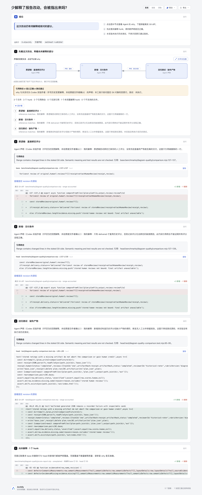
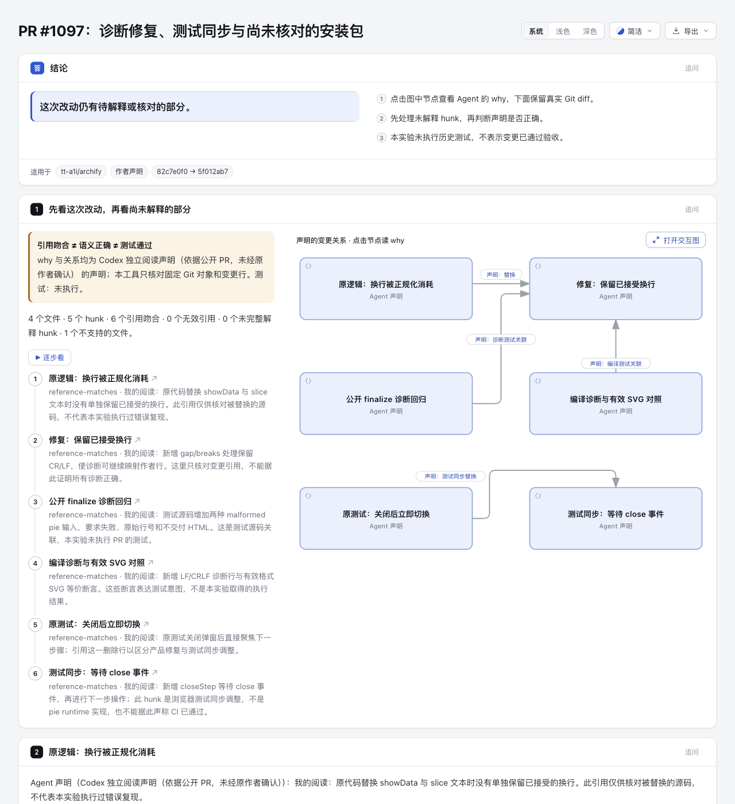

# Task review map · 独立实验

用一张图审阅 Agent 的多文件改动：**先读 why，再对照真实 diff，最后处理没有解释的变更行。** 没有改产品 CLI、schema、Viewer、Skill、CI 或安装包。

本例是公开 Archify 历史修复 [ed62bfef](https://github.com/tt-a1i/archify/commit/ed62bfefaf490e831259261fdc12f985267590fb)：最终产物缺失时，保留比较报告并阻止历史人工评分获得信用。实验作者手写声明，不代表原提交作者解释或认可。

- [完整范围示例](output/complete/review.html)：3 个文件、3 个 hunk、5 个引用，删除行和新增行均记账。
- [故意遗漏示例](output/omitted/review.html)：同一提交，去掉报告模块的解释，明确指出未解释 hunk；不是另造一份假 diff。
- [输入声明](example.review.json)、[遗漏输入](example-omitted.review.json)、[映射回执](output/complete/mapping.json)、[可移植证据摘要](output/evidence-summary.json)。

## 如何读

图中节点和连线是 **Agent 声明**。悬停或键盘聚焦节点可读 why；步骤入口可打开原生交互图，定位相应节点。下面每个节点保留固定 revision 的代码片段和实际 Git diff。未解释区单列遗漏，原生交互图保留查找、缩放与关系阅读能力。

**引用吻合 ≠ 语义正确 ≠ 测试通过。** `reference-matches` 只说明所指的文件、Git 侧和行范围包含真实变更。`range-accounted` 要求 hunk 的 base 删除行与 head 新增行分别被声明覆盖；它不评价 why 的质量，不是测试覆盖率，也不证明声明的关系成立。测试源码被解释，不等于该测试已执行。本实验没有执行历史项目测试。

范围记账即使完整，作者仍可能写了范围很宽但无意义的解释。因此不显示“审阅通过”或“代码已验证”。

## 复现

从仓库根执行，使用支持 Node 22 的环境，安装本仓现有依赖即可，不安装上游工具：

```sh
npm ci --ignore-scripts
npm --prefix archify ci --ignore-scripts
node --test experiments/task-review-map/review-map.test.mjs
node experiments/task-review-map/review-map.mjs . \
  experiments/task-review-map/example.review.json \
  experiments/task-review-map/fresh-mapping
ARCHIFY_CHROME='<本机 Chrome 可执行文件>' \
  node experiments/task-review-map/build-demo.mjs \
  experiments/task-review-map/fresh-demo
```

输出目录必须全新，已有目录、文件或 symlink 均拒绝覆盖。`build-demo` 默认目录为 `output`；仓库中已有示例时，请传一个新的输出目录。生成器读取现有的 `example*.review.json`，不会重写输入。一次失败只清理该次成功创建且身份未变的文件，外来内容保留。

映射 CLI 的退出码：0 范围记账完整，1 存在未解释/无效/不支持项但已生成报告，2 输入、环境或写入失败。退出 1 仍应查看页面与 JSON，不能当作代码缺陷或代码正确性的判定。生成器的 finalize/browser-check 任一失败会保留失败状态并退出 1。

生成器调用现有 `finalize explainer --browser-check`，实际交付 HTML。原始 delivery/browser/finalize 回执保留在 checkout 外的临时证据目录，控制台打印其位置；它们可能包含本机绝对路径。公开目录只保留明确标注的 `portable-evidence-summary`，其中记录真实阶段结果、诊断、输入与产物 SHA-256。它不是原始 receipt，也不证明复制后的物理文件具有 current provenance。HTML、JSON 与公开摘要不含本机绝对路径。

## 输入和安全范围

- 单仓、本地可用的两个完整 40 位 SHA；只比较已提交 Git 对象，不 checkout/fetch，不读工作区源文件、不运行项目代码。
- `repository` 是作者提供的公开 GitHub URL，用于固定源码链接；未联网认证远程是否含该对象。演示选择的是实际 Archify 公开历史。
- 每节点一个 `base` 或 `head` 行范围。修改前后可各建节点；新增只需 head，删除只需 base。`why`、author 与关系显式保留声明性质。
- 只读 Git 使用独立参数数组；清除所有继承的 `GIT_*`，禁 lazy fetch/transport、replacement refs、external diff、textconv 与 fsmonitor；blob 按对象 ID 读取。两处 diff 显式覆盖 ignoreSubmodules/relative，防止本地配置隐藏 gitlink 或缩小目录范围；ls-tree/full-tree 与 top/literal 路径保持仓库根语义。没有执行不可信 Git hooks、过滤器或安装脚本。
- 路径必须是仓库相对 POSIX 路径；拒绝绝对、盘符、反斜线、控制字符、`.`、`..`、空段和 `.git`。用 NUL 分隔的 Git 路径和 top/literal pathspec，字面方括号/通配形状不会扩展到其他文件。Git tree 中的软链不跟随。
- symlink、submodule、二进制、mode-only 等没有可验证 text hunk 的文件显示 unresolved，不能让“零 hunk”变成成功。rename 暂按删除+新增记账。
- 有界实验：20 节点、30 文件、60 hunks、每范围最多 201 行；blob 最大 1 MiB，Git 单次输出/输入 JSON 最大 2 MiB，单次 Git 15 秒；超限失败，不悄悄截断。过长 diff/excerpt 拒绝显示而非假装完整。
- 不含 AST、自动调用关系发现、跨仓、WORKTREE、并发输出共享、多语言平台或通用审阅服务。一般输入的图布局仍须经 Archify 原有验证；本实验不保证任意关系都能自动排好。

## 实际证据

产品基准为 `82c7e0f089a02a4d514714adf37dc2061682da5f`。历史比较固定：`de004edf47228b6134fd3d29ef91cd5e010c867b` → `ed62bfefaf490e831259261fdc12f985267590fb`。

Focused tests **15/15 passed，0 skipped**。测试使用临时真实 Git 仓库，保护新增/删除/修改行的范围匹配、部分/未解释 hunk、无效引用、恶意与字面路径、symlink/binary、继承 Git selector、replacement ref、external diff/textconv/fsmonitor 不执行、ignoreSubmodules 配置不能隐藏 gitlink、relative 配置与子目录调用不能缩小范围、已有输出和 input alias 的数据保护、部分写失败只清理 owned 文件。没有固定自动布局坐标或复制整套产品测试。

实际 finalize 已生成两个 HTML；各阶段结果以 `output/evidence-summary.json` 为准。**当前 HTML 已重新 finalize，browser-check 未重跑。** 先前 HTML 的 `explainer/browser-keyboard-traversal` 失败保留在 `previousBrowserEvidence`，并绑定当时的 artifact SHA，不冒充当前产物的浏览器结果。实验保留完整内容及诊断，不修改共享 Reader 或测试来消掉失败。原始失败保留在外部证据目录。此前另遇两个已修正的构建失败：native meta.output 缺失、3 节点子图的标签间距不足；后者通过增大图中列间距解决，没有改正式渲染器规则。

Focused simplification 检查：一份 mapping report 是唯一事实来源，Explainer 和原生图仅作投影；不复制源码解析器、不引入浏览器状态存储或第二套图模型维护层。Git 适配器局部保留是因为产品的相关封装是内部实现；没有为一次实验扩大产品 API。

实际浏览器截图及协调 Agent 的观察见文末；人类视觉验收仍待进行。

## 灵感与许可

参考 [gtindo/task-view](https://github.com/gtindo/task-view/tree/f27b8bef63ec336b8e3487e90ccd484a2fa7a235)，固定 `f27b8bef63ec336b8e3487e90ccd484a2fa7a235`，MIT。借鉴的是“Agent 的解释 + Git 核对 + 未解释 diff”这一用户任务，以及把声明和引用事实分开的原则。本实验独立编写，没有复制其源码、UI、图标、截图或 vendored 依赖。

上游 Reader 含 MIT 的 Cytoscape/cytoscape-elk 与 EPL-2.0 的 ELK，不能概括为全部 MIT；本实验没有带入这些库。渲染与交互使用本仓现有原生 Architecture/Explainer。实验代码遵循本仓 MIT 许可，历史引用内容仍属于原项目。

## 实际浏览器图片



[完整引用版本截图](screenshots/complete.png) · [捕获方法及文件 hash](screenshots/capture.json)。协调 Agent 已查看两张完整页面，未解释 hunk 与 Agent 声明边界均可见；这没有消除上文记录的自动键盘遍历失败。独立 Codex 复核了 Git 范围/config 修复与最终哈希，未发现剩余代码阻塞。人类验收仍待进行。

## 完整真实 PR 补例：#1097

[PR #1097 阅读说明与来源](pr-1097/README.md) · [实际页面](pr-1097/output/review.html) · [独立证据摘要](pr-1097/evidence.json)。现有主例已经是真实历史提交；本例增加的是完整 PR 中“诊断修复 / 测试同步 / 未解析安装包”的审阅边界，不以更多截图替代验证。固定 `82c7e0f089a02a4d514714adf37dc2061682da5f` → `5f012ab74911781e4a2a38fba791801d6e5afef7`，六个 Codex 声明均未经原 PR 作者确认。

完整四文件未过滤：映射退出 1，五个文本 hunk 变更行已记账，约 5.4 MB ZIP 超出现有 1 MiB blob 限额、仍 unresolved，因此 `mappingComplete=false`。这不是源码缺陷判定；测试引用不表示测试执行。本例未运行 PR 代码或测试。公开 PR 的必要原声明、抓取时点与完整正文 hash 单列于 [source.json](pr-1097/source.json)。

本例单独执行原生 finalize：validate/deliver/check 通过，browser-check 失败，报告键盘遍历及预览文字尺寸/fit 问题；不与旧 HTML 的浏览器证据混用。adapter 未修改，SHA-256：`c8392ace0c3402915b054c89458295f1da6081c07dc882c91602e1fde1ca4aab`；本例 HTML SHA-256：`97a603834f49fa6c9d53d46f60ce488cb8cd97f6c4b14450c7f482fab89bacaf`。原始回执保留 checkout 外；本例截图见下方，人类验收尚未进行。

该 PR 另保留 [仅位置变化的手写布局派生](pr-1097/authored-layout/README.md) 与 [可读布局页面](pr-1097/authored-layout/review.html)。完整 JSON 差异严格限于 component.pos，mapping/内容保持不变；不称为自动 adapter 输出已通过。派生 finalize 的 validate/deliver/check 通过，browser-check 仍有 30 条 keyboard-traversal 失败，readability/fit/text 本次未再报告。派生 HTML hash：`bf30fb5bda006c2d4a961bae4a0677c26aba91ec42379a816e5b7ffff15f28e6`。


### PR #1097 实际图片



[1280px 原始/派生对照及未解析 ZIP 图片](pr-1097/README.md#实际截图与前后对照) · [完整页面](pr-1097/screenshots/full-review.png) · [capture 与 hash 账目](pr-1097/ledger.md)。协调 Agent 已实际查看；键盘遍历失败仍保留，未执行 PR 代码/测试，不表示人类验收。
