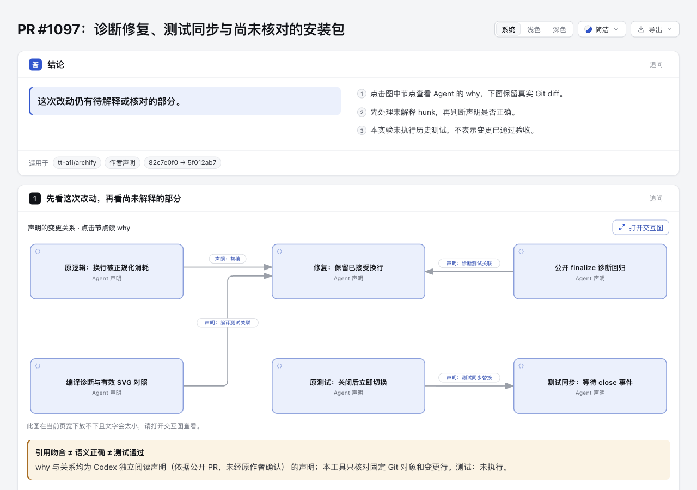
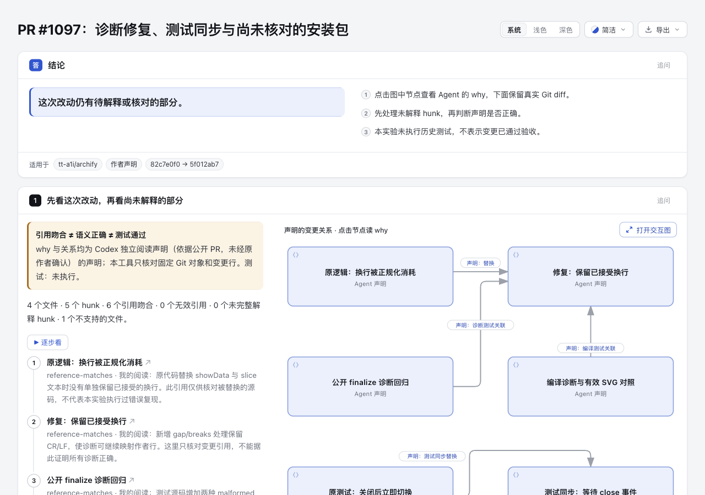
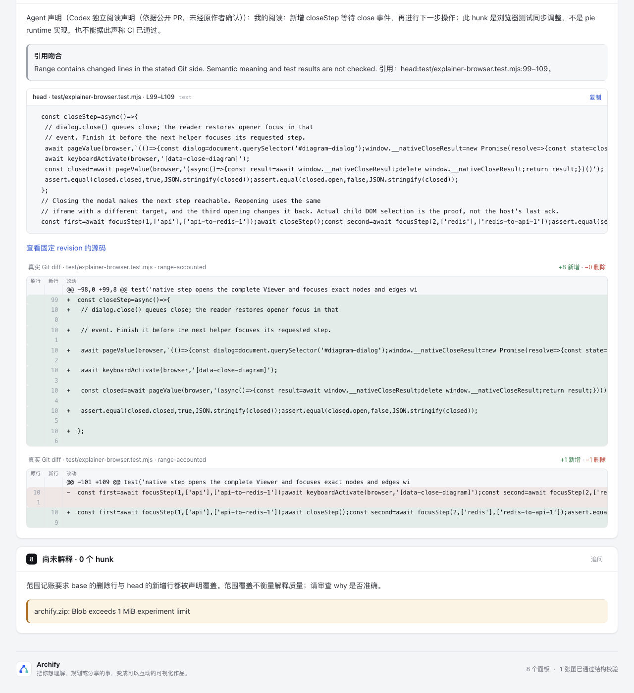

# PR #1097 · 完整真实 PR 的范围边界

[公开 PR](https://github.com/tt-a1i/archify/pull/1097) 固定比较 `82c7e0f089a02a4d514714adf37dc2061682da5f` → `5f012ab74911781e4a2a38fba791801d6e5afef7`。本例不是新增 parser 或审阅功能：复用原实验 adapter，将一个包含两种修改意图和安装包的真实 PR 全部交给它。

- [原始自动生成页面](output/review.html) · [六个独立 Codex 声明](review.json) · [实际映射](output/mapping.json)
- [公开来源与原声明](source.json) · [本例单独证据和 hash](evidence.json)

审阅问题是：哪些改动修复 pie 诊断，哪些只是浏览器测试同步，哪些仍需独立产物证据？图中 why/关系是 Codex 的阅读声明，未经原 PR 作者确认。`source.json` 单独保留 PR 正文的必要原始段落、抓取时点和完整 body 的 UTF-8 SHA-256；该原声明不能冒充本实验计算结论。

实际映射命令退出 **1**，报告成功写出：**4 文件、5 个文本 hunk、6 个引用吻合、0 无效引用、0 未完整解释 hunk、1 个 unresolved 文件**。所有文本变更行已记账与 `mappingComplete=false` 同时成立。它不表示源码有 bug，也不表示通过审阅。

`archify.zip` 两侧约 5.4 MB，超过现有 1 MiB blob 限额，真实原因是 `Blob exceeds 1 MiB experiment limit`。完整四文件范围没有过滤、截断或扩大限额。只记录包的 Git blob ID/大小，没有读出、解压、构建或验证包内容。不能将 ZIP 记为 pass。

## 输入和复现

Git 对象从公开仓库取得，保留原始 SHA；未 checkout、未重建提交、未运行 PR 的代码、测试、构建、hooks 或安装脚本。adapter 只读取独立临时裸仓里的 Git 对象。源代码中的测试断言只是被审阅的内容，`testExecution=not-run`；不复述原作者的测试声明为本实验执行结果。

在新建的临时目录中准备裸仓（这里的目录变量仅为示例）：

```sh
probe_dir=$(mktemp -d)
git init --bare "$probe_dir/objects.git"
git -C "$probe_dir/objects.git" -c core.hooksPath=/dev/null fetch --no-tags --depth=1 \
  https://github.com/tt-a1i/archify.git \
  82c7e0f089a02a4d514714adf37dc2061682da5f \
  5f012ab74911781e4a2a38fba791801d6e5afef7
git -C "$probe_dir/objects.git" rev-parse --verify '82c7e0f089a02a4d514714adf37dc2061682da5f^{commit}'
git -C "$probe_dir/objects.git" rev-parse --verify '5f012ab74911781e4a2a38fba791801d6e5afef7^{commit}'
node experiments/task-review-map/review-map.mjs "$probe_dir/objects.git" \
  experiments/task-review-map/pr-1097/review.json "$probe_dir/output"
```

最后一条命令应退出 1；它不是输入拒绝的退出 2。检查输出 JSON 后，可用本仓现有 `finalize explainer` 渲染 `$probe_dir/output/explainer.json`。输出目录必须全新。

## 证据边界

本例自己的原生渲染/finalize/browser 阶段与文件 hash 记录在 `evidence.json`，不复用根实验旧 HTML 的浏览器失败。原始回执在 checkout 外的临时目录，公开摘要不含本机路径。协调 Agent 已实际捕获并逐图查看下面的页面截图；截图不代表测试执行、原作者认可或人类验收。

本次实际结果：`validate/deliver/check=pass`，显式 `browser-check=fail`，finalize 退出 1。诊断包括键盘遍历，以及 1280 宽度原生预览文字 9.34px 低于 10px、diagram-fit/text。它们属于本例当前 HTML 的实际失败，不复用旧示例，也没有修改 adapter/布局策略绕过。HTML SHA-256：`97a603834f49fa6c9d53d46f60ce488cb8cd97f6c4b14450c7f482fab89bacaf`。

完整 finalize 回执包含 42 条诊断：keyboard-traversal 30、readability 4、diagram-fit 4、diagram-text 4；底层 browser 回执含 54 条（含其额外 readability 观测），分别为 30/16/4/4。两种层级计数单列，公开摘要未把只显示的 8 条当作全量。

## 仅本例的手写布局修订

[可读布局页面](authored-layout/review.html) · [精确位置差异与内容同一证明](authored-layout/layout-proof.json) · [布局说明](authored-layout/README.md)。这是同 mapping 后的手写两列布局，adapter 没有改；原始 output/ 与其失败全部保留。实际新 finalize 的 validate/deliver/check 通过；browser-check 仍失败，仅剩 keyboard-traversal 30 条，未再报告 readability/diagram-fit/diagram-text。没有删除控件来绕过失败。派生 HTML SHA-256：`bf30fb5bda006c2d4a961bae4a0677c26aba91ec42379a816e5b7ffff15f28e6`。

## 实际截图与前后对照

协调 Agent 在同一 1280px 宽度实际查看了原始与派生页面。新图中六个节点/步骤可读，未出现 fit 提示；底部仍显示 ZIP 超限。两组 capture 与文件 hash 见 [证据账目](ledger.md) 和 [portable 摘要](evidence.json)。浏览器键盘遍历失败仍保留，不由截图抵消。

| 原始自动布局 · 1280×900 | 仅位置变化的手写布局 · 1280×900 |
| --- | --- |
|  |  |




[派生完整页面截图](screenshots/full-review.png) · [原始完整页面截图](screenshots-before/review.png) · [派生 capture](screenshots/capture.json) · [原始 capture](screenshots-before/capture.json)。前后对照仅说明本例手写布局的阅读变化，不证明自动布局通用性或真实审阅收益。
