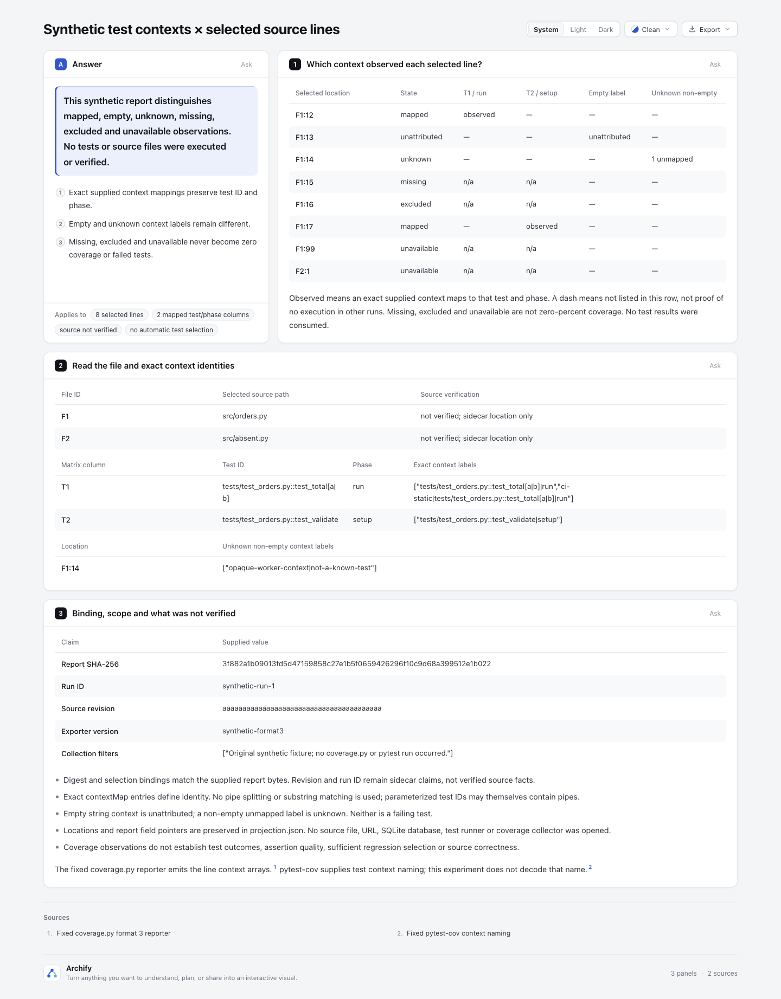
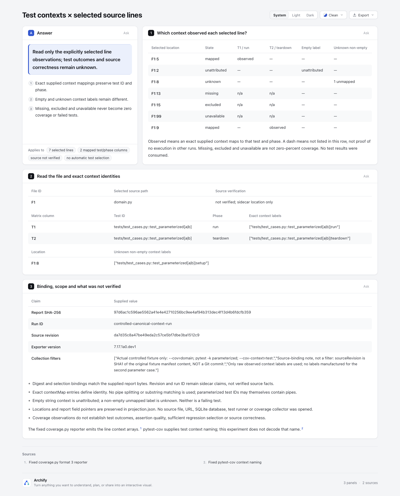

# 测试上下文 × 选择源码行：观测矩阵

这个离线实验读取**已有 coverage.py format 3 JSON 和显式选择 sidecar**，回答“这份运行记录中，哪些精确映射的 test/phase context 观测到了选中行”。它不运行 coverage/pytest、不读取 `.coverage` SQLite、不打开用户源文件或 URL，不从静态 imports 推测测试依赖，不自动选择或跳过测试。

原始示例为原创 **synthetic**：8 个显式选中位置、2 个 mapped test/phase 列，包含六类状态。新增 [measured 证据](measured/README.md)使用固定上游工具实际执行原创受控fixture后导出的报告；它仍不代表真实用户项目、源码位置验证或用户收益测量。

基准 `82c7e0f089a02a4d514714adf37dc2061682da5f`；分支 `codex/lab-test-context-map`。仅新增本目录，没有修改共享合同、renderer、Viewer、CI、ZIP 或 live installation。

## 查看

- [紧凑原生 Explainer 矩阵](output/matrix.html)
- [可选的文件/行位置 Tree](output/selection.html)：只表达所选位置的组成关系，不画调用、依赖或测试执行顺序。
- [安全观测投影](output/projection.json)、[Explainer JSON](output/matrix.explainer.json)、[Tree JSON](output/selection.tree.json)
- [测试记录](output/tests.tap)
- [可移植验证摘要](output/portable-validation.json)：明确是选取阶段结果和 hashes 后生成的 summary，**不是原始 Archify receipt**。

[实际浏览器矩阵截图](screenshots/matrix.png) 已由协调 agent 捕获并检查：概览矩阵、精确身份、binding 的布局可读，无巨大 JSON 卡片。[可选位置 Tree 截图](screenshots/selection-tree.png)也已捕获。此视觉检查与原始 finalize 的 browser-check not-run 分开记录。



## 实际采集补充



pytest记录两个参数用例都通过，但本次coverage只导出其中一个用例的context标签。矩阵保留实际标签，不补造第二个，也不消费测试结果；输入的白名单投影、工具版本和逐项变换见[采集说明](measured/README.md)。适配器源文件与原18项focused证据未变。独立代理核对了raw→公开字段、fixture/tool来源和最终生成输入及HTML摘要。

## 六类状态如何读

| 标记 | 提供的证据 | 不意味着什么 |
| --- | --- | --- |
| mapped | line 是 executed，且完整非空 label 在显式 map 中映到 testId/phase | 测试通过、断言充分、源码正确 |
| unattributed | executed line 的 label 数组含精确空字符串 `""` | 某个猜测的测试，或失败 |
| unknown | executed line 有非空 label，但没有精确映射 | 可以按名字或 pipe 猜出 testId |
| missing | line 在 `missing_lines` | 某个测试失败，或应该自动新增/选择某个测试 |
| excluded | line 在 `excluded_lines` | 覆盖率为 0%，或应归到 mapped 列 |
| unavailable | file 不在报告，或 line 不在三种 line set | 文件不存在，或基础设施/测试数量为0 |

**这是标签/证据分类，不是六种互斥的行状态。** 同一 executed line 可以同时含 mapped label、空 label 和未知非空 label，矩阵保留三个观察；missing/excluded/unavailable 则不归属测试列。空字符串 context 与空 label 数组不同：`[""]` 是有效 unattributed，executed line 的 `[]` 或缺 context key 在本实验中拒绝为归属证据不可用。

矩阵 `observed` 只表示该完整 label 映射到列中的 test/phase；`—` 是这行未列出该映射，不表示其他运行从未执行。`n/a` 保留 missing/excluded/unavailable 的边界。没有消费 test results，因此页面不给任何 test 贴 pass/fail。

一个参数化 testId 本身可含 pipe，例如 `test_total[a|b]`。本实验**不拆分 pipe、不做 substring 匹配**。多个完整 label（例如静态前缀加动态 label）可由明确 map 指向同一 testId/phase，矩阵聚合为一个列，同时投影保留全部原始 label；label 数量不是测试执行次数。

## 原格式与显式 sidecar

Fixture 的报告遵循固定 reporter 的实际结构：`meta.format=3`、`meta.show_contexts=true`、`files[path].executed_lines/missing_lines/excluded_lines/contexts`，line key 是字符串，label 值是数组。summary、functions/classes、branches 与 totals 不用于推导 test 归属或覆盖百分比。

[synthetic.selection.json](fixtures/synthetic.selection.json) 是**本实验自定义的 sidecar**，不是 coverage.py 原生导出格式：

- `reportBinding` 给报告 SHA-256、claimed runId/sourceRevision、exporterVersion 和 collectionFilters。
- `selectionBinding` 再指定选择所依据的 reportSha256/runId/sourceRevision。两个绑定必须一致，报告 digest 必须等于实际输入文件字节，版本必须等于 report.meta.version。digest/revision/run/version 不匹配时拒绝，不能靠布局继续产图。
- `fileMap` 是显式 reportPath → sourcePath 允许映射数组，`selections` 指定 sourcePath 与正整数行号。保留选择顺序，拒绝重复/冲突路径、重复行和未声明映射；不补充扫描源码。
- `contextMap` 是显式 `{context,testId,phase}` 条目数组，以便拒绝 duplicate/conflicting label。phase 只支持 setup/run/teardown；未知 phase 拒绝。没有映射的非空 label 仍显示 unknown。

coverage.py JSON **本身没有这个 source revision/run 绑定**。匹配的 sidecar 仍是使用者声明，不能证明报告真的采集于该 commit 或 run。本实验始终标 `source not verified`，不创建未经验证的 pinned 源码链接，也不把已提供路径当已验证源位置。

## 溯源与选择范围

投影的每行包含原 report SHA、reportPath、选中 sourcePath/line，以及两类独立来源定位：

- `contextLookupPointer/Path` 是上下文查找位置；`contextLookupPresent` 明确它是否存在。missing/excluded/不存在 file 的该 lookup 可以不存在，绝不伪装成已解析的证据。
- `classificationEvidence` 对 executed/missing/excluded 给真实数组元素的 JSON Pointer；对 unavailable file 标明 lookup 不存在，对 unavailable line 给三个已提供数组中均不含该行的查找记录。

例如 file key 中的 `/` 在 JSON Pointer 转义为 `~1`；另保留字段段数组以便精确核对。报告原始字节保存在用户输入位置，本实验分享的是选择投影，不是 round-trip 报告。投影记录报告文件数、选择文件/行数，未选择位置不自动纳入矩阵。

路径只作数据：所有文件 key/mapping/selection 必须是显式相对路径，拒绝绝对路径、URL、反斜线、空段、`.` 和 `..`。不会去打开 report/sidecar 指向的源文件。Tree 使用 F1/F2 与行号，完整 sourcePath 在矩阵身份表中，均标未验证；它不是模块依赖图。

## 官方一手来源与许可

- coverage.py format 3 reporter：[jsonreport.py](https://github.com/coveragepy/coveragepy/blob/0e4f752b455bbf26fdad32ac29948d067c87dd62/coverage/jsonreport.py)，固定 commit `0e4f752b455bbf26fdad32ac29948d067c87dd62`，Apache-2.0。已核对 show_contexts 时才写 contexts_by_lineno。
- 行集合语义同版本 [results.py](https://github.com/coveragepy/coveragepy/blob/0e4f752b455bbf26fdad32ac29948d067c87dd62/coverage/results.py) 与 [parser.py](https://github.com/coveragepy/coveragepy/blob/0e4f752b455bbf26fdad32ac29948d067c87dd62/coverage/parser.py)：Python reporter 的 statements 排除了 excluded，missing 来自 statements minus executed。
- pytest-cov [TestContextPlugin](https://github.com/pytest-dev/pytest-cov/blob/a8cb1260170754f2aff9022cfd252c488098e813/src/pytest_cov/plugin.py) 与 [contexts.rst](https://github.com/pytest-dev/pytest-cov/blob/a8cb1260170754f2aff9022cfd252c488098e813/docs/contexts.rst)，固定 commit `a8cb1260170754f2aff9022cfd252c488098e813`，MIT。它记录 nodeid 加阶段；参数化标识须完整保留。本实验只消费明确 map，不执行 plugin 或移植命名解码。

没有复制 Python 运行实现或引入 collector/test-impact 数据库；适配器独立编写，Archify 原有许可见根 LICENSE。fixture.meta.version 为 `synthetic-format3`，不声称由某个真实 coverage 版本生成。

## 复现

从仓库根用 Node 22 执行。本次 Node 22，依赖仅现有项目依赖，lockfile 未改：

```sh
npm ci --ignore-scripts
npm --prefix archify ci --ignore-scripts
node --test experiments/test-context-map/adapter.test.mjs
node experiments/test-context-map/build.mjs
```

每次 build 使用全新 `run-<UUID>/`，依次运行适配器、公共 `render tree --quality standard`、公共 `finalize explainer`。原始 delivery/finalize receipts 与命令日志留在 checkout 外临时目录；终端打印其路径，不改写或伪装原收据。当前 `output/` 是成功 fresh-run 的字节相同分享副本，portable summary 记录真实命令、阶段与 hash，不重新绑定原收据。

读取自己的已有报告与 sidecar：

```sh
node experiments/test-context-map/adapter.mjs report.json selection-sidecar.json new-output-directory
node archify/bin/archify.mjs render tree new-output-directory/selection.tree.json new-output-directory/selection.html --quality standard
node archify/bin/archify.mjs finalize explainer new-output-directory/matrix.explainer.json new-output-directory/matrix.html --json
```

这些命令不执行 pytest/coverage、不读 SQLite、不读用户源码或用户 URL。手动 finalize 的 receipts 可含本机路径，分享时应另作明确标记的 portable summary。

## 有界输入与安全显示

- 只接受 format 3 和 show_contexts=true；每个报告 file 都要求 contexts 对象，executed 行须有非空 label 数组。line sets 重叠、重复、非法行号、missing line 却有 observed labels 拒绝。excluded 的 raw context 可存在，但不算进 test 归属；未分类行即使有 raw context，也保留 unavailable。
- 最多50个报告 file，10个 file 映射，10个 contextMap 条目，20个选中位置，选中 executed 行最多10种完整 label。超限明确拒绝，不静默截断。sidecar 的选择数组/映射数组重复会拒绝；普通 JSON 对象重复 key 仍沿用 JSON.parse 的最后值语义，没有另造 JSON parser。
- 报告最多500000字节、sidecar最多100000字节；CLI 有界读取并拒绝非法 UTF-8、非普通输入文件和非法 JSON。字符串有长度限制并拒绝无法忠实显示的控制字符/孤立代理项。map/test/phase 身份不作 trim 或规范化猜测。
- 所有用户 metadata 进入 comparison cell 前逐字符转义 inline 语言特殊符号，不形成 Markdown 链接、图片、HTML 或 directive。未读取/复制报告里的 source text、环境、任意日志和摘要内容。metadata 本身仍可能识别测试或项目；这不是通用匿名化器。
- 输出目录必须不存在；文件 `wx` 独占创建。既有目录和 symlink 拒绝，避免覆写无关 victim。三个 JSON 文件不是单一原子事务，磁盘失败可能留下当次目录的部分输出；HTML 交付继续使用既有 Archify gates。

## 实际验证与限制

18/18 focused tests 通过，0 skipped。保护六类状态、同一行三种 observed 分类共存、含 pipe 参数化 ID、不拆 static/dynamic label、exact mapping 聚合、缺 contexts 拒绝、contradictory sets、digest/revision/run/version mismatch、duplicate mapping/selection、源位置不升级 verified、真实字段定位与 unavailable lookup。

真实公共 renderer 验证恶意 testId/context 与 sourcePath 中的 HTML/Markdown 字面符号：最终 cell 原文保留，没有攻击者链接、图片或 script。没有 mapped 或 unknown 列时也真实渲染，不留 schema 不允许的空 comparison。publication 期间禁止 readFileSync/fetch 的 probe 仍能正常生成，另有绝对路径/URL/traversal 拒绝测试；source key 不会触发外读。fresh-output symlink/victim 和 CLI malformed/oversize 输入拒绝均通过。

原始 synthetic 与新增 measured 产物的 Tree render / Explainer finalize 阶段结果分别保存在各自摘要中；browser-check 未请求，原始 visualReview 为 not-requested。measured 补充有固定工具实际执行及 raw→公开字段的独立核对；适配器仍不消费测试结果或验证源码位置。观察关系不能变成充分测试集合、执行次数、通过率或正确性结论。实际用户读图收益未测量。

按 test-value 保持测试围绕本地适配器语义和实际公共输出；没有改 shared runtime，因此未重复全套 Windows、安装、CI 或完整 renderer suite。独立 reviewer 提醒后已明确“行可多观察”与“context lookup 可能不存在”，并用 classificationEvidence 单独定位状态来源；没有把该澄清冒充真实源码验证。

## 实际产物图片


[可选位置 Tree 图片](screenshots/selection-tree.png)只展示选中位置层级；主阅读入口是上面的矩阵。协调 agent 检查了实际布局，未进行用户效率研究。

AI 协助：Codex / gpt-6.1-sol 负责调研、实现、独立审查与截图；人类代码和视觉验收仍待进行。
