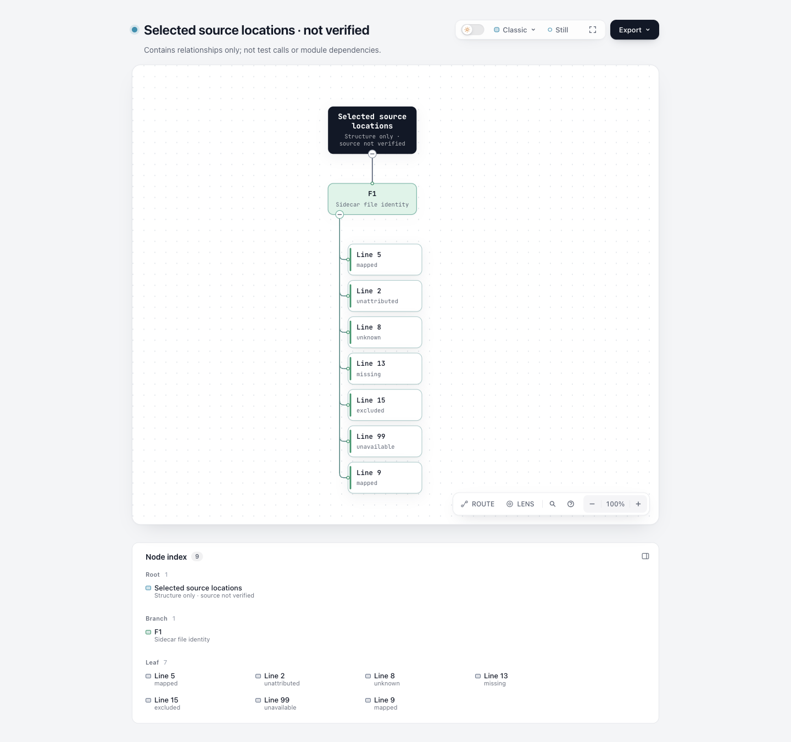

# 实际上游运行证据：context × 选择源码行

这次补充验证固定 coverage.py/pytest-cov 实际导出的 format 3 contexts，不再仅靠外层手写形状 fixture。

- [实际观察矩阵](observations/matrix.html)
- [可选位置 Tree](observations/selection.html)
- [白名单输入与逐项变换](projection-transforms.json)
- [上游执行观察](execution-observations.json)

context reader 的受支持标签是 `kind=provided-report`；sidecar 另外声明 lab classification 为 redacted，来源 manifest 明确它是 actual-run consumed-field projection。没有把真实采集观察标成 synthetic，也没有新增或放宽 reader 合同。

**sourceRevision 不是 Git commit。** 原创 fixture 是临时文件，没有创建提交。这里按既有40字符字段合同使用原始 fixture-source-manifest.json 字节的 SHA-1内容 token，只作为 sidecar assertion。sidecar、页面的采集说明、toolchain manifest 都写明其含义；业务源位置仍为 not-verified。逐文件 SHA-256 才是原始代码快照的直接核对依据。

显式选择了7个位置。line5/run、line9/teardown 的完整 label 映到带 pipe 的参数化 nodeid；line8 的真实 setup label **有意未列入精确 map**，所以显示 unknown，不能据此说测试身份或阶段真的未知。line2 是真实空 context，line13 reported missing，line15 excluded，line99 不在报告分类集合而 unavailable。没有手填新的 coverage 观察，也没有按 pipe 猜 testId。context reader 不消费旁边的实际测试结果，因此矩阵不展示 pass/fail。

## 这是什么证据

这些是**实际执行的原创受控 fixture** 的上游导出，不是手填观测形状，也不是真实用户项目或用户收益验证。Python fixture 只做纯计算，并明确设计了 setup、call、teardown、collection 故意失败场景。它没有网络、业务数据或外部服务操作。

原始 JSON 包含 root/environment 和绝对路径，只保留在临时采集目录。这里的输入明确标为 **actual-run consumed-field projection**：白名单保留现有 reader 消费的字段，删除环境/日志/时长等字段，并只在 failure 输入中把本次受控 fixture 的绝对前缀归一为同一个相对文件名。没有制造、排序或改写 outcome、阶段、行号或 context label。

- `projection-transforms.json` 逐项列出删除的 subtree、路径归一化、原 raw SHA-256 和公开输入 SHA-256。归一化路径另有原路径字符串 hash，原字符串留在 raw。
- `toolchain-provenance.json`、`package-artifacts.json` 固定工具版本、源码 commit、archive/wheel hashes，以及实际安装关键源码文件与上游原文的逐字节 hash 对照。
- `fixture-source-manifest.json` 记录原创 fixture 每个文件的 SHA-256；`controlled-fixture/` 是对应代码快照，不包含临时 cache、SQLite 或 venv。
- `actual-commands.json` 保留真正执行的 argv 和 exitcode，只将采集目录替换为 `<CAPTURE_DIR>`。`execution-observations.json` 是原 pytest JSON 中 nodeid、总 outcome、各阶段 outcome 的明确选择，不冒充原始 JSON。
- `reader-provenance.json` 固定本次使用的既有 reader 文件 SHA。没有为接受这些记录放宽 reader 的输入合同，也没有手改生成 Markdown/JSON 来绕过合同。

## 固定上游工具与许可

| 工具 | 实际安装版本 | 固定来源 | 许可 |
| --- | --- | --- | --- |
| pytest | 8.4.2 | [bfae4224fd554d3d7f2c277a4cc092b6ec6af3ae](https://github.com/pytest-dev/pytest/tree/bfae4224fd554d3d7f2c277a4cc092b6ec6af3ae)；wheel hash 在 package-artifacts | MIT |
| pytest-json-report | 1.5.0 | [c6f0bc93a174770e04b965e459d339a880005e78](https://github.com/numirias/pytest-json-report/tree/c6f0bc93a174770e04b965e459d339a880005e78) | MIT |
| pytest-cov | 7.1.0 | [a8cb1260170754f2aff9022cfd252c488098e813](https://github.com/pytest-dev/pytest-cov/tree/a8cb1260170754f2aff9022cfd252c488098e813) | MIT |
| coverage.py | 7.17.1a0.dev1 | [0e4f752b455bbf26fdad32ac29948d067c87dd62](https://github.com/coveragepy/coveragepy/tree/0e4f752b455bbf26fdad32ac29948d067c87dd62) | Apache-2.0 |

解释器为现有 Python 3.14.8，所有包仅装在新建的隔离 venv。coverage 的开发版本来自本次调研固定的 commit，没有替换成其他版本。实际安装的 jsonreport.py、pytest_cov/plugin.py、pytest_jsonreport/plugin.py、_pytest/main.py 均与固定官方源码逐字节匹配；完整工具链 provenance 包含相应 hash。原创 fixture 按本仓库 MIT 许可提供；没有打包第三方运行时或包源码。

## 实际执行与不隐藏的失败

| 捕获场景 | 上游 pytest exitcode | 实际记录 |
| --- | --- | --- |
| canonical-context | 0 | 2 个参数化用例 reported passed，另3个用例被本次 `-k parameterized` 排除 |
| canonical-phase-failures | 1 | setup 故意失败、call 故意失败、teardown 故意失败；总计2 error和1 failed |
| canonical-collection-failure | 2 | 导入原创 collection fixture 时故意抛出 RuntimeError，tests 数组为空、collector failed |

exit 1/2 是保留的原始故意失败，不是“测试全通过”。后面的 Archify render/finalize 通过，只证明既有 reader 接受了相应投影并完成图文交付。

初次以 macOS `/tmp` 别名作为 cwd/rootdir 时，pytest nodeid 丢了文件前缀，collector 出现重复空 ID。该反例与日志仍保留在临时目录。随后只改为 canonical 采集目录/rootdir 重新执行同一固定工具链，得到完整路径；没有修改上游源码或 reader 来硬接别名异常输入。

还观察到一个边界：原 pytest JSON 报告两个参数用例都 passed，但 coverage JSON 的 context labels 只出现 `a|b` 用例。原因未定位；没有补造第二个 context，也不能把未列 label 当作第二个用例没执行。此证据只覆盖实际导出的记录，不证明采集完整性。

## 隔离重放

从本仓库根，用 Python 3.14.8 显式运行本目录 `reproduce.py`。脚本会新建临时目录和 venv，校验只包含原始 allowlist fixture 文件且 hash 未变、拒绝 symlink/额外文件，安装固定上游源码/版本，禁自动加载其他 pytest plugin，明确 rootdir/config/cwd，只收集复制到临时目录的原始 fixture。不会安装到全局、不运行用户项目，也不自动修改当前公开输入或产物。

脚本将每条命令的 stdout/stderr/exitcode 和 raw JSON 写到新临时目录；expected 0/1/2 不匹配就停止。它还检查安装关键源码的 SHA 与本证据相符。这里只做了脚本语法与静态范围核对；本次实际采集执行的是 `actual-commands.json` 对应命令，不宣称这个后来整理的重放 wrapper 也已重跑。

这不是全环境或 bit-for-bit 复现保证：宿主系统、构建依赖、地址和时间戳可变化，raw JSON hash 自然会不同；重放必须重新保留其实际 raw/projection hashes。不能拿新的 raw 套用本次旧 sidecar digest。

## 范围与验证

本目录保存新增的实跑证据，既有 context reader 的输入合同未修改；配套 failure reader 的措辞修正和旧例再生在其单独分支记录。独立 reviewer 已逐字段核对 consumed projection 与原 raw、所有删除/路径变换、raw/projected SHA、源码与工具版本、fixture hash 和真实 exitcodes。图文由现有 reader 原生生成，没有后处理生成的 MD/JSON。

每个输出目录的 `portable-validation.json` 明确是选择阶段结果与 hash 后生成的摘要，不是重写的原始 receipt；原始 Archify receipts 与日志留在临时目录。自动 browser-check 没有请求；截图由协调 agent 后续统一捕获，不能把它标作自动 gate 通过。真实用户项目适用性、读图收益、业务源码位置与测试充分性均未验证。

重放采集：

```sh
python3 experiments/test-context-map/measured/reproduce.py
```

重读本次公开 consumed-field 输入（目标目录必须不存在）：

```sh
node experiments/test-context-map/adapter.mjs experiments/test-context-map/measured/inputs/contexts.consumed.json experiments/test-context-map/measured/inputs/contexts.sidecar.json /tmp/context-measured-fresh
node archify/bin/archify.mjs finalize explainer /tmp/context-measured-fresh/matrix.explainer.json /tmp/context-measured-fresh/matrix.html --json
```

该矩阵不代表全部测试集合、不自动选择回归测试、不将 empty/unknown/missing/excluded/unavailable 归为覆盖0%。同一行可有 mapped、empty 和 unknown 的多种观察，不能把六类标记说成互斥的行状态。

实际浏览器截图已由协调 agent 捕获并查看；[capture.json](screenshots/capture.json)绑定图片与HTML。自动browser-check仍未请求。



