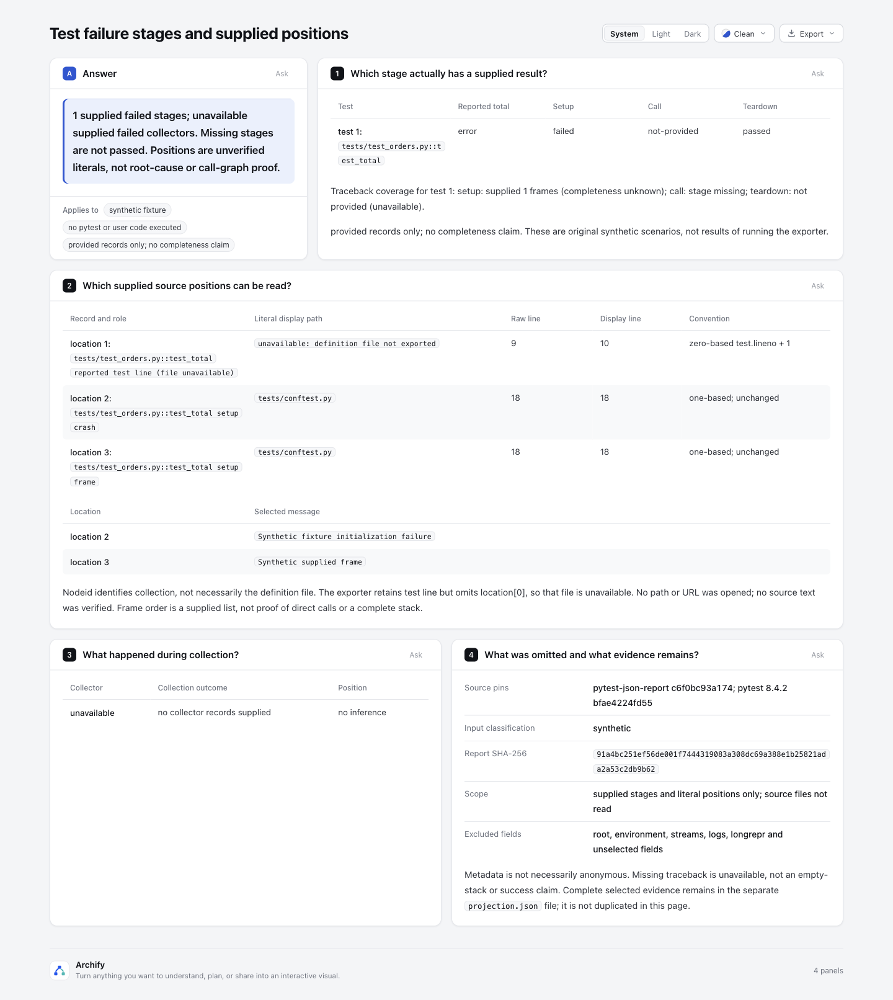
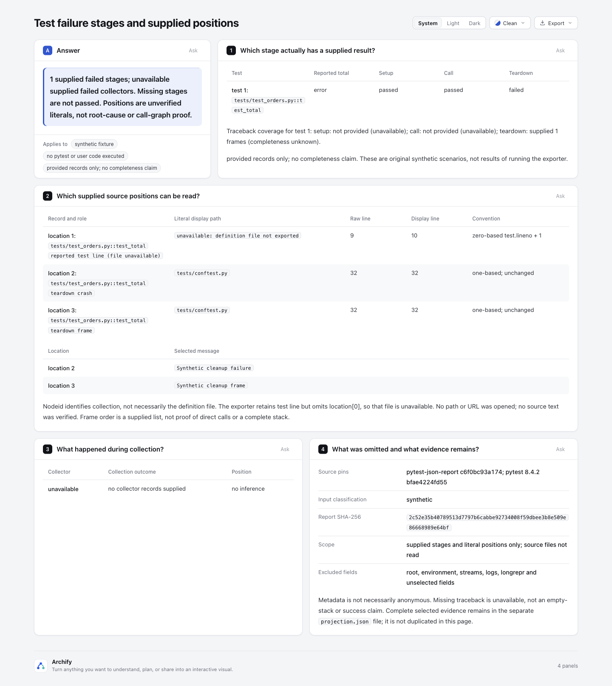

# Pytest failure stages and supplied source positions

Read an explicitly provided pytest-json-report JSON plus sidecar. The first panels show a compact setup/call/teardown overview and literal source-location table. A passed call does not conceal a failed teardown; setup failure does not turn a missing call into passed. Collection failures stay separate from test cases.

Base: `82c7e0f089a02a4d514714adf37dc2061682da5f`. Branch: `codex/lab-test-failure-map`. Node: 22.23.3. Only `experiments/test-failure-map/` changes; no shared renderer/schema/Viewer/CI/package/ZIP modification, installation or new runtime dependency.

## Fixed sources, licenses and line conventions

- [pytest-json-report serializer](https://github.com/numirias/pytest-json-report/blob/c6f0bc93a174770e04b965e459d339a880005e78/pytest_jsonreport/serialize.py), fixed commit `c6f0bc93a174770e04b965e459d339a880005e78`. [MIT](https://github.com/numirias/pytest-json-report/blob/c6f0bc93a174770e04b965e459d339a880005e78/LICENSE), retained in `fixtures/EXPORTER-LICENSE`. `make_testitem` copies `location[1]`; `make_fileloc` copies ReprFileLocation path/lineno/message without decrementing. Collection records provide longrepr but no structured crash/traceback.
- [pytest 8.4.2 TestReport source](https://github.com/pytest-dev/pytest/blob/bfae4224fd554d3d7f2c277a4cc092b6ec6af3ae/src/_pytest/reports.py#L290), fixed commit `bfae4224fd554d3d7f2c277a4cc092b6ec6af3ae`, explicitly documents test location as zero-based.
- [pytest traceback construction](https://github.com/pytest-dev/pytest/blob/bfae4224fd554d3d7f2c277a4cc092b6ec6af3ae/src/_pytest/_code/code.py#L1093) creates ReprFileLocation with `entry.lineno + 1`; crash construction also uses `lineno + 1`. [MIT](https://github.com/pytest-dev/pytest/blob/bfae4224fd554d3d7f2c277a4cc092b6ec6af3ae/LICENSE), retained in `fixtures/PYTEST-LICENSE`.

No upstream code was copied or executed. All four report fixtures are **original synthetic examples**, not outputs of running pytest or the exporter. The version pins identify the source conventions used to construct/read them, not a claim that those versions executed successfully here.

## Four scenarios

| Original synthetic scenario | Key evidence | Delivered page |
| --- | --- | --- |
| setup failure | reported test line raw 9 → display 10; definition file unavailable; crash/frame raw 18 → display 18; call not-provided | `evidence-setup/failure.html` |
| teardown failure | call passed and teardown failed remain separate | `evidence-teardown/failure.html` |
| collection only | failed collector; no fabricated test/stage or source position | `evidence-collection/failure.html` |
| omitted traceback | supplied crash remains visible; detailed frames unavailable, not empty or passed | `evidence-omitted/failure.html` |

No native Tree is added: the phase/location tables communicate this slice without inviting the reader to mistake containment/frame order for direct calls. There is no root-cause classifier or complete dynamic call graph.

## Narrow input and safety contract

The CLI reads only the **two explicit filenames** passed to it. It never opens a test definition path, frame/crash path, URL, repository, source map, home directory, test cache or session database. No pytest, user code, shell commands from reports or upstream tools are executed.

Sidecar version 1 requires `classification: synthetic|redacted`, the supported exporter commit, pytest 8.4.2, exact raw report SHA-256, `pathMap`, traceback coverage (`provided|omitted|unknown`) and explicit `showMessages` boolean. A label of redacted is supplied metadata, **not an anonymization guarantee**. The `pathMap` maps exact raw report paths to distinct safe relative display paths; it authorizes a display name, not filesystem access. Collected nodeid paths without mapping fail; non-allowlisted crash/frame paths show unavailable, and their original strings are not copied into output.

Test nodeids must be explicit unique strings. Repeated nodeids could represent retries, so this version refuses to merge them. Supported total outcomes: passed/failed/skipped/error. Supported stage outcomes: passed/failed/skipped. Unknown phase shapes, malformed line numbers, unsafe paths, provenance/hash conflicts and passed-total plus supplied failed-stage conflicts fail. A failed/skipped setup with a supplied call, or a non-failed stage carrying failure locations, is also rejected in this narrow supported slice. A failed total without a supplied failed stage remains a reported total with phase details unavailable, never an invented assertion failure.

Reported test `lineno` must be a safe nonnegative integer whose +1 is also exact. The exporter does not retain `location[0]`, so the definition file is unavailable. A collected `nodeid` file may differ from the actual definition file, for example an inherited test method defined in another module. The nodeid path is used only for collected identity; it is never paired with `lineno` as a definition-file position. Crash/frame records do supply their own paths: those positive one-based lines stay unchanged. Every displayed position is labeled **unverified literal**. The reader has neither verified source text nor manufactured pinned-source links.

Missing setup/call/teardown means not-provided. Missing traceback means unavailable; a sidecar-declared omission is explicitly different from an actually supplied empty array. Empty arrays still do not establish complete stack coverage. `traceback: omitted` plus actual supplied frame array is a conflict. Summary-only reports yield unavailable failure counts (`null`) and never “no failures.” Collection-only reports leave test phase counts unavailable.

Budgets: at most 20 tests, 20 collectors and 50 supplied frames. Exceeding a budget requires explicit selection outside this reader; there is no silent truncation. Unknown/unselected fields are omitted and counted at report/test/stage/collector levels; counts do not claim to enumerate every nested dropped field.

## What is excluded from shareable output

Root, environment, stdout, stderr, logs, longrepr, duration, summary and unknown fields are not copied into generated Markdown/JSON/HTML. This intentionally omits raw exception/log payloads rather than trying to redact arbitrary secrets. Crash/frame messages appear only when the sidecar explicitly enables them. Test IDs, selected messages and mapped relative paths can still identify a project or person; review those metadata before publishing.

Values use existing inline-code/JSON-literal rendering. Delimiter-heavy, multiline, control-character or long values are deferred to selected JSON evidence rather than interpreted as Markdown/HTML/directives. The full raw report is not embedded in delivered output. The main HTML ends with compact source pins, classification, report SHA and omitted-field boundaries; it does not duplicate the full projection JSON. Traceback availability and selected messages stay readable beside the overview/location tables. Only delimiter-heavy or long table values get a small literal-detail block. This is a projection, not a lossless exporter round trip.

Complete selected projections remain separate and unchanged by the compact presentation: [Setup](evidence-setup/projection.json), [Teardown](evidence-teardown/projection.json), [Collection](evidence-collection/projection.json), [Omitted traceback](evidence-omitted/projection.json).

Output must be a fresh directory. Exclusive mkdir and `wx` file creation reject existing outputs, symlinks and input aliases. Later-output failures remove only inode-matched files created by this invocation; unrelated victim files survive. This is not a power-loss transaction.

## Reproduce

From repository root, use new output directories:

```sh
/opt/homebrew/opt/node@22/bin/node --test experiments/test-failure-map/report-reader.test.mjs
/opt/homebrew/opt/node@22/bin/node experiments/test-failure-map/report-reader.mjs experiments/test-failure-map/fixtures/setup-failure.report.json experiments/test-failure-map/fixtures/setup-failure.sidecar.json experiments/test-failure-map/repro-setup
/opt/homebrew/opt/node@22/bin/node archify/bin/archify.mjs finalize explainer experiments/test-failure-map/repro-setup/failure.archify.md experiments/test-failure-map/repro-setup/failure.html --browser-check --json
```

Repeat with `teardown-failure`, `collection-only` and `omitted-traceback` report/sidecar pairs. The sidecar SHA-256 binds the original report bytes. Changing even whitespace requires a new explicit digest.

## Actual evidence and limits

- Focused tests: **10 pass, 0 fail, 0 skip** (`tests.tap`). They protect both line conventions, phase separation, collection-only/summary-only/omission distinctions, malformed/conflicting input, default field exclusion, hostile literals through public Explainer rendering, victim/rollback safety and real CLI hash failure.
- All four final pages actually use public `finalize explainer --browser-check`. Each portable summary records actual stage results, source/HTML SHA-256 and bytes. Original receipts contain local paths and are kept outside checkout; summaries are clearly labeled transcriptions, not original unredacted receipts.
- Actual hash-conflict input exits nonzero and creates no output directory (`hash-conflict.failure.json`). An initial hostile-literal render test exposed duplicate auto-generated table row IDs when several long identities used the same placeholder. Fixed row ordinals retain distinct positions; the earlier failed TAP is retained outside checkout, while current tests pass.
- Independent review corrected an initial field-pairing mistake: the prototype had combined collected nodeid path with report.lineno as a test definition location. Fixed output explicitly leaves the definition file unavailable; an inherited-method counterexample now protects that distinction. All four pages and final portable summaries were regenerated.
- The original finalize summaries retain `visualReview: not-requested`. The parent agent separately captured and inspected all four final pages; [capture.json](screenshots/capture.json) binds each image to its HTML. Human acceptance remains pending. Browser checks do not prove that any test was fixed or that the supplied run data are genuine.

This demonstrates a narrow handoff aid. Real-value validation still needs an explicitly provided, reviewed, safe report from an actual failed test handoff; synthetic examples do not establish saved diagnosis time or improved test quality.

## Actual artifact images

| Setup failed; call not supplied | Call passed; teardown failed |
| --- | --- |
|  |  |

[Collection-only image](screenshots/collection.png) · [Omitted traceback image](screenshots/omitted.png)

The final layout keeps the reading tables and provenance concise. The first
full-JSON presentation was inspected and replaced; complete selected projections
remain separate and unchanged. These are actual browser captures, not mockups.

AI assistance: Codex / gpt-6.1-sol implemented, independently reviewed and
captured this experiment. Human code and visual acceptance remain pending.
