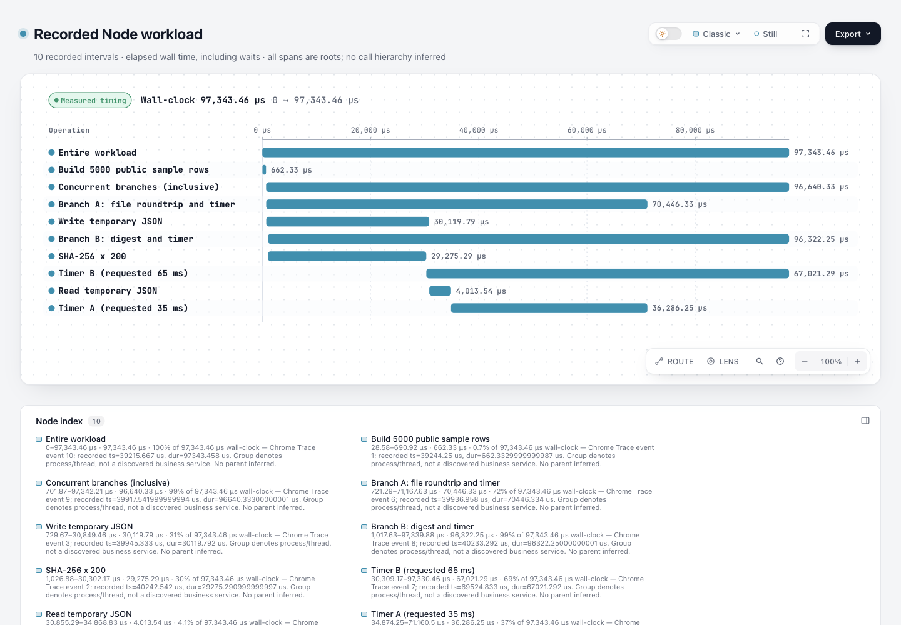

# Chrome Trace 完整事件 → Archify Waterfall 实验

本实验把已有 Chrome Trace `ph:"X"` 完整事件转换为现有 native Waterfall。示例来自运行本目录原创 Node workload 时的真实测量：10 个操作区间、11 个输入事件（另一个为线程名称 metadata）。时间不是手写数值，也不是请求 timer 的等待参数。它演示如何分享一次小执行的耗时与并发，不是新的 profiler、observability 平台或完整 Chrome Trace importer。

基线：`82c7e0f089a02a4d514714adf37dc2061682da5f`，分支 `codex/lab-trace-waterfall`。只新增本目录，不改 renderer、Viewer、CI、schema 或发布 ZIP；没有新增 runtime 依赖。独立实验的授权来自当前维护者会话；不表示已合入、发布、安装或获得实际用户认可。

## 看什么

- [workload.html](workload.html)：已生成的原生独立 HTML。
- [workload.trace.json](workload.trace.json)：原始测量，含 collector 的时间源、版本和范围。
- [workload.waterfall.json](workload.waterfall.json)：`schema_version:1` typed JSON，`meta.evidence:"measured"`。
- [import report](workload.waterfall.json.import-report.json)：原始文件摘要、计数、origin、unsupported phases、限制。
- [portable evidence summary](evidence-summary.json)：**从本机原始 receipts 派生的可公开摘要，不是原始 receipt**，记录命令、最终文件 hash 和阶段结果；原始 receipts 保留在 checkout 外供协调人复核。
- [tests.tap](tests.tap)：9 passed、0 failed、0 skipped。

截图：协调 Agent 已生成 [workload.png](screenshots/workload.png)，并报告图完整可读。截图与感知判断来自协调 Agent，本实现任务没有独立复审该图片；它不证明文件写入安全。更多主题或截图可由协调人补充。



截图的 viewport、产物与图片 hash 见 [capture.json](screenshots/capture.json)。独立 Codex 复核另外检查了全部 10 条 X 事件与输出的名称、顺序、origin、start、duration，以及 9 项测试；未发现阻止作为受限实验审查的问题。人类审阅仍待进行。

## 真实采集范围

`collect-workload.mjs` 是本实验原创程序，只操作它自己创建的临时目录：生成 5000 条公共样例行、写入/读回 JSON、做 200 次 SHA-256、启动两个并发异步分支及 35/65 ms timer，然后删除临时文件。不会运行外部项目、读取用户文件或连接网络。

每个显式包裹操作的开始/结束都读 `performance.now() * 1000`。输出 `ts` 与 `dur` 均为**进程相对微秒**，`dur = end - start`，不是 Unix epoch。collector 写 Chrome 格式 `X`，不是声称 Node 内置 trace 自动采到了整个运行时。`pid = process.pid`，`tid = worker_threads.threadId`；此次所有操作都属于真实 main event loop 的 tid 0，异步操作在同线程上也可以重叠。

计时是 elapsed wall time，包含 I/O、timer、调度和程序受到的系统竞争。父摘要区间和内层操作都保留为 root，读者不可相加当 CPU 时间。一次采集无法证明固定耗时、吞吐、速度提升、跨机器稳定性或生产性能。采集器不记录 CPU 栈、V8 GC、内核调度、网络请求或自动调用树。

本次采集时间及 Node 版本保存在 trace 和摘要中；实际使用 Node `v22.23.3`。另用独立 Python 检查逐一比对了 10 条输出：名称、原始 duration、公共 origin 后的 start 全部一致，最终 HTML/typed JSON 的 SHA256 与 finalize 对应。

## 转换边界

- 接受裸事件数组或 `{traceEvents:[...]}`；仅 `X` 生成 span。其他每种 `ph` 都以计数列在 `unsupportedPhases`，包括可用于线程命名的 `M`。只有 B/E 等记录时明确失败，不凭空匹配、估计或吞掉它们。
- `name` 必须非空，`pid/tid` 必须非空字符串或非负安全整数。`ts/dur` 必须有限、非负、在安全数值范围内；缺失或非法值拒绝整个输入。文件不带 provenance 时，调用者必须显式选择 `measured` 或 `illustrative`；converter 不会相信 JSON 自己写的 evidence。
- 全部使用 `us`，共同减去最早 X 的 `ts`。按开始时间排序，同刻按原记录顺序。事件名重复也有不同 span ID。线程组在 `service` 中显示 pid/tid 和可选名称；这只是进程/线程分组，不是服务拓扑发现。
- 不从时间包含或重叠推导 parent。即使严格嵌套，也保持 root；不推出 dependency、critical path、等待原因、成功/失败或 Sequence 请求/返回消息。
- 上限：2 MiB 输入文件、1000 条输入 event、60 条 X span。超过即失败，不截断，不自动选最长事件。文件增长期间也使用有界读取。这些是实验控制范围，尚无大规模性能验证。
- 不收 protobuf、compressed trace、OTLP、Jaeger 内部 JSON、B/E 配对、async/flow/counter 或 sampled stack；不宣称全面兼容 Chrome、Perfetto、Node 内置 tracing、VizTracer 或 Bazel。
- 输出须使用新路径；collector 和 importer 都以 exclusive-create 拒绝已有文件、input alias 及 symlink（包括 dangling symlink）。importer 若第二个文件创建失败，仅清理本次创建且仍匹配 dev/inode 的文件，不删除替代物。这不是并发对抗环境中的跨文件事务；不要在输出目录同时修改这些路径。

## 复现

从 repository root，用 Node 22。本机实际使用 `/opt/homebrew/opt/node@22/bin/node`；下列命令的 `node` 应指向你的对应 runtime。collector 和 importer 只使用 Node 标准库，不需要安装陌生工具或运行安装脚本。

```sh
node --test experiments/trace-waterfall/import-trace.test.mjs
mkdir experiments/trace-waterfall/repro-run
node experiments/trace-waterfall/collect-workload.mjs experiments/trace-waterfall/repro-run/raw.json
node experiments/trace-waterfall/import-trace.mjs experiments/trace-waterfall/repro-run/raw.json experiments/trace-waterfall/repro-run/input.waterfall.json measured
node archify/bin/archify.mjs render waterfall experiments/trace-waterfall/repro-run/input.waterfall.json experiments/trace-waterfall/repro-run/output.html
ARCHIFY_CHROME="<your Chrome executable>" node archify/bin/archify.mjs finalize waterfall experiments/trace-waterfall/repro-run/input.waterfall.json experiments/trace-waterfall/repro-run/output.html --json --receipt experiments/trace-waterfall/repro-run/finalize.json
```

重复采集使用另一个新目录，保留每次实际数值，不要求随机机器复现相同 duration。`meta.output` 是相对路径；render/finalize 的输出路径以命令为准。原始 receipt 可能包含本机绝对路径，公开前移至 checkout 外并另写明确标注的派生摘要，不能冒充未改过的原始 receipt。HTML 本次检查未含本机 `/Users/` 或 `/private/` 路径。

## 验证结果与未测范围

本次执行 `node --test`：9/9 通过，0 跳过。测试用明确标为 illustrative 的小 JSON，保护共同原点与 duration、零时长、重叠不造 parent、跨 pid/tid 分组、metadata 与 unsupported 计数、非法时间/结构、强制 evidence 选择、文件/event/span 上限、CLI 失败和目的文件保留。真实临时 victim 文件另验证 collector 对 symlink 的拒绝、converter 的 existing/input alias/dangling symlink 保护及部分失败清理。断言用户可见的输入/输出契约，不冻结布局像素。

公共 `render` 已运行；最终 `finalize` quality 为 showcase，`validate / deliver / check / browser-check` 全 pass。browser-check 真实启动本机 Chrome，非 skipped。行序改为按开始时间后，首次重跑曾拒绝绑定旧 HTML 的 browser evidence；该失败及旧 receipt 已保留在 checkout 外。移开旧证据后，最终组合完整重跑成功，摘要 hash 绑定当前 HTML。

没有改共享 renderer，所以不重复完整仓库测试或 unrelated generated/ZIP 检查；没有运行生产输入、真实 Chrome DevTools 导出、VizTracer/Bazel 格式验收、其他操作系统、其他 Node 版本或大 trace 压力测试。感知审阅状态按协调 Agent 的截图记录单独判断。输出安全补强后 HTML/typed JSON 未改变，保留其 hash 对应的原 finalize 证据，并重跑最终源码的 9 个测试。此结果仅证明上述 X 子集与原创采集路径，不等于一般 profiler 或全部格式的支持。

## 一手来源与许可

本目录代码为原创，随仓库 MIT 许可；没有复制上游实现、UI 或 trace fixture。借鉴的是公开数据格式和可复现证据的呈现方式。

- [Perfetto external formats](https://github.com/google/perfetto/blob/a39834aa20faca91179990afaff9c8551f6305a3/docs/getting-started/other-formats.md)：格式参考固定到本次核对的 commit；[官方网页](https://perfetto.dev/docs/getting-started/other-formats) 描述 Chrome JSON 字段、微秒 `ts`、X/B/E 等 phase；[该 revision LICENSE](https://github.com/google/perfetto/blob/a39834aa20faca91179990afaff9c8551f6305a3/LICENSE) 为 Apache-2.0。Perfetto 的原生 protobuf 和 JSON best-effort 兼容边界不由本实验实现。
- [Node 22 tracing 文档固定来源](https://github.com/nodejs/node/blob/e29aa496472073e1582fb360e1e575f29b5eedc2/doc/api/tracing.md)：说明内置 trace event 的微秒时间戳；[performance API](https://github.com/nodejs/node/blob/e29aa496472073e1582fb360e1e575f29b5eedc2/doc/api/perf_hooks.md) 为 collector 的计时依据；[该 revision LICENSE](https://github.com/nodejs/node/blob/e29aa496472073e1582fb360e1e575f29b5eedc2/LICENSE) 包含 MIT 主许可及第三方 notices。文档 revision 与实际运行二进制版本分别记录，未声称两者为相同 source build。
- 当前仓库 [`waterfall.schema.json`](../../archify/schemas/waterfall.schema.json)、[renderer contract](../../archify/renderers/waterfall/README.md) 为输出契约；现有 [PR #1028](https://github.com/tt-a1i/archify/pull/1028) 和 [#1030](https://github.com/tt-a1i/archify/pull/1030) 的 timing/legend 工作不在本实验修改范围；[Tracks #730](https://github.com/tt-a1i/archify/pull/730) 也不是本实验的依赖。

按 `archify-review` 判断：价值是把一次真实记录变成可分享解释，成本集中在输入边界和 provenance，影响限定为新实验 script 与已有 Waterfall 的组合。下一步应先看真实截图是否清晰、有无阅读收益；没有实际需求和多来源 fixture 前，不提升为公共核心 import 命令。
