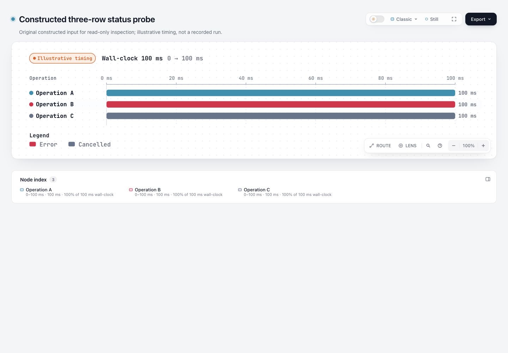
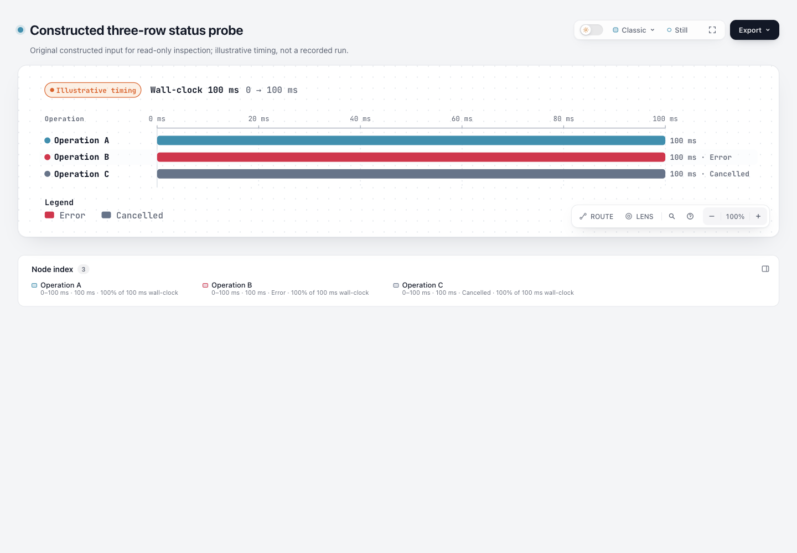

# Waterfall: supplied Error and Cancelled statuses become readable per row

Before — original illustrative status probe:



After — supplied Error and Cancelled words are visible beside their rows:



Explicit `status: error` and `status: cancelled` now append the existing localized status word to the row's duration label. The same label already feeds the semantic sublabel, so the visible row, SVG accessible text and existing Passport/Outline/Finder metadata projections receive the supplied fact. A palette kind such as Security or External is not used as the textual status.

Base: `82c7e0f089a02a4d514714adf37dc2061682da5f`; branch `codex/lab-waterfall-status`. Product change: only `archify/renderers/waterfall/render-waterfall.mjs` plus its existing focused tests and refreshed `archify.zip`. No Viewer, schema, locale, Skill rule or version change.

## Constructed counterexample, not a recorded incident

[Input](input.waterfall.json) is an original **illustrative constructed** probe: three neutral Operation A/B/C labels, equal 0–100 ms timing, and explicit ok/error/cancelled status. It is not a natural user failure, a newly measured workload, or evidence that any operation actually ran.

Root's [baseline observation](screenshots-base/observation.json) shows why the slice is useful: the global legend named Error/Cancelled, but the relevant SVG node names/descriptions and Passport row detail did not. A Security/External palette kind did not resolve which supplied status a row had.

- Input SHA: `891141aa7a0d304d0ebd64f396e7c0444cd82f0a9054351103026ea2af3e047b`.
- [Base](base.html) SHA: `608f95e84821e36e24016edccf1c447c0bdd3c7251dbd39578b0174c93a28cf2`.
- [Candidate](candidate.html) SHA: `045a99d1e92eb6fa9bd6c0ffbea1ead07b3eb94499f134389db3c1f3524493da`.

[Binding evidence](evidence/binding-summary.json) verifies unchanged start/end/duration/status attributes for all three spans. The duration and wall-clock shares remain 100 ms / 100%; this percentage is time share, not success rate. The added text is measured before after-bar canvas space is reserved: the constructed canvas width changes from 1035 to 1114, so **pixel/layout identity is not claimed for status-bearing input**.

The root-frozen base uses standard quality and finalized candidate uses showcase. A direct current standard-profile render also gives width 1114 and the same timing/status attributes; quality metadata is not mistaken for the status change. Re-emitting with the candidate's matching showcase profile is byte-identical to the captured candidate.

## Small implementation and preserved contracts

The existing duration/incomplete expression remains intact as `durationLabel`. Only explicit error/cancelled obtains `i18nText(locale, 'legend.waterfall.<status>')`; it is appended to `label` before existing `labelWidth` measurement. The existing timing → semantic sublabel path is reused. Names, authored detail, timing data, percentages, service/context and parent relationships are not inferred or replaced.

Unprovided status and explicit ok keep their original labels. Incomplete remains on its existing branch: no-end means an open lower bound; an incomplete span with a recorded end keeps its existing recorded-end behavior. The status palette and global legend are unchanged. This experiment does not address issue #1022 or open PR #1030's incomplete-legend scope.

Both checked-in public Waterfall examples have no error/cancelled statuses. Fresh current renders match the base tracked and development golden HTML **byte for byte** ([actual comparison](evidence/unchanged-examples.json)), including their geometry:

- checkout-request: `1e83c9acdaf3ca9849fde8361225674769787dd4bcb2af3c8d2fddd3fe817a34`.
- example-rebuild: `4dc89cfefc54305319f42db08c7f89a40db7f844e311510bb711ab6e3f5eb149`.

These unaffected outputs were not regenerated into changed files. Viewer/templates, other diagram types and unrelated gallery/site outputs were not rebuilt.

## Actual browser observations

Root used its existing browser space at 1440×1000 and inspected the actual candidate:

- [AX nodes](screenshots/ax.json) and [observations](screenshots/observation.json): Operation B's name/description includes Error; Operation C includes Cancelled. Operation A remains the same as the baseline, and timing/share values remain unchanged.
- [Error Passport](screenshots/op_b.png) and [Cancelled Passport](screenshots/op_c.png): the correct supplied status is visible in row detail before truncation, separately from the existing palette-kind badge.
- [Light overview](screenshots/overview.png) and [dark overview](screenshots/overview-dark.png): after-bar status words are visibly complete. Root clicked the existing theme toggle and recorded actual `data-theme=dark`, then viewed the dark image.

[Capture file bindings](evidence/capture-summary.json) record actual image/JSON hashes and dimensions alongside the unchanged input/artifact hashes. Images prove visible text in the captured state; AX JSON provides the accessible-tree evidence. This is Chromium AX and coordinator visual inspection, not VoiceOver/NVDA, cross-AT, spoken output, human acceptance or usability improvement. A first screenshot command had a require/top-level-await syntax error before browser dispatch; the recorded ESM retry produced these actual captures. The failed command is not a product failure or successful capture.

The unchanged Viewer receives the new semantic sublabel. This does not independently add a Finder button description API or import another experiment's Viewer changes.

## Provenance and license

The trigger is root's constructed legal input. No external implementation or asset was copied. Existing contracts come from the repository at the fixed base: [Waterfall schema/status](https://github.com/tt-a1i/archify/blob/82c7e0f089a02a4d514714adf37dc2061682da5f/archify/schemas/waterfall.schema.json), [existing renderer](https://github.com/tt-a1i/archify/blob/82c7e0f089a02a4d514714adf37dc2061682da5f/archify/renderers/waterfall/render-waterfall.mjs), [English status words](https://github.com/tt-a1i/archify/blob/82c7e0f089a02a4d514714adf37dc2061682da5f/archify/locales/en.json) and [Chinese status words](https://github.com/tt-a1i/archify/blob/82c7e0f089a02a4d514714adf37dc2061682da5f/archify/locales/zh-CN.json), under the repository's [MIT license](https://github.com/tt-a1i/archify/blob/82c7e0f089a02a4d514714adf37dc2061682da5f/LICENSE).

## Reproduce and scope evidence

From repository root with Node 22:

```sh
node scripts/run-tests.mjs --require-files test/waterfall-rendering.test.mjs test/core-smoke.test.mjs
node archify/bin/archify.mjs finalize waterfall experiments/waterfall-status/input.waterfall.json experiments/waterfall-status/repro.html --json
node archify/bin/archify.mjs finalize waterfall experiments/waterfall-status/fixtures/localized.waterfall.json experiments/waterfall-status/repro-localized.html --json
```

- Final focused/core run: **34 pass, 0 fail, 0 skip** (15 Waterfall cases and 19 core checks). New assertions protect visible and semantic status text, unchanged numeric timing/share, unprovided/ok, English/Chinese words, literal long non-ASCII names and open/recorded-end incomplete boundaries. They do not freeze canvas coordinates.
- [Localized constructed page](localized.html) separately uses zh-CN status words and non-ASCII operation names. It is another illustrative fixture, not an upstream run or an AT acceptance claim. Both candidate and localized pages actually passed public finalize validate/deliver/check/browser-check.
- Original delivery/finalize/browser receipts contain local paths and remain outside checkout. [Candidate portable summary](evidence/candidate.portable-summary.json) and [localized portable summary](evidence/localized.portable-summary.json) are clearly labeled transcriptions, not original receipts. `visualReview: not-requested` belongs to those automated runs, separate from root's later captures.
- Canonical ZIP built twice using official **Node 22.23.2 / bundled zlib 1.3.1-e00f703**. Both builds match checked-in `archify.zip`, its renderer matches current source, all member CRCs validate, and experiments are excluded. Exact extracted archive package smoke passes on macOS ([ZIP evidence](evidence/zip-summary.json)).
- [Checks and coverage](evidence/checks-summary.json) record actual scope. No complete-repository/Windows/cross-AT suite, release or live installation occurred.

**Generation benchmark justified exemption:** this is a maintainer-scoped renderer-local exposure of explicit existing status, with no Agent generation or Skill-rule change. Two existing public no-status examples are byte-identical; constructed status cases demonstrate that supplied facts become readable. They do not establish real-Agent authoring benefit, better generation accuracy or saved authoring time. No unrelated benchmark or full-repository test expansion is warranted by this slice.
