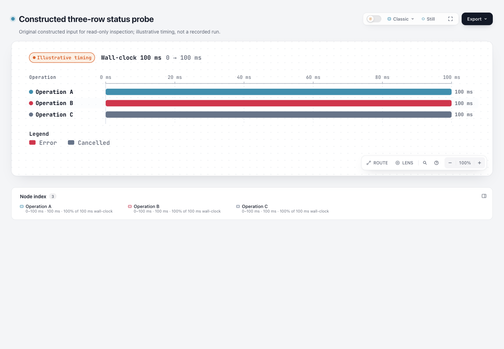
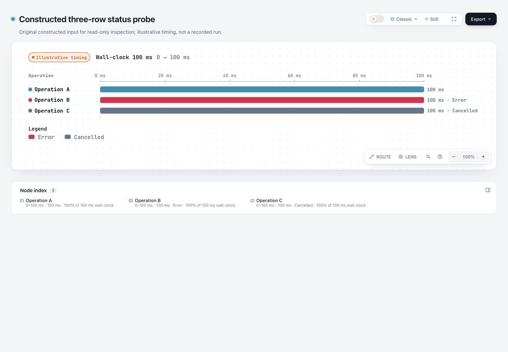

# Supplied Waterfall status text on dev 10b4

This refresh merges fixed GitHub dev [`10b4dd5c5f2264baa315ee65a9b4cc23c13ea5f0`](https://github.com/tt-a1i/archify/commit/10b4dd5c5f2264baa315ee65a9b4cc23c13ea5f0) into the existing `codex/lab-waterfall-status` candidate, previously `e20acd6d6c0083f6b6ddecaf7bb250becfbca228`. The old experiment's input, HTML, screenshots and evidence retain their historical bytes and identity. The parent README only gains a refresh entry.

Open the new [base](base.html) and [candidate](candidate.html). Both use the identical complete [input](input.waterfall.json), 815 bytes, SHA-256 `891141aa7a0d304d0ebd64f396e7c0444cd82f0a9054351103026ea2af3e047b`, and the same **standard** quality profile. This remains the original **constructed illustrative** three-row counterexample, not a recorded operation, natural incident or real workload.

| Fixed dev · light | Refreshed candidate · light |
| --- | --- |
|  |  |

[Base dark](screenshots/base-dark.png) · [candidate dark](screenshots/candidate-dark.png) · [base Operation B Passport](screenshots/base-op_b.png) · [candidate Error Passport](screenshots/candidate-op_b.png) · [candidate Cancelled Passport](screenshots/candidate-op_c.png).

The coordinating agent captured and viewed all seven original PNGs at 1440×1000. [Capture summary](screenshots/capture-summary.json) binds the actual input/HTML, PNG bytes and dimensions, original DOM records and native AX snapshot files. Base row text lacks the supplied statuses; candidate row labels show Error/Cancelled. The statuses also appear before the Passport's existing ellipsis. **Complete visibility of its wall-clock tail is not claimed**: DOM `innerText` can include text clipped on screen.

Actual DOM `aria-label` and sublabel records are distinguished from native AX snapshot text. The latter includes status-bearing duration text in the candidate; it is not a spoken screen-reader transcript, VoiceOver/NVDA acceptance or human review. An initial driver query used `aria-label` for a region actually named through `aria-labelledby`, returned null, and was corrected before the final Passport captures. That driver mistake is preserved in the raw bindings and is not a product failure.

## The same narrow repair still has value

New dev retained global Error/Cancelled legend words and color tones, but still omitted the explicit status from each row's readable duration label. The candidate appends the existing localized Error/Cancelled word before the established label-width measurement. The same label already feeds semantic sublabels, so no Viewer state, new accessibility mechanism, locale key or schema is added. New dev's layout-json stdout-drain fix remains intact.

Operation A (`ok`) remains unchanged. Operation B/C retain start 0, end/duration 100 ms and 100% of the same 100 ms wall clock; the percentage is time share, not success rate. Labels become `100 ms · Error` and `100 ms · Cancelled`. [comparison.json](comparison.json) records actual layout output and semantic attributes. Its DOM evidence is not mislabeled actual AX evidence.

The canvas grows from width **1035 to 1114** to reserve the added text. Bar/tick timing coordinates and open-state semantics remain equal; no claim is made that every pixel or the complete layout is identical for status-bearing input. Empty/missing status, explicit `ok`, and open or recorded-end `incomplete` behavior remain unchanged. This refresh does not address #1022 / #1030's incomplete-legend scope.

## Unaffected public examples and generated scope

Both existing public Waterfall examples contain no error/cancelled status. Fresh base and candidate renders at matching standard quality are byte-identical. Tracked dev examples use showcase: two actual candidate renders with that matching profile are also byte-identical to tracked dev. The standard-versus-tracked difference is only the profile attribute; it is not attributed to status text. [unchanged-examples.json](unchanged-examples.json) records these distinct hashes.

No example, gallery or template rebuild was retained: new dev's generated files remain intact. Viewer, brand-mark, validator and release-identity freshness checks passed. The renderer-local source patch is still the original duration-label change; the existing three status behavior tests remain unchanged. No coordinate golden, new framework or new product feature was added.

## Actual scoped results

- On archived fixed dev, the same existing explicit-error/cancelled regression **fails** for missing status text: 0 passed, 1 failed, 0 skipped. The temporary base tree only receives that existing test file; its product source is unchanged.
- Waterfall **15** cases and core **19** checks passed. The combined first invocation also selected generated SVG/XML, whose module could not start because this local worktree lacked the already available `saxes` dependency. That first result is retained as **34 passed / 1 failed**; it is not rewritten as a clean run.
- Reusing the existing local dependency without installation or lockfile edits, only the failed XML file was rerun: **3 passed, 0 failed, 0 skipped**. This is two runs, not a fabricated single 37-test passing run.
- The existing tests cover visible/semantic words, numeric timing/share, English/Chinese localization, literal long non-ASCII labels, absent/ok status and open/recorded-end incomplete boundaries. They do not freeze canvas coordinates.
- Candidate public finalize explicitly ran browser-check: validate/deliver/check/browser-check all passed, zero diagnostics, and the screenshot-ready HTML hash stayed unchanged. [Selected fields](candidate-finalize-summary.json) are derived; original receipts remain outside checkout.

The ZIP conflict was resolved by normal final-source builds, not by taking the old binary. Canonical **Node 22.23.2 / bundled zlib 1.3.1-e00f703** double builds are byte-identical. The 235-entry archive has valid CRCs; compared member by member to fixed dev, **only `archify/renderers/waterfall/render-waterfall.mjs` differs**, and that member exactly matches source. All other packaged behavior, new dev's Apache-2.0 license and retained notices remain intact. [ZIP summary](zip-summary.json) records this check. Actual [exact-archive finalize](archive-finalize-summary.json) also passed four stages, and its emitted HTML is byte-identical to the public candidate.

The historical MIT reference in the old README belongs to its pinned 82c7 source. This refreshed candidate follows the new software base's Apache-2.0 license and retained notices; no outside implementation or asset was copied.

## Reproduce and interpret

From the repository root with existing dependencies and Node 22:

```sh
node scripts/run-tests.mjs --require-files test/waterfall-rendering.test.mjs \
  test/core-smoke.test.mjs test/generated-artifact-xml.test.mjs
node archify/bin/archify.mjs render waterfall \
  experiments/waterfall-status/refresh-dev-10b4/input.waterfall.json '<fresh-output.html>' --quality standard
node archify/bin/archify.mjs finalize waterfall \
  experiments/waterfall-status/refresh-dev-10b4/input.waterfall.json '<fresh-output.html>' \
  --quality standard --browser-check --json --receipt '<raw-receipt.json>' --out-dir '<raw-checks>'
```

[checks-summary.json](checks-summary.json) preserves failures, coverage and historical identities; [binding-summary.json](binding-summary.json) binds the final public files and source/test/ZIP. These are explicitly derived records, not raw receipts with local paths removed. No full-repository, Windows, cross-AT, live installation, release or upstream execution is claimed. Successful dev CI is not assigned to this experiment candidate.

The existing generation-benchmark exemption still applies: this is a maintainer-scoped renderer repair exposing explicitly supplied facts. The two public no-status examples remain byte-identical under matching profiles, while the constructed counterexample establishes the text difference. It does not establish real-Agent authoring benefit, operation success or user-efficiency improvement.
