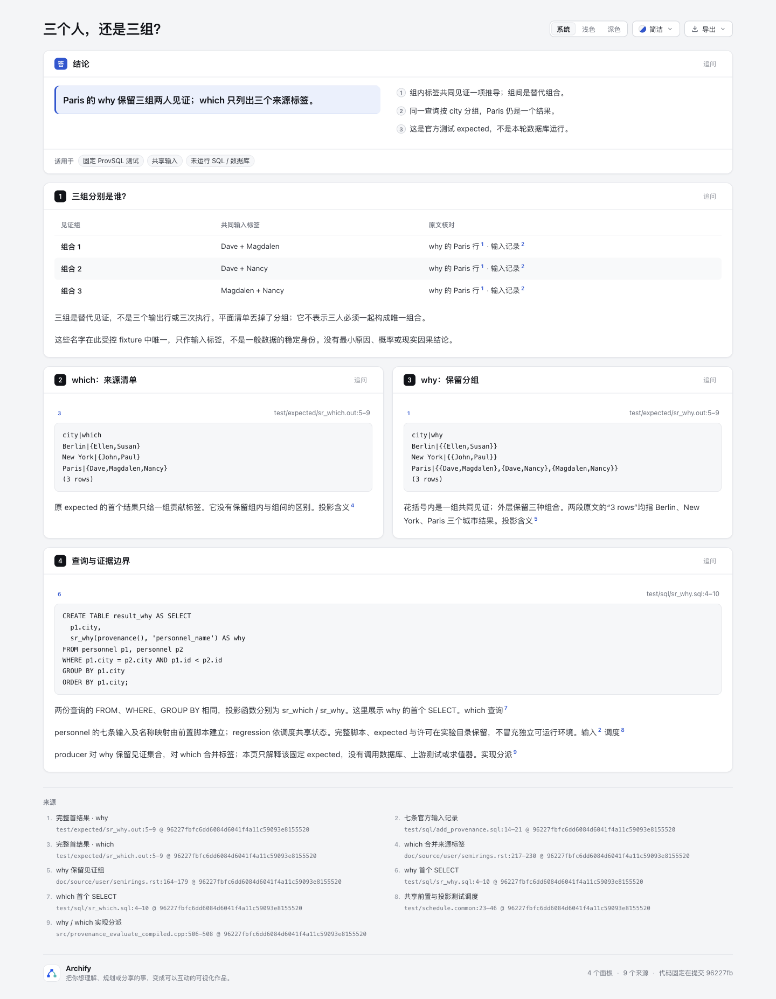
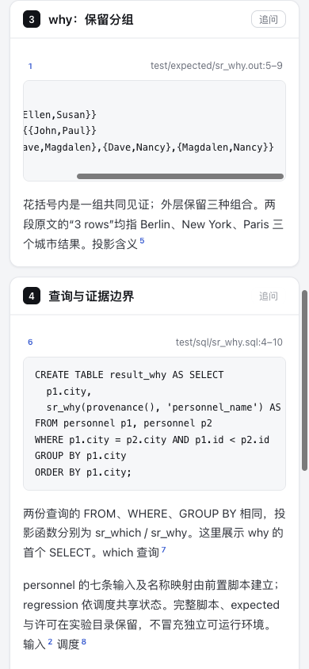

# 三个人，还是三组？

[中文解释页](explainer.html) · [作者输入](explainer.json) · [固定事实](facts.json) · [来源审计](audit-result.json)

同一份 ProvSQL 官方 expected 中，Paris 的 which 是 `{Dave,Magdalen,Nancy}`；why 则保留三组：`{Dave,Magdalen}`、`{Dave,Nancy}`、`{Magdalen,Nancy}`。**组内是共同见证，组间是替代组合。** 平面来源清单没有保留这些分组。

这是固定测试材料的内容阅读，不是新 SQL/血缘工具、产品缺陷修复或本轮数据库运行。三组不表示三行输出、三次执行、耗时、概率或现实因果；两份首 expected 各自的 `(3 rows)` 指 Berlin、New York、Paris 三个城市结果。名字在这个 fixture 中唯一，不是可推广的数据稳定身份，也没有最小原因或反事实删除执行结论。

## 完整来源与共享状态

固定上游 [PierreSenellart/provsql@96227fbfc6dd6084d6041f4a11c59093e8155520](https://github.com/PierreSenellart/provsql/tree/96227fbfc6dd6084d6041f4a11c59093e8155520)，完整 [MIT LICENSE](upstream/LICENSE) 与16份完整原文件的 Git blob/SHA-256/bytes 见 [source-manifest.json](source-manifest.json)。归属见 [NOTICE](NOTICE.md)。文件由固定 Git 对象读取，未 checkout 或执行其中程序；保留原字节与原末尾换行。

- `test/sql/add_provenance.sql` 创建共享 personnel，插入七条受控输入并建立名称映射；本页三条 Paris 标签来自原第17、19、20行。
- `sr_which.sql`、`sr_why.sql` 的首查询均以同 city、`p1.id < p2.id` 自连接，再按 city 分组。投影函数不同，完整脚本还含 structured leaf / 底值等其他测试；本页只聚焦首结果，不删改完整原件或混入后续输出。
- `test/schedule.common` 和 `Makefile.internal` 记录 pg_regress 的共享前置。setup、add/remove provenance、映射等脚本均保留，但它们不是完整独立数据库环境；没有复现整次 suite 或猜测所有共享状态。
- SQL wrapper 与 compiled evaluator 分派到 `Why.h` / `Which.h`。why 保存见证集合的集合，which 合并贡献标签。本页不引入 evaluator，也不把另一项目的 minimal-support 简化套到这个 producer 上。

四个面板先列三组、再并排放两份完整首结果与原 SELECT。只用现有 Explainer 表格、code 和固定来源引用；没有 Workflow、Dataflow、parser、数据库连接、运行器或后处理 HTML。与普通列血缘不同，本例保留的是一项结果的替代 tuple 组合，而非列名依赖、查询计划或行数性能。内容有独立教育问题，阅读收益尚未测量。

## 实际交付与审计

软件基线为 Archify `10b4dd5c5f2264baa315ee65a9b4cc23c13ea5f0`；官方 Node `22.23.2`。首次正常 `finalize explainer --quality standard` 的 validate、deliver、check 三阶段通过，零诊断；browser-check **未请求**，visualReview 为 not-requested。不是完整 browser gate，也不是上游查询/测试通过。

stdlib [audit.py](audit.py) 实际通过六项固定字节/内容检查：16份完整 source/license；两份首 expected 与三组；完整七条输入及共同查询子句；九个 source ID/范围上下界/全文摘要/摘录；实际 HTML 三段 code 与非flatten三行表；公开路径与未执行边界。它只核这个 SHA-bound case，不解析任意 SQL、不求值 semiring、不做新测试框架或产品回归。没有全仓 suite、第三方安装或上游执行。

首轮 CLI 与审计均直接通过，本阶段没有已发生却被掩盖的失败。后续若修正文案或产物，会保留原始版本/回执并分别绑定；不能把“保留失败”当作必须制造一个失败。

原始 finalize/delivery/audit/来源记录均在 checkout 外。HTML旁自动生成的 delivery 侧车移到私有证据目录保存，公开 [portable-summary.json](portable-summary.json) 是原件选定字段与指纹的派生记录。它不冒充原始 receipt，也不称现在物理目录还带有 current strict provenance。最终 HTML 字节、source identity 与当时正常三阶段结果分别绑定。

## Root 实际图片

Root 在既有 Ego / Chromium 实际查看下面四张原 PNG，作者仅原字节复制与核对尺寸/摘要，没有运行浏览器。[capture-summary.json](screenshots/capture-summary.json) 是选取字段与原始指纹的派生摘要；四份原观察 JSON 留在 checkout 外，不冒充机器 gate 或数据库执行记录。



桌面实际 viewport1440×1100，完整图1440×1855，pageWidth1440；表和三段 code 原文与冻结摘录相同。Root 实际点深色和 `#groups` 锚点，再 hover 组合1的 why 引用，[深色来源卡](screenshots/why-source-dark.png) 显示固定第5–9行，Paris三组与 `(3 rows)` 同时可读；没有打开外部源码链接。

[390px 完整页](screenshots/mobile-light.png) 的 viewport390×844、PNG390×3073，pageWidth390。见证表clientWidth/scrollWidth为332/332，全列可读；三个pre依次为330/330、330/411、330/368。**不是所有代码都同时可见**：why与query仍需局部横向滚动，不能用页面不溢出代替代码全宽可见。



Root 实际发送鼠标wheel160，why代码scrollLeft由0到81，最右端可见；左侧city/标签此时被code视口裁掉。它是浏览器鼠标滚轮动作，不是物理触屏验收。Root没有做键盘遍历、AT、OS剪贴板、外链、DB或导出；这些局部实图与未请求的整体browser gate分开。早期desktop-first/mobile-first私有观察不选为终版图片。没有真实用户学习/效率、上游执行或现实因果结论。

## 复查

从仓库根，用固定源 Git 对象仓库作为 `--repo-root`；不要执行其 SQL 或启动数据库。`<fresh-output.html>` 和私有收据目录均换成新的路径，不覆盖已冻结图片绑定。

```sh
python3 experiments/witness-groups/audit.py
node archify/bin/archify.mjs finalize explainer \
  experiments/witness-groups/explainer.json '<fresh-output.html>' \
  --repo-root '<fixed-upstream-repository>' --quality standard \
  --receipt '<external-receipt.json>' --out-dir '<external-evidence>' --json
```

审计需要本目录已生成的冻结 HTML。没有安装/更新 live Skill，没有修改产品、schema、Viewer、依赖、ZIP或其他实验。内容影响按 test-value 用固定来源/HTML读回与实际CLI证明，不跑无关suite。AI assistance：Codex / GPT-6.1-Sol 编写原创内容和审计，独立 Agent 复核与 Root 实际观察另行记录，不代表人类接受。
