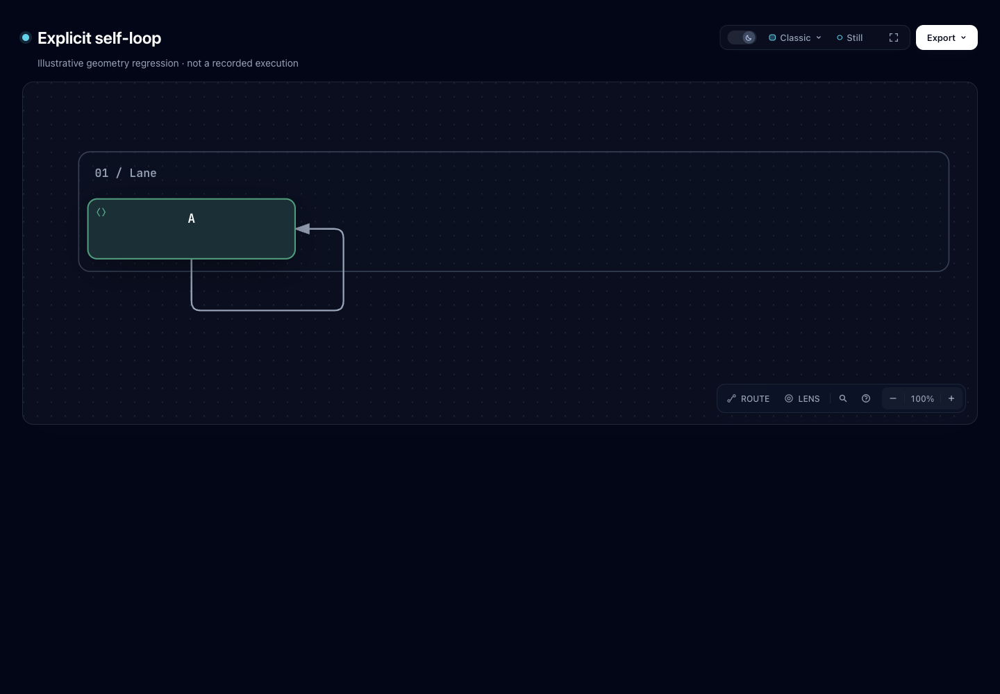

# Workflow self-loop: preserve both endpoint contacts

An explicit Workflow self-loop could leave its bottom port, stay outside its node, and return to its right port, yet fail with `workflow/explicit-pin-conflict`. The same node was treated only as a source obstacle when its final segment touched the target boundary. This experiment fixes that endpoint identity error, without changing the schema or adding routing candidates.

The primary [input](input.workflow.json) is an original, illustrative geometry regression, not a recorded execution. [Candidate HTML](candidate.html) renders that exact input. Base `82c7e0f089a02a4d514714adf37dc2061682da5f` failed before producing HTML; [base evidence](base-finalize-summary.json) records the actual failure and input hash. There is no invented “before” diagram.



Root agent inspected this actual Chromium capture at 1440×1000 in dark mode: the line leaves the bottom port, turns outside the node, and returns to the right port. [Capture metadata](screenshots/capture.json) binds the input and HTML hashes. This is agent visual review, not human or assistive-technology acceptance.

## What changed

- `firstRouteNodeCollision` recognizes the node's source **and** target identities. It exempts its first and last endpoint segments respectively; intermediate contacts remain obstacles.
- `routeClearsEndpointNodes` applies the same contact rule to automatic/preset candidate feasibility. Ordinary two-node behavior is unchanged.
- A necessary companion guard rejects adjacent collinear reversal for same-node routes at both candidate acceptance and explicit-geometry validation. During review, simply repairing clearance released an existing automatic candidate that went out and immediately retraced the same line. That intermediate result was rejected, not presented as a usable loop. The final implementation uses the existing `0.0001` axis tolerance and adds no candidate family or search expansion.

Existing automatic candidates can now pass when they form a real outer turn. [The old two-node failure fixture](existing-auto.workflow.json), including its earlier `[94,30]` label pin, now selects an existing outside path rather than the collapsed candidate. Full base diagnostics and final candidate geometry are in [compatibility-summary.json](compatibility-summary.json). This is a measured acceptance change, not a promise that every self-loop topology or port pair is routable.

## Keep author errors separate from the defect

[Author-attempts-summary.json](author-attempts-summary.json) binds three earlier content-authoring attempts to their original input and raw receipt hashes:

| Attempt | Actual result | Classification |
| --- | --- | --- |
| first-draft | `workflow/route-preset-conflict`, perpendicular endpoint-side direction | The `outside-right` preset left a bottom port horizontally. Author constraint conflict. |
| repair1 | schema type errors | Object-shaped points were used where `[x,y]` arrays are required. Author format error. |
| repair2 | `workflow/explicit-pin-conflict`, source-endpoint collision on final segment | Product gap: the same endpoint node's target identity was lost. |

The original repair2 also passes candidate compilation. Its separate content experiment already uses Lifecycle; this product fix does not change that artifact or its authoring history.

## Reproduce

Run from the repository root with supported Node. The final evidence used Node 22.23.3 for runtime checks and official Node 22.23.2 / bundled zlib `1.3.1-e00f703` for ZIP bytes.

```sh
node archify/bin/archify.mjs render workflow \
  experiments/workflow-self-loop/input.workflow.json /tmp/self-loop.html
node archify/bin/archify.mjs finalize workflow \
  experiments/workflow-self-loop/input.workflow.json /tmp/self-loop.html \
  --json --receipt /tmp/self-loop.finalize.json --out-dir /tmp/self-loop-checks
node scripts/run-tests.mjs --require-files \
  test/workflow-compiler-hard-contract.test.mjs \
  test/workflow-routing-clarity.test.mjs \
  test/workflow-route-order.test.mjs test/workflow-port-slot.test.mjs \
  test/workflow-crossing-repair.test.mjs test/core-smoke.test.mjs
```

To reproduce base, use a separate checkout at the recorded base and the exact same input bytes. Keep receipts outside the checkout. Public summaries are explicitly derived projections, not redacted files masquerading as original receipts.

## Verification and limits

Final focused run: **145 tests passed, zero failures/skips** across the six files above, including 19 core smoke tests. Protection covers explicit outer-loop pins under standard/showcase; intermediate self-node re-entry; another node obstacle; wrong departure direction; ordinary two-node endpoint contacts; explicit immediate reversal; and automatic outer-turn geometry with the earlier label pin preserved. Two real, still-infeasible top/top fixtures protect later-error attribution and actual recompilation of each advertised side-removal fix. Those fixtures describe the current candidate set, not a permanent ban on all top/top loops.

Two historical assertions used unpinned self-loops as guaranteed solver failures. Their original inputs now protect successful geometry, and the separate real failures protect diagnostic responsibility. A scoped search found no independent real Workflow `solver-budget-exhausted` regression remaining in `test/`; the Explainer packaging test uses a fault stub. This change does **not** claim new solver-budget-specific coverage.

The four shipped Workflow JSON examples compile on base and candidate with byte-identical SVG and compiler receipts. Generated Viewer, brand marks, validators and release identity checks pass; three generated SVG/XML tests pass. Their source inputs are unchanged and no Gallery/Viewer HTML regeneration is needed. The ZIP is refreshed because renderer source is distributed: canonical double-build, matching bytes, 221 entry CRCs, exact bundled compiler, and exclusion of experiments are recorded in [zip-summary.json](zip-summary.json). Extracted exact-archive finalize smoke is recorded separately.

Actual public render/finalize completed validate, deliver, strict artifact check and browser-check. These automated gates do not establish human visual acceptance or assistive-technology acceptance. Root owns the recorded Chromium screenshots and agent visual review; no full-repository suite, live installation or release was performed. [Checks](checks-summary.json) retain final source/log bindings and disclose initial dependency-resolution failures, resolved by linking already-installed development dependencies without package/lockfile changes.

## Evidence and source

- [Primary input](input.workflow.json), [candidate HTML](candidate.html).
- [Base finalize projection](base-finalize-summary.json), [candidate projection](candidate-finalize-summary.json), [exact archive smoke](archive-smoke-finalize-summary.json).
- [Compatibility geometry](compatibility-summary.json), [ZIP verification](zip-summary.json), [binding](binding-summary.json).
- Fixed Archify [edge schema](https://github.com/tt-a1i/archify/blob/82c7e0f089a02a4d514714adf37dc2061682da5f/archify/schemas/workflow.schema.json#L321-L379), [coordinate-array contract](https://github.com/tt-a1i/archify/blob/82c7e0f089a02a4d514714adf37dc2061682da5f/archify/schemas/common.schema.json#L61-L70), and [hard-pin contract](https://github.com/tt-a1i/archify/blob/82c7e0f089a02a4d514714adf37dc2061682da5f/archify/renderers/workflow/README.md#L220-L230).
- Source and original fixtures use Archify's [MIT license](../../LICENSE). No external implementation, algorithm, dependency or source data was copied.

Related searches found [#960](https://github.com/tt-a1i/archify/pull/960), which records a self-loop failure as diagnostic evidence, and [#1086](https://github.com/tt-a1i/archify/pull/1086), which improves constrained fork search. Neither establishes that this endpoint identity defect is fixed. No issue/comment/PR was posted by this experiment.
