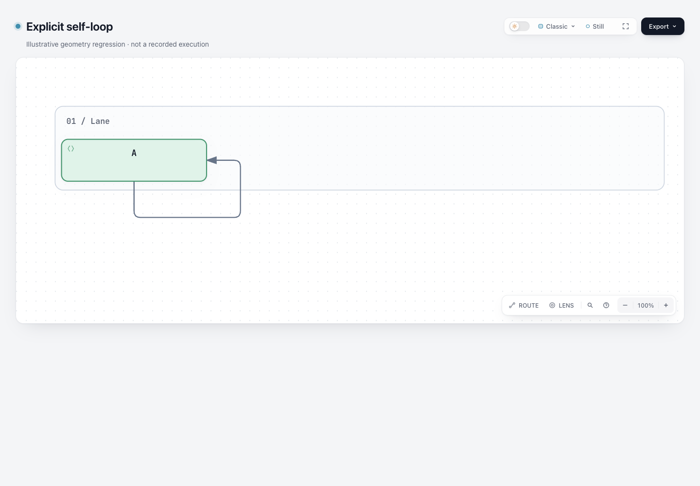
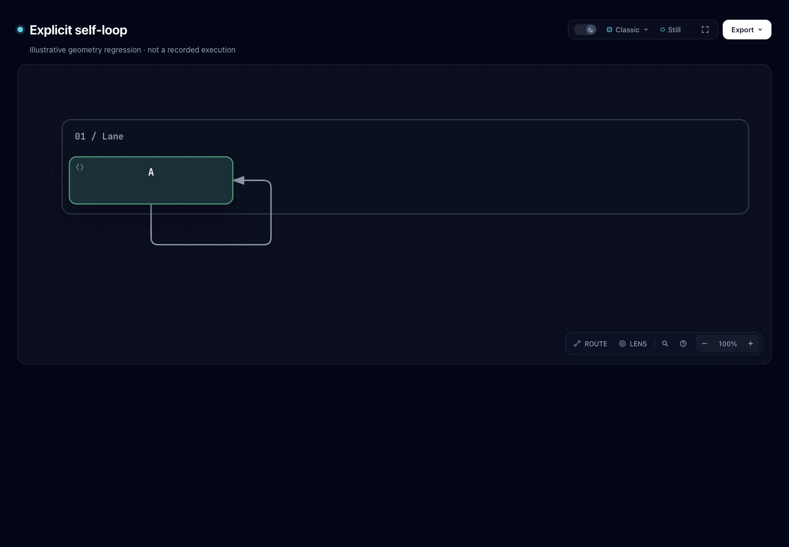
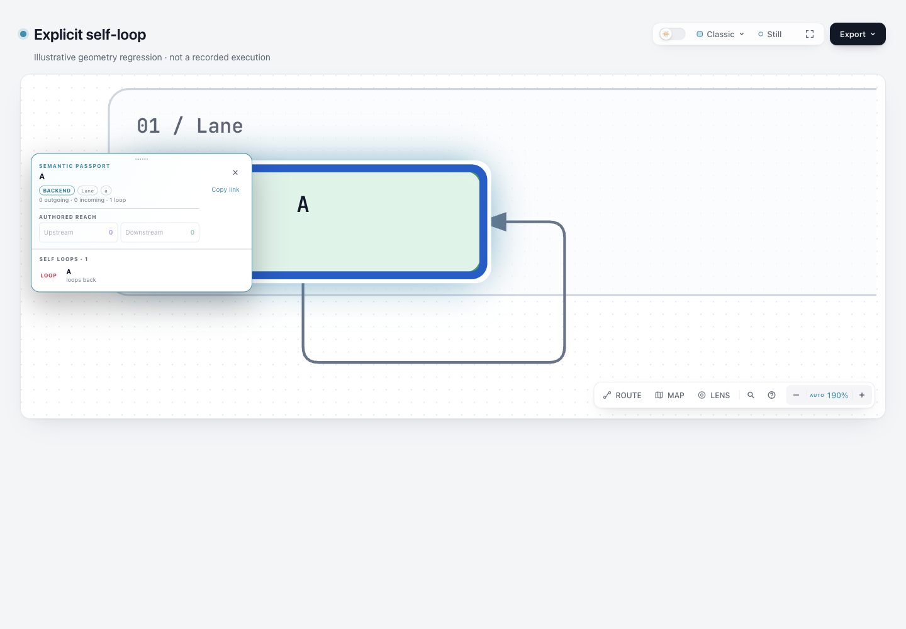

# Workflow self-loop on dev 10b4

This refresh merges fixed GitHub dev [`10b4dd5c5f2264baa315ee65a9b4cc23c13ea5f0`](https://github.com/tt-a1i/archify/commit/10b4dd5c5f2264baa315ee65a9b4cc23c13ea5f0) into the existing `codex/lab-workflow-self-loop` experiment, previously `eb299b1568327fb77ce7e8a6dcaab610e2b6af0c`. The original experiment files retain their exact historical bytes and revision bindings. This directory supplies the fresh comparison and evidence.

The same complete [input](input.workflow.json) is 853 bytes, SHA-256 `ab8105274c3da65cb657db81a7d2054d2248e5575d812cf5f5d24ec999abe4f7`. It is the original **illustrative geometry regression**, not a recorded workflow execution or a newly collected author trace. Both sides use **standard** quality.

On new dev, actual public finalize exits **1**, validation reports `workflow/explicit-pin-conflict` / `node clearance`, and delivery does not run. The diagnostic identifies the final segment `[270,119] → [228,119]`, obstacle `a`, incorrectly classified only as `source-endpoint`. No baseline HTML was produced. [Base selected receipt fields](base-finalize-summary.json) bind the original external receipt and exact input. There is no invented “before” diagram.

The refreshed [candidate HTML](candidate.html) renders the same supplied outer loop. Its points remain `[138,145] → [138,190] → [270,190] → [270,119] → [228,119]`: leave the bottom port, turn outside the node, and return to the right port. These are preserved authored pins and actual compiler geometry, not a new suggested route or a performance measurement.

| Candidate · light | Candidate · settled dark |
| --- | --- |
|  |  |



The coordinating agent captured and viewed all three original PNGs at 1440×1000, Classic/Still. Both overviews show the complete outer loop and return arrow. Selecting `a` shows Passport counts `0 outgoing · 0 incoming · 1 loop` and the Self loops relationship back to A. The actual native AX snapshot records the same counts and `Self loops: loops back, A`; it is accessible-tree text, not spoken screen-reader output or human acceptance.

Selection autozoomed the selected screenshot to **190%**. The earlier AX snapshot still reports **100%**; it is not claimed to describe the identical camera state of that image or the overviews. An initial dark image caught a finite UI transition with Export grey and remains outside checkout; the published settled dark frame records Export enabled. [Capture summary](screenshots/capture-summary.json) binds the final input/HTML, original PNGs and external raw checks/snapshot, publishing only selected safe AX text instead of their private file locations.

## Independent value and minimal source scope

New dev's Workflow change adds drilldown/anchor output in `renderNode`; it does not repair endpoint clearance. Its collision checker still chooses a mutually exclusive from/else-to role, and its endpoint-clearance function treats a same-node target contact as a source collision. This is why the fixed input still fails on the fresh baseline.

The candidate keeps the original narrowly reviewed changes:

- Recognize the same node's source and target endpoint identities separately, exempting only the correct first/last contact. Intermediate self-node re-entry and unrelated obstacles remain rejected.
- Apply the same rule to automatic/preset candidate clearance. Ordinary two-node behavior remains unchanged.
- Keep the necessary shared adjacent-collinear-reversal guard at both explicit and automatic acceptance. Without that companion guard, repairing clearance would release a collapsed out-and-back candidate. It is not optional visual polish and is not a new search family.

There is no schema, port policy, candidate search expansion or new renderer feature. New dev's drilldown imports, node wrapper and metadata output remain intact. The old [author-attempt classification](../author-attempts-summary.json) remains historical: wrong preset departure and object-shaped via points are author errors; the double-role endpoint collision is the product gap. This refresh does not rerun those historical author attempts or alter their content experiment.

## Geometry and failure boundaries

[compatibility-summary.json](compatibility-summary.json) contains actual same-input compiler comparisons:

- All four shipped Workflow examples compile successfully on fixed dev and candidate with **byte-identical SVG and compiler receipts**. No example, Viewer template or gallery regeneration is retained. This is representative compatibility evidence, not a claim that every Workflow input is unchanged.
- The existing [automatic fixture](../existing-auto.workflow.json) still fails on new dev but succeeds on the candidate by selecting an already available outside path. Its earlier label pin remains present. No new candidate was added, and the immediate-reversal guard prevents presenting a retraced line as a readable loop.
- The unchanged focused tests protect explicit standard/showcase pins, middle re-entry, another node obstacle, wrong departure, ordinary two-node contacts, explicit reversal and automatic outer-turn geometry. Separate real top/top failures retain later-error attribution and advertised-fix verification. They do not declare all top/top loops permanently unsupported.

The prior change replaced two assertions that relied on erroneous guaranteed rejection with successful geometry checks and separate real failures. This refresh does not claim that solver-budget-specific coverage was restored or expanded. That coverage boundary remains explicit.

## Scoped results and package

One actual final invocation passed **148 tests, 0 failures, 0 skipped**: the six previously selected routing/core files (145 tests including 19 core) plus the existing generated SVG/XML file (3 tests). No new test, coordinate snapshot or source-assertion framework was added. The same existing test-value rationale applies: protect preserved pins, meaningful route shape and rejection responsibility, allowing equivalent valid automatic routes.

Viewer, brand marks, validators and release-identity freshness checks passed. Candidate public finalize explicitly ran browser-check: validate, deliver, check and browser-check all passed with zero diagnostics. The screenshot-ready HTML hash stayed `2be2c0852efa749fc917eea5619323190a2f8e193dd77b5394955c55357fc928`. [Candidate summary](candidate-finalize-summary.json) is a derived projection; the original receipt remains outside checkout.

The merge's sole binary conflict was resolved through normal final-source ZIP builds. Canonical **Node 22.23.2 / bundled zlib 1.3.1-e00f703** double builds are byte-identical. The 235-entry archive has valid CRCs and differs from fixed dev's ZIP in exactly **`archify/renderers/workflow/workflow-compiler.mjs`**; that member matches source. All other packaged dev bytes, including new behavior, Apache-2.0 license and retained notices, are preserved. [ZIP summary](zip-summary.json) records the comparison. Actual [exact-archive finalize](archive-finalize-summary.json) passed four stages and emitted HTML byte-identical to the public candidate.

The historical experiment's MIT reference belongs to its pinned 82c7 source; refreshed software follows new dev's Apache-2.0 license and retained notices. No outside implementation, algorithm or asset was copied.

## Reproduce and limits

Use existing repository dependencies and Node 22. Keep original logs/receipts in a fresh external directory before publishing derived summaries.

```sh
node scripts/run-tests.mjs --require-files \
  test/workflow-compiler-hard-contract.test.mjs test/workflow-routing-clarity.test.mjs \
  test/workflow-route-order.test.mjs test/workflow-port-slot.test.mjs \
  test/workflow-crossing-repair.test.mjs test/core-smoke.test.mjs \
  test/generated-artifact-xml.test.mjs
node archify/bin/archify.mjs render workflow \
  experiments/workflow-self-loop/refresh-dev-10b4/input.workflow.json '<fresh-output.html>' --quality standard
node archify/bin/archify.mjs finalize workflow \
  experiments/workflow-self-loop/refresh-dev-10b4/input.workflow.json '<fresh-output.html>' \
  --quality standard --browser-check --json --receipt '<raw-receipt.json>' --out-dir '<raw-checks>'
```

[checks-summary.json](checks-summary.json) binds the final source/test, logs and preserved historical files. [binding-summary.json](binding-summary.json) binds the public comparison, package and visual evidence. These are explicitly derived records, not receipts edited to hide local paths. No full-repository/Windows suite, installation, release, upstream program execution, workflow execution or human/assistive-technology acceptance is claimed. New dev's successful CI is separate from this experiment candidate's local evidence.

The generation comparison remains bounded to the original authorized bug: same legal explicit pins, the existing automatic candidate and shipped examples. This does not establish general generation quality or saved authoring time; no additional generation benchmark or new routing capability is claimed.
